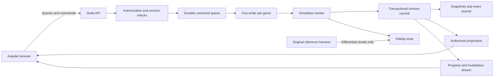

# Node.js and Angular implementation architecture

Status: proposed target architecture. These are engineering decisions for the web conversion, not claims about the original game's implementation. Gameplay fidelity is governed by the evidence and acceptance gates in the other chapters.

## 1. Product boundary

Build a browser-playable CM 01/02: Bosman Edition with Angular screens and a Node.js authoritative backend. Preserve the complete management loop: configure a world, appoint managers, review the club, select and train players, scout and negotiate, advance time, play matches, administer competitions, complete seasons, and save/load an ongoing career. Include the repository's season selection and changing rules, assistant selection, player comparisons, attribute groups, holiday controls, and save conveniences.

The target is this repository at the revision in `evidence/coverage-summary.json`. The locally installed Bosman application is a separate, older runtime reference. Its unchanged original program can establish 3.9.68 behavior; it cannot demonstrate newer Bosman enhancements. Record these identities in every fixture.

Two implementation boundaries must stay explicit:

1. **Web platform work:** Angular presentation, authenticated HTTP commands, persistence, process scheduling, and infrastructure. This chapter specifies it.
2. **Gameplay translation:** exact decisions and state transitions recovered from original instructions plus Bosman source hooks. Do not substitute generic football rules for an unresolved routine.

A playable approximation is a separate product decision. It does not satisfy the faithful conversion acceptance criteria.

## 2. Stack baseline and repository layout

Choose Angular 22.0.x, Node.js 24.x at or above 24.15.0, TypeScript 6.0.x, and RxJS 7.x within Angular's supported range; pin actual patch versions in a lockfile when scaffolding. This is a compatible baseline, not an instruction to use an unverified future version. The official compatibility table supports these ranges; Node 24 is listed as LTS on the research date. Recheck when implementation starts. [Angular compatibility](https://angular.dev/reference/versions), [Node releases](https://nodejs.org/en/about/previous-releases).

Use TypeScript for new web and engine modules. Use a relational database for accounts, game ownership, commands, revisions, save manifests, and searchable projections; use immutable blob storage for large snapshots and imported data. PostgreSQL is the proposed initial database, selected as an architecture decision, not a recovered game dependency. Redis and a distributed queue are optional scaling additions, not correctness dependencies.

```text
apps/
  web/                    Angular application
  api/                    Node HTTP API and progress stream
  simulation-worker/      TypeScript world executor
packages/
  contracts/              Runtime-validated requests/responses, errors, events
  engine-core/            Deterministic domain types and transition functions
  engine-compat/          Integer/date/RNG/layout compatibility primitives
  rules/                  Versioned Bosman season/competition rule packs
  data-import/            Checked original database and asset conversion
  save-format/            Web snapshots, migrations, optional legacy conversion
  projections/            Manager-authorized read models and search
  oracle-protocol/         Original/recompiled comparison harness
  test-fixtures/          Synthetic and authorized golden inputs/manifests
docs/web-port/             This implementation dossier
```

Do not rewrite or remove the current native source while constructing the web application. It is the evidence and reference implementation. Keep build-generated original code outside normal source control, linked by hashes.

## 3. Runtime topology



The client never decides match results, salaries accepted by AI, injury recovery, transfer outcomes, player growth, competition standings, or whether time can advance. It sends intentions. Every accepted intention is validated against the server's current world and applied through its designated owner.

Run CPU-heavy TypeScript simulation in a bounded worker pool. Node's worker documentation supports separate JavaScript execution threads and pooled jobs; do not create a new worker for each match tick. Worker failure handling and request tracing must be explicit. [Node worker API](https://github.com/nodejs/node/blob/main/doc/api/worker_threads.md), [worker pool context example](https://github.com/nodejs/node/blob/main/doc/api/async_context.md).

Pin an active game to one executor while it has pending work. Parallelize independent games. Do not parallelize matches within the same game until shared random draws, news, finances, competitions, and chronological processing have been proven independent. Thread scheduling must never choose game outcomes.

### Native reference isolation

The present C runtime uses process-global `cpu`, `fpu`, and `g_mem` (`src/recomp_rt/rt.h:13`, `src/recomp_rt/rt.c:25`). `rt_init` reserves a 32-bit address space and places the PE image at its original addresses. `rt_callback` manipulates an emulated stack and register state (`src/recomp_rt/rt.c:190`). Therefore, a native oracle or transitional native engine belongs in its own process per world, not in a shared addon called concurrently by Node workers.

A native bridge may preserve opaque gameplay during migration, but is an explicitly optional transitional approach. It does not by itself deliver an all-TypeScript implementation or prove that the original UI can be replaced with semantic commands. Specify and validate each bridge command/read model first. A browser canvas that merely streams the old desktop is not the Angular screen implementation described here.

## 4. Compatibility model

Keep an immutable `CompatibilityProfile` in every game:

```ts
interface CompatibilityProfile {
  id: string;
  originalSha256: string;
  bosmanSourceCommit: string;
  engineBuildId: string;
  dataPackId: string;
  dataPackSha256: string;
  rulesPackId: string;
  rulesPackSha256: string;
  startYear: number;
  changingRules: boolean;
  numericSemanticsVersion: string;
  schedulingSemanticsVersion: string;
  saveSchemaVersion: number;
}
```

Never silently switch an existing save to a new rules pack or engine behavior. Migration creates an explicit new save lineage, retaining the old snapshot and identifying changes.

### Numbers

JavaScript `number` is not a replacement for every original integer operation. The compatibility layer must implement signed and unsigned 8/16/32-bit loads, truncation, wrapping multiplication, signed division toward zero, unsigned division, bit shifts, and little-endian reads/writes. Use `Math.imul` and explicit narrowing where needed. Use `bigint` or split words for exact 64-bit integer intermediates; encode them as decimal strings at JSON boundaries. Do not serialize `bigint` directly.

The recompiler runtime models x87 values as doubles with precision control and explicit rounding (`src/recomp_rt/rt.h`, `Fpu`, `fround`, `fist16/32/64`). Nearest-even conversion is different from JavaScript `Math.round`, especially at ties and negative values. Port the source behavior, including invalid-conversion sentinels, and compare vectors. Do not assume financial calculations are decimal; original units and rounding come from the relevant routine. Web account billing, if ever added, is unrelated to game currency.

### Time

Represent game dates with an explicit calendar type, not locale-sensitive JavaScript `Date`. Store the source date representation where compatibility requires it and expose a normalized display form. A virtual football date is independent of the user's timezone, server wall clock, daylight saving, or browser locale. Document every boundary conversion and the inclusive/exclusive meaning of transfer windows, contract expiry, bans, and fixture deadlines.

Wall-clock timestamps belong only to operational metadata such as command submission and save creation. Scheduling timers may pace execution but may not independently advance simulation state.

### Randomness, memory and ordering

Do not use `Math.random`, object property iteration, or database row order in gameplay. Recover and persist every RNG stream, seed derivation, cursor, and consumption order. Preserve each original comparator's equality result and its sorting implementation/secondary passes; do not add a universal stable-ID tie-break. Some original mini-table paths return equality deliberately. Angular display sorting can be stable independently, but must not determine qualification. Preserve zero and sentinel values; do not turn every absent attribute into a mean value.

The repository documents memory-layout-sensitive outcomes in `docs/TESTING.md` and commentary-speed-sensitive match interleaving in `src/recomp_rt/win/commentary.c:14`. A mathematically equivalent algorithm with different random-call ordering can still be incompatible. Reference tests must fix allocation inputs, manager settings, match-detail mode, and scheduling conditions, not just a seed.

A proposed web improvement is to decouple visual playback speed from simulation. That is a **behavioral divergence**, not automatically faithful. Until the reference scheduler is recovered, either retain its logical scheduling controls in the compatibility profile or explicitly reject bit-identical outcome claims for that mode. Do not silently resolve this conflict in frontend code.

## 5. Canonical world and ownership

```ts
type EntityId = string;
type Revision = string; // decimal uint64 on the wire

interface GameWorld {
  gameId: EntityId;
  revision: Revision;
  profile: CompatibilityProfile;
  phase: 'setup' | 'ready' | 'advancing' | 'decision'
       | 'prematch' | 'match' | 'postmatch' | 'saving' | 'error';
  date: GameDate;
  scheduler: SchedulerState;
  random: RandomState;
  entityStores: WorldEntityStores;
  pendingDecisions: PendingDecision[];
  activeMatches: ActiveMatch[];
}
```

`GameDate`, `SchedulerState`, `RandomState`, `WorldEntityStores`, `PendingDecision`, and `ActiveMatch` are domain contracts to complete from the gameplay and data chapters. They are not unspecified JSON bags that an agent may fill by guesswork.

Assign each datum a single canonical owner:

| Domain owner | Canonical state | Derived projections |
|---|---|---|
| World scheduler | Virtual date, pending work, competition update cursors | Calendar, continue progress |
| People | Staff/player identity, ability, fitness, health, relationships | Player profile, squad views |
| Employment | Contracts, loans, negotiation cases, release obligations | Contract page, transfer centre |
| Club | Membership, resources, board state, facilities | Club overview, board screen |
| Finance | Balances and ledger postings in game units | Income/expenditure views |
| Tactics/training | Accepted selections, instructions, schedules | Editors and assistant suggestions |
| Competition | Entrants, rule version, fixtures, stages, disciplinary state | Tables, draws, results |
| Match | Participants, engine state, officials, event sequence, statistics | Commentary, score, live tables |
| Knowledge/news | Manager-specific knowledge, reports, inbox decisions | Search, scout results, inbox |
| History | Archived seasons, awards, records, careers | Historical tables and profiles |

Entities are keyed by stable IDs scoped to a data pack/world. Names are labels, never identifiers. Distinct players can share a name. A club can change its display name or division without changing identity. Unknown legacy pointer relationships are retained as unresolved imports until validated.

Use a world-level lock or lease with fencing, even for apparently disjoint club actions: a transfer or fixture can affect multiple clubs, competitions and finances. Future finer-grained concurrency requires evidence that it preserves ordering.

## 6. Command protocol and atomicity

```ts
interface CommandEnvelope<TKind extends string, TPayload> {
  commandId: string;        // client-generated unique ID
  gameId: string;
  expectedRevision: Revision;
  managerId: string;
  kind: TKind;
  payload: TPayload;
}
interface CommandReceipt {
  commandId: string;
  status: 'queued' | 'committed' | 'rejected';
  revision?: Revision;
  jobId?: string;
  error?: {code: string; field?: string; details?: unknown};
}
```

Authenticate the user independently of `managerId`. Verify that the user may control that manager in that game. A submitted manager ID is not authorization.

Process a command as follows:

1. Validate schema, payload bounds, identity and ownership.
2. Look up `(gameId, commandId)`. An identical retry returns the original receipt; the same ID with another payload returns `COMMAND_ID_REUSED`.
3. Acquire ownership with a fencing token and compare expected revision.
4. Evaluate game-phase and domain preconditions without mutating canonical state.
5. Execute on an isolated candidate state or a reversible staged change set.
6. Check invariants and compute state/event hashes.
7. Atomically commit the new revision, command outcome, events and snapshot reference. Publish progress only after commit.
8. Release ownership or continue the same durable job from the committed boundary.

On stale revision return `REVISION_CONFLICT`, current revision and affected read-model keys. Do not silently rebase a team selection, transfer offer, or date-advance request. An optional user retry must revalidate the proposal.

For a long `Continue` operation, commit bounded simulation units with a durable cursor. The idempotency record remains associated with the whole job; retries resume that job, never submit a second advancement. A crash after the commit but before the response must be recoverable without replaying financial postings or a match result twice. Stop/cancel takes effect only at a documented safe boundary.

Game creation precedes allocation of a `gameId`; deduplicate it by authenticated owner plus a client-generated creation request ID. Once the world exists, the ordinary game-scoped command envelope applies. A failed or retried setup request must not create duplicate worlds.

Web GET projections must not call original functions on live canonical state merely because their names resemble getters. The original talks-status lookup has a persistent normalization write (chapter 07). Capture such behavior in an explicit engine transition or a verified projection-building boundary, preserving its ordering and testing downstream effects. Do not remove the write casually or let repeated Angular rendering invoke it unpredictably.

### Command families

| Family | Commands to specify and implement | Core preconditions |
|---|---|---|
| Setup | CreateGame, SelectSeason, ConfigureLeagues, AddManager, StartCareer | Setup phase, supported data/rules combination |
| Manager | ActivateManager, ApplyForJob, Resign, Retire, StartHoliday, EndHoliday | Controlling user, current employment/phase |
| Squad | SelectPlayer, SwapSlots, AssignCaptain, SetSetPieceOrder, RequestAssistantSelection | Club control, eligible squad, unique slots |
| Tactics | SetFormation, SetTeamInstructions, SetPlayerInstructions, SaveTactic, LoadTactic | Valid formation/tactic version, legal match phase |
| Training | SetSchedule, AssignSchedule, AssignCoaches | Valid personnel, workload and original schedule rules |
| Scouting | AssignScout, RequestReport, AddShortlistEntry, RemoveShortlistEntry | Staff availability and manager knowledge rights |
| Transfers | SubmitOffer, CounterOffer, WithdrawOffer, RespondToOffer, SubmitContract, ReleasePlayer, ListPlayer | Current negotiation state, budgets, contract/registration rules |
| Club | RequestBoardAction, ArrangeFriendly, CancelFriendly, RespondToNews | Current decision and club authority |
| Match | SubmitTeam, StartMatch, PauseAtAllowedBoundary, QueueSubstitution, ChangeTactics, ResumeMatch, FinishMatch | Eligibility, substitution limits, match phase and revision |
| World | Continue, StopAdvance, AcknowledgeDecision | All blocking decisions satisfied |
| Persistence | CreateSave, RestoreSave, ExportSave, ImportSave, DeleteSave | Ownership, validated format, safe snapshot boundary |
| Preferences | SetDisplayPreferences, SetManagerMatchPreferences | Separate presentation settings from engine-affecting settings |

These are semantic web names and broad command families, not the exhaustive action catalog. Chapter 04 section 14 also requires manager notes/aliases, foreground/background switching, reserve control, trial/leave/rehabilitation, FA complaints/ban appeals, squad promotion/reserve assignment, and tours/tournaments. Map each action to actual original/Bosman handlers before marking it implemented. Do not expose commands merely because this table names them; unsupported cases must be explicit.

## 7. HTTP and stream surface

The following endpoint structure is the proposed v1 boundary; validate payload schemas in the contracts package and generate OpenAPI from the implementation. No concrete HTTP framework is required by this specification.

| Method/path | Purpose | Required behavior |
|---|---|---|
| `POST /api/v1/games` | Create setup world | Return game ID, revision, resolved profile |
| `GET /api/v1/games/:gameId` | Summary and phase | Only authorized games |
| `POST /api/v1/games/:gameId/commands` | Submit typed intention | Revision checks and idempotent receipt |
| `GET /api/v1/games/:gameId/commands/:commandId` | Recover receipt | Works after reconnect |
| `GET /api/v1/games/:gameId/jobs/:jobId` | Long operation progress | Durable cursor and stop reason |
| `GET /api/v1/games/:gameId/views/:view` | Screen projection | Explicit manager context and revision |
| `GET /api/v1/games/:gameId/events` | Progress/invalidation stream | Resumable event sequence; snapshot refresh on gap |
| `GET /api/v1/games/:gameId/players` | Paged filtered search | Knowledge-filtered data, stable sort and cursor |
| `GET /api/v1/games/:gameId/matches/:matchId` | Match projection | Event cursor, authorized detail |
| `POST /api/v1/games/:gameId/saves` | Durable save at safe boundary | No partially committed world |
| `POST /api/v1/imports` | Stage legacy/web import | Quarantine, validation report, no existing-world overwrite |
| `GET /api/v1/imports/:importId` | Import validation/progress | Explicit supported/unsupported members |
| `POST /api/v1/imports/:importId/commit` | Create new world from accepted import | New ID and lineage |

Use 400 for malformed requests, 401/403 for identity/ownership, 404 for inaccessible/missing resources, 409 for revision/phase conflicts, 422 for domain invalidity, 413 for oversized imports, 429 for capacity, and 503 for temporary execution unavailability. Do not return a fake success for an unsupported rule or incomplete import.

Server-sent events are sufficient for progress and match commentary if commands use HTTP. Choose WebSockets only when bidirectional transport is required. Both require authenticated ownership and reconnect recovery; transport events are notifications, not the durable truth.

Every projected response carries `revision`, `profileId`, and a view-specific cursor if paginated. Do not combine tables from unrelated revisions in a screen that claims a coherent state. An event gap invalidates affected projections and fetches a fresh snapshot; it must not fabricate missed match actions.

## 8. Angular application structure

Use standalone components, lazy route boundaries per feature, and signal-based view state. Angular documents lazy `loadComponent`/`loadChildren` and derived reactive state through signals. [Angular lazy routes](https://angular.dev/best-practices/performance/lazy-loaded-routes), [Angular signals](https://angular.dev/guide/signals).

```text
/                           Start, load, options, extras
/new                        Season and league setup, manager creation
/games/:gameId               Active manager home
/games/:gameId/inbox         News and decisions
/games/:gameId/clubs/:id     Squad, tactics, training, finance, board, history
/games/:gameId/people/:id    Player/staff/manager profile
/games/:gameId/search        Players, staff, clubs, competitions
/games/:gameId/shortlist     Saved targets and reports
/games/:gameId/transfers     Negotiations and transfer activity
/games/:gameId/competitions/:id
/games/:gameId/matches/:id   Prematch, match, postmatch
/games/:gameId/calendar
/games/:gameId/history
/games/:gameId/options
```

Build reusable data tables, sortable attribute cells, entity-name navigation, date/currency formatting, formation pitch, player comparison polygon, tab sets, news action panels, and accessible confirmation dialogs. Route history must preserve useful list filters and scroll positions without mutating the game. Unknown entities should show a controlled unavailable state rather than a broken profile.

Keep three distinct forms of state: committed server projections; an editable local draft; and the pending command receipt. A user editing a formation must see which changes are unapplied. Disable conflicting actions while a mutation is pending, but support network retries through the same command ID. Display field-specific validation errors and preserve the draft when safe.

Never make a hidden ability value, private report, or AI decision visible in browser JSON and merely conceal its component. Apply fog-of-war and authorization in the server projection. Preserve explicit Bosman profile additions such as goalkeeper One On Ones/Consistency only where the source exposes them; profile display does not automatically authorize using them in assistant scores, comparisons, or polygons. Those calculations keep their own source-defined input sets.

The initial target is desktop/tablet browser play preserving the dense management tables. Support keyboard focus, labelled controls, readable contrast, non-colour status cues, and scrollable wide tables on small screens. Responsive layout is a web presentation decision; desktop pixel identity is not the criterion unless a screen explicitly requires it. Preserve all information and actions.

## 9. Persistence, imports and migrations

Store command/event metadata transactionally and immutable snapshots with content hashes. A snapshot manifest includes game/profile IDs, schema version, revision, virtual date, all RNG state, scheduler cursors, module payload checksums, and required pack hashes. No timestamp alone identifies a snapshot.

Suggested relational tables: `users`, `games`, `game_memberships`, `game_heads`, `commands`, `simulation_jobs`, `domain_events`, `save_manifests`, `data_packs`, `rules_packs`, `import_jobs`, `migration_runs`. Unique constraints include game/command ID and game/revision. Projections may be separate tables or indexed snapshot views; they are rebuildable.

Save flow: acquire safe world boundary; serialize candidate snapshot; hash and validate it; durably write immutable payload; atomically point a manifest at it; only then report success. Failed writes retain the previous save. Garbage collect unreferenced uploads after a retention interval. Keep three prior named-save versions to preserve Bosman's backup behavior where applicable.

Restore flow: validate manifest and every part; check engine/rules compatibility; deserialize into isolated state; verify entity links, scheduler and invariants; only then activate the restored world. An import creates a new world by default. Never overwrite the user's native save.

Legacy `.sav` container decoding is not equivalent to gameplay-state conversion. Complete member mapping, pointer/index repair and post-load rebuilds must pass separately. Unknown members are preserved in the import record and block a fidelity claim until understood. Document unsupported versions explicitly.

## 10. Assets and packaging

Create a content-addressed pack manifest for database files, language data, commentary templates, formation files, graphics, fonts and sound. Record source path, SHA-256, converter version, output hash and provenance. Keep pack conversion reproducible and separate from world simulation. Translated names are tied to source table counts/order; preserve the source-to-world row mapping through imports and saves before applying `.lng` names. A language file from another data pack is not interchangeable merely because it uses the same language.

Do not fetch historical external game websites automatically when rendering in-game links. Present them as external links. Import names and commentary as text, not executable HTML; sanitize any supported markup. Retain source attribution and the repository's license notices. The repository README distinguishes its code license from original assets and database rights; that distinction belongs in distribution metadata, not an assumed permission to republish every supplied file.

## 11. Operational requirements and measurable budgets

These are proposed engineering targets, not benchmark results:

- Ordinary read-model requests: p95 under 300 ms at the agreed workload; command acknowledgement under 500 ms when capacity is available.
- Progress indication during longer tasks, with a visible reason when Continue stops.
- No simulation work on the HTTP event loop sufficient to starve unrelated users; measure event-loop delay and worker queue depth.
- Fixed per-world memory/cpu quotas determined after all-nation season benchmarks. The native runtime's 4 GB virtual address reservation does not imply 4 GB of committed memory, and neither is a safe Node worker budget.
- Save/load tests at realistic late-career size, not only tiny fixtures. Stream large payloads with bounded memory and backpressure.
- Crash recovery after every documented transaction boundary, with zero duplicate results, salary payments, transfer fees or awards.

Log command ID, game ID, revision, profile ID, worker ID, elapsed time, phase and failure code. Avoid logging private saves or entire player tables. Add metrics for transition throughput, RNG divergence, invariant failures, save size, load duration, projection lag and retry counts. State hashes must be reproducible after restart.

## 12. Definition of implementation-ready per feature

A feature is ready for autonomous implementation only when its dossier states: source/artifact identity; entry points; input/output schema; complete branches and sentinels; mutations and ownership; time and random dependencies; observable UI states; failure cases; persistence behavior; and executable comparison fixtures. Mark it blocked if a probability, threshold, callback, or state field essential to outcomes is unresolved.

Engineering scaffolding can proceed while a gameplay dossier is blocked. A blocked gameplay module must not be replaced by a plausible invented algorithm to make the product appear complete.
