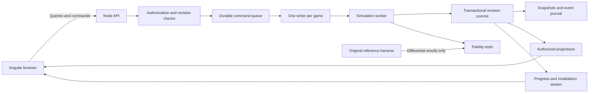

# CM 01/02: Bosman Edition — technical specification and reverse-engineering dossier

Target: Angular frontend and Node.js authoritative backend. Research date: 28 October 2026.
Reference repository: `cf2e8fa5f4cc816f252611a0e9c81e66d088358e`.

**Status:** implementation blueprint and evidence-backed recovery dossier; not yet a complete semantic recovery of every original gameplay routine. Verified rules, documented product behavior, web design choices and unresolved algorithms are distinguished throughout. Full implementation readiness remains false in the coverage ledger until the required gameplay and end-to-end fidelity gates close.

The user selected Bosman Edition including its season selection and enhancements. The supplied official patch and matched original establish version 3.9.68; the installed Bosman host is older than the current source enhancements. The patch installer and live game were not run, and existing saves were not altered.

This is the consolidated reading copy. Edit the numbered source chapters and run `docs/web-port/build_book.py` to regenerate it. See [README](README.md) for artifact identities, reproduction commands and evidence navigation.

## Contents

1. [Node.js and Angular implementation architecture](#chapter-01)
2. [Gameplay, simulation, and management specification](#chapter-02)
3. [Competition, calendar, and season specification](#chapter-03)
4. [Data, saves, screens, assets, and user flows](#chapter-04)
5. [Evidence, reproducibility, and fidelity verification](#chapter-05)
6. [Agent implementation plan and completion contract](#chapter-06)
7. [Original transfer and contract decision evidence](#chapter-07)
8. [Plan to complete the full technical specification](#chapter-08)


---

<a id="chapter-01"></a>

# Node.js and Angular implementation architecture

Status: proposed target architecture. These are engineering decisions for the web conversion, not claims about the original game's implementation. Gameplay fidelity is governed by the evidence and acceptance gates in the other chapters.

## 1. Product boundary

Build a browser-playable CM 01/02: Bosman Edition with Angular screens and a Node.js authoritative backend. Preserve the complete management loop: configure a world, appoint managers, review the club, select and train players, scout and negotiate, advance time, play matches, administer competitions, complete seasons, and save/load an ongoing career. Include the repository's season selection and changing rules, assistant selection, player comparisons, attribute groups, holiday controls, and save conveniences.

The target is this repository at the revision in `evidence/coverage-summary.json`. The locally installed Bosman application is a separate, older runtime reference. Its unchanged original program can establish 3.9.68 behavior; it cannot demonstrate newer Bosman enhancements. Record these identities in every fixture.

Two implementation boundaries must stay explicit:

1. **Web platform work:** Angular presentation, authenticated HTTP commands, persistence, process scheduling, and infrastructure. This chapter specifies it.
2. **Gameplay translation:** exact decisions and state transitions recovered from original instructions plus Bosman source hooks. Do not substitute generic football rules for an unresolved routine.

A playable approximation is a separate product decision. It does not satisfy the faithful conversion acceptance criteria.

## 2. Stack baseline and repository layout

Choose Angular 22.0.x, Node.js 24.x at or above 24.15.0, TypeScript 6.0.x, and RxJS 7.x within Angular's supported range; pin actual patch versions in a lockfile when scaffolding. This is a compatible baseline, not an instruction to use an unverified future version. The official compatibility table supports these ranges; Node 24 is listed as LTS on the research date. Recheck when implementation starts. [Angular compatibility](https://angular.dev/reference/versions), [Node releases](https://nodejs.org/en/about/previous-releases).

Use TypeScript for new web and engine modules. Use a relational database for accounts, game ownership, commands, revisions, save manifests, and searchable projections; use immutable blob storage for large snapshots and imported data. PostgreSQL is the proposed initial database, selected as an architecture decision, not a recovered game dependency. Redis and a distributed queue are optional scaling additions, not correctness dependencies.

```text
apps/
  web/                    Angular application
  api/                    Node HTTP API and progress stream
  simulation-worker/      TypeScript world executor
packages/
  contracts/              Runtime-validated requests/responses, errors, events
  engine-core/            Deterministic domain types and transition functions
  engine-compat/          Integer/date/RNG/layout compatibility primitives
  rules/                  Versioned Bosman season/competition rule packs
  data-import/            Checked original database and asset conversion
  save-format/            Web snapshots, migrations, optional legacy conversion
  projections/            Manager-authorized read models and search
  oracle-protocol/         Original/recompiled comparison harness
  test-fixtures/          Synthetic and authorized golden inputs/manifests
docs/web-port/             This implementation dossier
```

Do not rewrite or remove the current native source while constructing the web application. It is the evidence and reference implementation. Keep build-generated original code outside normal source control, linked by hashes.

## 3. Runtime topology



The client never decides match results, salaries accepted by AI, injury recovery, transfer outcomes, player growth, competition standings, or whether time can advance. It sends intentions. Every accepted intention is validated against the server's current world and applied through its designated owner.

Run CPU-heavy TypeScript simulation in a bounded worker pool. Node's worker documentation supports separate JavaScript execution threads and pooled jobs; do not create a new worker for each match tick. Worker failure handling and request tracing must be explicit. [Node worker API](https://github.com/nodejs/node/blob/main/doc/api/worker_threads.md), [worker pool context example](https://github.com/nodejs/node/blob/main/doc/api/async_context.md).

Pin an active game to one executor while it has pending work. Parallelize independent games. Do not parallelize matches within the same game until shared random draws, news, finances, competitions, and chronological processing have been proven independent. Thread scheduling must never choose game outcomes.

### Native reference isolation

The present C runtime uses process-global `cpu`, `fpu`, and `g_mem` (`src/recomp_rt/rt.h:13`, `src/recomp_rt/rt.c:25`). `rt_init` reserves a 32-bit address space and places the PE image at its original addresses. `rt_callback` manipulates an emulated stack and register state (`src/recomp_rt/rt.c:190`). Therefore, a native oracle or transitional native engine belongs in its own process per world, not in a shared addon called concurrently by Node workers.

A native bridge may preserve opaque gameplay during migration, but is an explicitly optional transitional approach. It does not by itself deliver an all-TypeScript implementation or prove that the original UI can be replaced with semantic commands. Specify and validate each bridge command/read model first. A browser canvas that merely streams the old desktop is not the Angular screen implementation described here.

## 4. Compatibility model

Keep an immutable `CompatibilityProfile` in every game:

```ts
interface CompatibilityProfile {
  id: string;
  originalSha256: string;
  bosmanSourceCommit: string;
  engineBuildId: string;
  dataPackId: string;
  dataPackSha256: string;
  rulesPackId: string;
  rulesPackSha256: string;
  startYear: number;
  changingRules: boolean;
  numericSemanticsVersion: string;
  schedulingSemanticsVersion: string;
  saveSchemaVersion: number;
}
```

Never silently switch an existing save to a new rules pack or engine behavior. Migration creates an explicit new save lineage, retaining the old snapshot and identifying changes.

### Numbers

JavaScript `number` is not a replacement for every original integer operation. The compatibility layer must implement signed and unsigned 8/16/32-bit loads, truncation, wrapping multiplication, signed division toward zero, unsigned division, bit shifts, and little-endian reads/writes. Use `Math.imul` and explicit narrowing where needed. Use `bigint` or split words for exact 64-bit integer intermediates; encode them as decimal strings at JSON boundaries. Do not serialize `bigint` directly.

The recompiler runtime models x87 values as doubles with precision control and explicit rounding (`src/recomp_rt/rt.h`, `Fpu`, `fround`, `fist16/32/64`). Nearest-even conversion is different from JavaScript `Math.round`, especially at ties and negative values. Port the source behavior, including invalid-conversion sentinels, and compare vectors. Do not assume financial calculations are decimal; original units and rounding come from the relevant routine. Web account billing, if ever added, is unrelated to game currency.

### Time

Represent game dates with an explicit calendar type, not locale-sensitive JavaScript `Date`. Store the source date representation where compatibility requires it and expose a normalized display form. A virtual football date is independent of the user's timezone, server wall clock, daylight saving, or browser locale. Document every boundary conversion and the inclusive/exclusive meaning of transfer windows, contract expiry, bans, and fixture deadlines.

Wall-clock timestamps belong only to operational metadata such as command submission and save creation. Scheduling timers may pace execution but may not independently advance simulation state.

### Randomness, memory and ordering

Do not use `Math.random`, object property iteration, or database row order in gameplay. Recover and persist every RNG stream, seed derivation, cursor, and consumption order. Preserve each original comparator's equality result and its sorting implementation/secondary passes; do not add a universal stable-ID tie-break. Some original mini-table paths return equality deliberately. Angular display sorting can be stable independently, but must not determine qualification. Preserve zero and sentinel values; do not turn every absent attribute into a mean value.

The repository documents memory-layout-sensitive outcomes in `docs/TESTING.md` and commentary-speed-sensitive match interleaving in `src/recomp_rt/win/commentary.c:14`. A mathematically equivalent algorithm with different random-call ordering can still be incompatible. Reference tests must fix allocation inputs, manager settings, match-detail mode, and scheduling conditions, not just a seed.

A proposed web improvement is to decouple visual playback speed from simulation. That is a **behavioral divergence**, not automatically faithful. Until the reference scheduler is recovered, either retain its logical scheduling controls in the compatibility profile or explicitly reject bit-identical outcome claims for that mode. Do not silently resolve this conflict in frontend code.

## 5. Canonical world and ownership

```ts
type EntityId = string;
type Revision = string; // decimal uint64 on the wire

interface GameWorld {
  gameId: EntityId;
  revision: Revision;
  profile: CompatibilityProfile;
  phase: 'setup' | 'ready' | 'advancing' | 'decision'
       | 'prematch' | 'match' | 'postmatch' | 'saving' | 'error';
  date: GameDate;
  scheduler: SchedulerState;
  random: RandomState;
  entityStores: WorldEntityStores;
  pendingDecisions: PendingDecision[];
  activeMatches: ActiveMatch[];
}
```

`GameDate`, `SchedulerState`, `RandomState`, `WorldEntityStores`, `PendingDecision`, and `ActiveMatch` are domain contracts to complete from the gameplay and data chapters. They are not unspecified JSON bags that an agent may fill by guesswork.

Assign each datum a single canonical owner:

| Domain owner | Canonical state | Derived projections |
|---|---|---|
| World scheduler | Virtual date, pending work, competition update cursors | Calendar, continue progress |
| People | Staff/player identity, ability, fitness, health, relationships | Player profile, squad views |
| Employment | Contracts, loans, negotiation cases, release obligations | Contract page, transfer centre |
| Club | Membership, resources, board state, facilities | Club overview, board screen |
| Finance | Balances and ledger postings in game units | Income/expenditure views |
| Tactics/training | Accepted selections, instructions, schedules | Editors and assistant suggestions |
| Competition | Entrants, rule version, fixtures, stages, disciplinary state | Tables, draws, results |
| Match | Participants, engine state, officials, event sequence, statistics | Commentary, score, live tables |
| Knowledge/news | Manager-specific knowledge, reports, inbox decisions | Search, scout results, inbox |
| History | Archived seasons, awards, records, careers | Historical tables and profiles |

Entities are keyed by stable IDs scoped to a data pack/world. Names are labels, never identifiers. Distinct players can share a name. A club can change its display name or division without changing identity. Unknown legacy pointer relationships are retained as unresolved imports until validated.

Use a world-level lock or lease with fencing, even for apparently disjoint club actions: a transfer or fixture can affect multiple clubs, competitions and finances. Future finer-grained concurrency requires evidence that it preserves ordering.

## 6. Command protocol and atomicity

```ts
interface CommandEnvelope<TKind extends string, TPayload> {
  commandId: string;        // client-generated unique ID
  gameId: string;
  expectedRevision: Revision;
  managerId: string;
  kind: TKind;
  payload: TPayload;
}
interface CommandReceipt {
  commandId: string;
  status: 'queued' | 'committed' | 'rejected';
  revision?: Revision;
  jobId?: string;
  error?: {code: string; field?: string; details?: unknown};
}
```

Authenticate the user independently of `managerId`. Verify that the user may control that manager in that game. A submitted manager ID is not authorization.

Process a command as follows:

1. Validate schema, payload bounds, identity and ownership.
2. Look up `(gameId, commandId)`. An identical retry returns the original receipt; the same ID with another payload returns `COMMAND_ID_REUSED`.
3. Acquire ownership with a fencing token and compare expected revision.
4. Evaluate game-phase and domain preconditions without mutating canonical state.
5. Execute on an isolated candidate state or a reversible staged change set.
6. Check invariants and compute state/event hashes.
7. Atomically commit the new revision, command outcome, events and snapshot reference. Publish progress only after commit.
8. Release ownership or continue the same durable job from the committed boundary.

On stale revision return `REVISION_CONFLICT`, current revision and affected read-model keys. Do not silently rebase a team selection, transfer offer, or date-advance request. An optional user retry must revalidate the proposal.

For a long `Continue` operation, commit bounded simulation units with a durable cursor. The idempotency record remains associated with the whole job; retries resume that job, never submit a second advancement. A crash after the commit but before the response must be recoverable without replaying financial postings or a match result twice. Stop/cancel takes effect only at a documented safe boundary.

Game creation precedes allocation of a `gameId`; deduplicate it by authenticated owner plus a client-generated creation request ID. Once the world exists, the ordinary game-scoped command envelope applies. A failed or retried setup request must not create duplicate worlds.

Web GET projections must not call original functions on live canonical state merely because their names resemble getters. The original talks-status lookup has a persistent normalization write (chapter 07). Capture such behavior in an explicit engine transition or a verified projection-building boundary, preserving its ordering and testing downstream effects. Do not remove the write casually or let repeated Angular rendering invoke it unpredictably.

### Command families

| Family | Commands to specify and implement | Core preconditions |
|---|---|---|
| Setup | CreateGame, SelectSeason, ConfigureLeagues, AddManager, StartCareer | Setup phase, supported data/rules combination |
| Manager | ActivateManager, ApplyForJob, Resign, Retire, StartHoliday, EndHoliday | Controlling user, current employment/phase |
| Squad | SelectPlayer, SwapSlots, AssignCaptain, SetSetPieceOrder, RequestAssistantSelection | Club control, eligible squad, unique slots |
| Tactics | SetFormation, SetTeamInstructions, SetPlayerInstructions, SaveTactic, LoadTactic | Valid formation/tactic version, legal match phase |
| Training | SetSchedule, AssignSchedule, AssignCoaches | Valid personnel, workload and original schedule rules |
| Scouting | AssignScout, RequestReport, AddShortlistEntry, RemoveShortlistEntry | Staff availability and manager knowledge rights |
| Transfers | SubmitOffer, CounterOffer, WithdrawOffer, RespondToOffer, SubmitContract, ReleasePlayer, ListPlayer | Current negotiation state, budgets, contract/registration rules |
| Club | RequestBoardAction, ArrangeFriendly, CancelFriendly, RespondToNews | Current decision and club authority |
| Match | SubmitTeam, StartMatch, PauseAtAllowedBoundary, QueueSubstitution, ChangeTactics, ResumeMatch, FinishMatch | Eligibility, substitution limits, match phase and revision |
| World | Continue, StopAdvance, AcknowledgeDecision | All blocking decisions satisfied |
| Persistence | CreateSave, RestoreSave, ExportSave, ImportSave, DeleteSave | Ownership, validated format, safe snapshot boundary |
| Preferences | SetDisplayPreferences, SetManagerMatchPreferences | Separate presentation settings from engine-affecting settings |

These are semantic web names and broad command families, not the exhaustive action catalog. Chapter 04 section 14 also requires manager notes/aliases, foreground/background switching, reserve control, trial/leave/rehabilitation, FA complaints/ban appeals, squad promotion/reserve assignment, and tours/tournaments. Map each action to actual original/Bosman handlers before marking it implemented. Do not expose commands merely because this table names them; unsupported cases must be explicit.

## 7. HTTP and stream surface

The following endpoint structure is the proposed v1 boundary; validate payload schemas in the contracts package and generate OpenAPI from the implementation. No concrete HTTP framework is required by this specification.

| Method/path | Purpose | Required behavior |
|---|---|---|
| `POST /api/v1/games` | Create setup world | Return game ID, revision, resolved profile |
| `GET /api/v1/games/:gameId` | Summary and phase | Only authorized games |
| `POST /api/v1/games/:gameId/commands` | Submit typed intention | Revision checks and idempotent receipt |
| `GET /api/v1/games/:gameId/commands/:commandId` | Recover receipt | Works after reconnect |
| `GET /api/v1/games/:gameId/jobs/:jobId` | Long operation progress | Durable cursor and stop reason |
| `GET /api/v1/games/:gameId/views/:view` | Screen projection | Explicit manager context and revision |
| `GET /api/v1/games/:gameId/events` | Progress/invalidation stream | Resumable event sequence; snapshot refresh on gap |
| `GET /api/v1/games/:gameId/players` | Paged filtered search | Knowledge-filtered data, stable sort and cursor |
| `GET /api/v1/games/:gameId/matches/:matchId` | Match projection | Event cursor, authorized detail |
| `POST /api/v1/games/:gameId/saves` | Durable save at safe boundary | No partially committed world |
| `POST /api/v1/imports` | Stage legacy/web import | Quarantine, validation report, no existing-world overwrite |
| `GET /api/v1/imports/:importId` | Import validation/progress | Explicit supported/unsupported members |
| `POST /api/v1/imports/:importId/commit` | Create new world from accepted import | New ID and lineage |

Use 400 for malformed requests, 401/403 for identity/ownership, 404 for inaccessible/missing resources, 409 for revision/phase conflicts, 422 for domain invalidity, 413 for oversized imports, 429 for capacity, and 503 for temporary execution unavailability. Do not return a fake success for an unsupported rule or incomplete import.

Server-sent events are sufficient for progress and match commentary if commands use HTTP. Choose WebSockets only when bidirectional transport is required. Both require authenticated ownership and reconnect recovery; transport events are notifications, not the durable truth.

Every projected response carries `revision`, `profileId`, and a view-specific cursor if paginated. Do not combine tables from unrelated revisions in a screen that claims a coherent state. An event gap invalidates affected projections and fetches a fresh snapshot; it must not fabricate missed match actions.

## 8. Angular application structure

Use standalone components, lazy route boundaries per feature, and signal-based view state. Angular documents lazy `loadComponent`/`loadChildren` and derived reactive state through signals. [Angular lazy routes](https://angular.dev/best-practices/performance/lazy-loaded-routes), [Angular signals](https://angular.dev/guide/signals).

```text
/                           Start, load, options, extras
/new                        Season and league setup, manager creation
/games/:gameId               Active manager home
/games/:gameId/inbox         News and decisions
/games/:gameId/clubs/:id     Squad, tactics, training, finance, board, history
/games/:gameId/people/:id    Player/staff/manager profile
/games/:gameId/search        Players, staff, clubs, competitions
/games/:gameId/shortlist     Saved targets and reports
/games/:gameId/transfers     Negotiations and transfer activity
/games/:gameId/competitions/:id
/games/:gameId/matches/:id   Prematch, match, postmatch
/games/:gameId/calendar
/games/:gameId/history
/games/:gameId/options
```

Build reusable data tables, sortable attribute cells, entity-name navigation, date/currency formatting, formation pitch, player comparison polygon, tab sets, news action panels, and accessible confirmation dialogs. Route history must preserve useful list filters and scroll positions without mutating the game. Unknown entities should show a controlled unavailable state rather than a broken profile.

Keep three distinct forms of state: committed server projections; an editable local draft; and the pending command receipt. A user editing a formation must see which changes are unapplied. Disable conflicting actions while a mutation is pending, but support network retries through the same command ID. Display field-specific validation errors and preserve the draft when safe.

Never make a hidden ability value, private report, or AI decision visible in browser JSON and merely conceal its component. Apply fog-of-war and authorization in the server projection. Preserve explicit Bosman profile additions such as goalkeeper One On Ones/Consistency only where the source exposes them; profile display does not automatically authorize using them in assistant scores, comparisons, or polygons. Those calculations keep their own source-defined input sets.

The initial target is desktop/tablet browser play preserving the dense management tables. Support keyboard focus, labelled controls, readable contrast, non-colour status cues, and scrollable wide tables on small screens. Responsive layout is a web presentation decision; desktop pixel identity is not the criterion unless a screen explicitly requires it. Preserve all information and actions.

## 9. Persistence, imports and migrations

Store command/event metadata transactionally and immutable snapshots with content hashes. A snapshot manifest includes game/profile IDs, schema version, revision, virtual date, all RNG state, scheduler cursors, module payload checksums, and required pack hashes. No timestamp alone identifies a snapshot.

Suggested relational tables: `users`, `games`, `game_memberships`, `game_heads`, `commands`, `simulation_jobs`, `domain_events`, `save_manifests`, `data_packs`, `rules_packs`, `import_jobs`, `migration_runs`. Unique constraints include game/command ID and game/revision. Projections may be separate tables or indexed snapshot views; they are rebuildable.

Save flow: acquire safe world boundary; serialize candidate snapshot; hash and validate it; durably write immutable payload; atomically point a manifest at it; only then report success. Failed writes retain the previous save. Garbage collect unreferenced uploads after a retention interval. Keep three prior named-save versions to preserve Bosman's backup behavior where applicable.

Restore flow: validate manifest and every part; check engine/rules compatibility; deserialize into isolated state; verify entity links, scheduler and invariants; only then activate the restored world. An import creates a new world by default. Never overwrite the user's native save.

Legacy `.sav` container decoding is not equivalent to gameplay-state conversion. Complete member mapping, pointer/index repair and post-load rebuilds must pass separately. Unknown members are preserved in the import record and block a fidelity claim until understood. Document unsupported versions explicitly.

## 10. Assets and packaging

Create a content-addressed pack manifest for database files, language data, commentary templates, formation files, graphics, fonts and sound. Record source path, SHA-256, converter version, output hash and provenance. Keep pack conversion reproducible and separate from world simulation. Translated names are tied to source table counts/order; preserve the source-to-world row mapping through imports and saves before applying `.lng` names. A language file from another data pack is not interchangeable merely because it uses the same language.

Do not fetch historical external game websites automatically when rendering in-game links. Present them as external links. Import names and commentary as text, not executable HTML; sanitize any supported markup. Retain source attribution and the repository's license notices. The repository README distinguishes its code license from original assets and database rights; that distinction belongs in distribution metadata, not an assumed permission to republish every supplied file.

## 11. Operational requirements and measurable budgets

These are proposed engineering targets, not benchmark results:

- Ordinary read-model requests: p95 under 300 ms at the agreed workload; command acknowledgement under 500 ms when capacity is available.
- Progress indication during longer tasks, with a visible reason when Continue stops.
- No simulation work on the HTTP event loop sufficient to starve unrelated users; measure event-loop delay and worker queue depth.
- Fixed per-world memory/cpu quotas determined after all-nation season benchmarks. The native runtime's 4 GB virtual address reservation does not imply 4 GB of committed memory, and neither is a safe Node worker budget.
- Save/load tests at realistic late-career size, not only tiny fixtures. Stream large payloads with bounded memory and backpressure.
- Crash recovery after every documented transaction boundary, with zero duplicate results, salary payments, transfer fees or awards.

Log command ID, game ID, revision, profile ID, worker ID, elapsed time, phase and failure code. Avoid logging private saves or entire player tables. Add metrics for transition throughput, RNG divergence, invariant failures, save size, load duration, projection lag and retry counts. State hashes must be reproducible after restart.

## 12. Definition of implementation-ready per feature

A feature is ready for autonomous implementation only when its dossier states: source/artifact identity; entry points; input/output schema; complete branches and sentinels; mutations and ownership; time and random dependencies; observable UI states; failure cases; persistence behavior; and executable comparison fixtures. Mark it blocked if a probability, threshold, callback, or state field essential to outcomes is unresolved.

Engineering scaffolding can proceed while a gameplay dossier is blocked. A blocked gameplay module must not be replaced by a plausible invented algorithm to make the product appear complete.


---

<a id="chapter-02"></a>

# Gameplay, simulation, and management specification

This chapter covers CM 01/02: Bosman Edition at repository revision `cf2e8fa5f4cc816f252611a0e9c81e66d088358e`. It separates executable rules available in this repository from original-game algorithms that still require recovery. It is a contract for implementation and investigation, **not a claim that all original gameplay has been recovered**.

Evidence labels used throughout:

- **[S] Source:** implementation read in this checkout. A wrapper establishes what the wrapper does, not the internals of the original function it calls.
- **[R] Research:** inherited research or generated function-map hypothesis, not independently established by reading the original instructions in this investigation.
- **[B] Binary:** instructions/constants directly read from the hash-matched original; static evidence only unless a completed execution probe is explicitly reported.
- **[M] Manual:** documented player-facing behavior in the supplied 67-page English manual; the manual predates some official-patch/Bosman behavior and is not a source for unstated formulas.
- **[D] Design:** required structure or proposed behavior of the web implementation. This is not evidence about the original.
- **[U] Unresolved:** exact algorithm, constants, ordering, or representation cannot yet be implemented faithfully from the evidence examined.

No complete game or match runtime comparison was performed for this chapter. Bounded isolated training-load and match-helper comparisons passed, as recorded in sections 5.5 and 6.4. Existing repository test source is evidence of intended checks, not evidence that those other checks passed in this investigation. Original addresses below identify analysis targets or callbacks. They do not imply that their bodies were recovered here unless explicitly labeled binary evidence.

During the investigation a matching original was found at `/Applications/CM 01-02 Bosman Edition.app/Contents/Resources/game/cm0102.exe`, SHA-256 `0c78e7da6d0bcb4603fa179449bbe6d1b6b5e1c627a22c445d14d489bd9bff86`. The binary observations in sections 3.3, 5.5 and 6.4 use that artifact. Its surrounding installed Bosman application is version 0.5.1; the newer wrappers in this checkout remain separate evidence. The first sandboxed isolated-function Unicorn attempt terminated with SIGILL (exit 132); a subsequently permitted execution completed all 1,024 training-load cases with no mismatch. This does not validate any other training behavior or the full application.

## 1. Fidelity boundary

The hand port under `src/cm3` and `src/si` is not a complete football simulation. Most original decisions are supplied by code generated from the user's original `cm0102.exe`. Bosman wrappers enhance or repair selected paths. A JavaScript implementation of the wrappers alone cannot play the complete game.

There are three distinct deliverables:

1. **Web shell with retained simulation:** Angular presents the game and Node.js owns sessions while an engine adapter executes the recompiled game. This can retain unrecovered behavior, provided the adapter, scheduling and original artifacts are available and validated.
2. **Behavioral port to TypeScript:** recovered algorithms replace original functions incrementally, behind the same adapter, with differential tests.
3. **Replacement football simulator:** newly designed formulas replace unknown ones. This is a different behavioral target and must be explicitly identified as such; it cannot satisfy exact CM 01/02 fidelity merely by using the same screens and player names.

The default implementation path should preserve the original engine boundary until each replacement subsystem passes its compatibility gate. Never fill an unresolved transfer acceptance formula, shot probability, training gain or board confidence formula with a plausible football heuristic and report it as recovered logic.

## 2. Complete gameplay surface and recovery coverage

The following is a requirements inventory. Candidate systems named from maps remain research leads. Every row needs both a player-visible flow and background processing, even when the current implementation milestone uses the retained engine.

| ID | Subsystem | Required behavior to preserve | Current evidence / gap |
|---|---|---|---|
| G01 | New game | Chosen season, data set, changing rules, active leagues, database size, manager creation, club/nation employment, initial injuries/contracts/fixtures | Setup and season wrappers available; original complete world initialization [U] |
| G02 | Game calendar | Morning/afternoon/evening, human turns, due tasks, match days, competition updates, weekly/monthly/yearly work | Date arithmetic [S]; top-level original loop order and gates [B], inner subsystem rules [U] |
| G03 | Squad | First/reserve teams, player availability, squad status, shirt/selection slots, captain, staff roles | Assistant selection [S]; ordinary selection and eligibility delegated to original [U] |
| G04 | Tactics | Formation, player positions, team/player instructions, with-ball/without-ball shape, set pieces, ordered takers, substitutions, presets and user tactics | Position masks and assistant scoring [S]; instruction effects [U] |
| G05 | Match setup | Fixture rules, lineups, officials, weather, venue, attendance, watched/quick mode, pre-match state | Callback sites and research leads; original preparation [U] |
| G06 | Full match engine | Movement, possession, passes, crosses, challenges, shots, saves, goals, fouls, advantage, offside, restarts, injuries, fatigue, cards, ratings | Grid guard and some metadata [S]; decisive algorithms [U] |
| G07 | Match periods | Regulation time, added time, half-time, extra time, golden-goal or other competition-specific conditions, penalty shootout, abandonment if supported | Original maps [R]; exact transition predicates [U] |
| G08 | Quick/background match | Lightweight results and simulated statistics; correct rule application; statistics and downstream effects | Separate candidate path in map [R]; formulas [U] |
| G09 | Match output | Commentary, team/player statistics, incidents, result, records, player condition and morale, news | Speed wrapper [S]; event taxonomy and effect order [U] |
| G10 | Fitness/injury | Condition versus match fitness/fatigue, recovery, training load, injuries/illness, treatment, recurrence, medical reports and retirement | Initialization guard [S]; rates and recovery formulas [U] |
| G11 | Training | Named schedules, category intensities, coach assignment, position/side retraining, progress and attribute changes | Categories, intensities and load formula [B]; progress coefficients and caps [U] |
| G12 | Player lifecycle | Ability/potential, development and decline, birthdays, retirement, regeneration, conversion to non-player roles | Candidate regeneration and staff data paths [R]; all generation distributions [U] |
| G13 | Scouting/knowledge | Assignments, region/competition/player scouting, reports, shortlist, filtering, attribute visibility, knowledge expiry | Assistant respects original visibility getter [S]; discovery/expiry rules [U] |
| G14 | Transfers | Cash/loan/exchange offers, clauses, negotiations, bids, offers on hold, permits, eligibility, transfer completion/cancellation | Loan fix [S]; offer state table, evaluations and fees [U] |
| G15 | Contracts | Wage, bonuses, length, role/status, clauses, renewal, expiry, free transfers, compensation, staff/player dual roles | Contract/loan indices [S]; negotiation and legal predicates [U] |
| G16 | Finances | Cash, wage and transfer budgets, transaction ledger, installments/clauses, income/expenditure, debt and board restrictions | Database fields/maps [R]; posting amounts and cadence [U] |
| G17 | Board/manager career | Confidence, expectations, requests, ultimata, appointment, job offers, dismissal, resignation, reputation | Manager map [R]; scores and decisions [U] |
| G18 | Relationships/morale | Selection reactions, transfer reactions, unhappiness, discipline/fines, disputes, missed training, media | Related maps [R]; exact causes, magnitudes, expiry [U] |
| G19 | AI managers | Recruitment, squad assessment, tactics, selection, rotation, substitutions, staff hiring and firing | Season rotation safeguard [S]; decision policy [U] |
| G20 | National teams | Eligibility, call-ups, withdrawals/replacements, release to clubs, tournaments and dual club/nation management | Cross-subsystem requirement; see competition chapter; selection/eligibility policy [U] |
| G21 | Competition aftermath | Tables, qualification, relegation/promotion, discipline, prize money, awards, records/history, season changes | Season wrappers and tables; see competition chapter |
| G22 | Holiday/delegation | Holiday settings, delegated transfers/team choices, return date, holiday until next match | Next-match return and faster-days wrappers [S]; ordinary holiday decision logic [U] |
| G23 | Persistence/history | Save/reload all managers and world state, resumable match/scheduled actions if supported, historical results and records | Requires cross-chapter schema and original save recovery |
| G24 | Multiple human managers | Independent knowledge and decisions, shared world, turn blockers and match control | Native human-slot references [S]; complete hot-seat/network semantics [U] |

## 3. Simulation execution contract

### 3.1 State and command ownership [D]

The server owns authoritative game state. Angular submits intentions; it never sends a proposed new bank balance, transfer outcome, injury duration, match result, ability, or random roll. Every command uses the architecture chapter's canonical envelope with `gameId`, `managerId`, `commandId`, `expectedRevision`, a typed payload, and a recorded logical decision point. Authentication must establish control of that manager independently of the body field.

At most one authoritative mutation runs for a world at a time. This includes matches in the same world: independent worker threads must not consume a shared original random stream in nondeterministic completion order. Different worlds may run concurrently. A task resumes from its persisted logical cursor, not from the browser's reconnect time.

The transport reports `queued`, `committed` or `rejected`, as defined in the architecture chapter. A committed domain operation may produce a `pendingDecision` blocker for a manager; that is game state, not an alternative transport status. Rejection includes a stable reason and any changed precondition the client must refresh. A repeated `commandId` returns the first committed outcome. A stale revision produces no random draws and no domain mutation. Save/export and view queries must not quietly advance the world.

### 3.2 Time model [S/D]

The hand port stores a date as zero-based day-of-year, year and leap flag. `src/si/date.c:4–40` uses month starts `[-1,30,58,89,119,150,180,211,242,272,303,333]`, with the leap-year table incremented after February. Months passed to the constructor are zero-based; day-of-month is one-based. `is_leap` uses the Gregorian 4/100/400 rule. The original function addresses represented by this source include `0x549f70`, `0x54a130`, `0x54a3f0`, `0x54a2d0`, `0x54c5b0` and `0x54c8e0`.

Preserve date semantics at the engine boundary. The web domain may expose `YYYY-MM-DD`, but use a pure game calendar; browser timezone, daylight saving and the server wall clock must not change fixture dates or a player's age. Date-only values are not JavaScript instants.

`date_to_weekday` selects the nearest requested weekday, allowing motion backward, and wraps differences greater than three days (`src/si/date.c:88–101`). It is not “next weekday on or after.” The weekday formula uses integer division truncated toward zero and signed remainder. `date_add_days`/`date_sub_days` take signed 16-bit counts; the source explicitly notes the `-32768` mutual-recursion edge case (`:141–154`). The new domain API should reject unsupported counts before conversion rather than reproduce unbounded recursion; compatibility adapters should record this guard as a divergence on invalid input.

### 3.3 Day progression [B/R/U]

Inherited research in `docs/research/2026-10-14-assistant-and-days-inventory.md`, section 2a, describes original `0x5cccd0` as a three-slice loop:

1. Build the slice's match-day object.
2. Offer match-day screens to relevant human managers.
3. Play matches.
4. Run competition day functions and staff-record updates; show results.
5. Apply date/slice-dependent daily work and selected periodic work.
6. Run human turns, including news and team screens.
7. Move to the next slice; after three slices advance the date.

The following direct instruction inspection supersedes that older outline where they differ. Full disassembly of the loop portion beginning at `0x5cd2b4` is retained in [original-day-loop.txt](evidence/original-day-loop.txt). The containing original function is `0x5cccd0`; generated mechanical C is in `build-web-evidence/original/gen/fn_013.c` (function starts at line 25727 at generation time). Generated translation coverage is not equivalent to validated semantic understanding.

**Top-level observed ordering:**

1. `0x5cd2b4–0x5cd2f9`: allocate/create a match-day object through `0x6b3c10(date,slice)`, call `0x6b42a0`, then `0x6b4360`. The first screen routine `0x6b42a0` was separately inspected: when object `+0x2b` is zero it returns immediately; otherwise it builds a selected human context, sets global `0xb67a48`, pushes `0x717cc0` and executes the screen loop `0x7fc7e0`, then clears the flag. It does not prove that every scheduled fixture is watched.
2. `0x5cd2fe–0x5cd32a`: traverse competition pointer array `0xadadfc` up to count `0xadadf8`; for every nonnull object call vtable slot `+0x14` with the date and zero. This happens **after match execution and before the date/slice duplicate-update guard**.
3. `0x5cd32c–0x5cd35e`: call `0x86dda0(date)`, call match-day screen routine again, destroy/free match-day object. Set its global pointer to zero.
4. `0x5cd361–0x5cd3a2`: compare last-updated date at `0xae2c78` with current date at `0xae2c90`, and last-updated slice at `0xae2cfc` with current byte at `0xae2c88`. If both match, skip updates directly to the human-turn loop. This is a per-date-and-slice guard, not a blanket once-per-day guard.
5. On changed date/slice, `0x5cd3a8–0x5cd3da`: scan every 110-byte staff record, call `0x53ab90(staff,date)` and write its signed result to staff `+0x18`. Thus this cached age field is refreshed for every changed slice.
6. `0x5cd3dc–0x5cd406`: call `0x8c5880(date,slice)` on the transfer manager, then `0x4c7ac0(date,slice,1)` on the contract manager. Original function bodies still determine which offers/contracts are due.
7. `0x5cd40b–0x5cd412`: if slice is not 2, skip the evening block to step 10 below. In slice 2 call `0x795360`, then enter additional periodic and daily processing.
8. Evening periodic blocks: weekday helper `0x54a3f0(date)` equal to **1** enables the club-rating block at `0x5cd437–0x5cd575`; separately, signed day-of-year `% 7 == 0` enables the club/squad/contract-reaction block at `0x5cd5a0–0x5cd99e`. These are different gates. The latter traverses clubs and up to fifty squad slots with many additional predicates; its effects cannot be collapsed into one generic morale increment.
9. Evening ordered routines are listed below. They include a day-of-year `% 30 == 0` conditional and other predicates; this is not the first day of a calendar month. Some routines contain their own calendar or competition checks, which must be recovered independently.
10. `0x5cdbbe–0x5cdbee`: call `0x448e30`, then `0x7f8750`; copy current date to last-updated date via `0x417c10`; save current slice to `0xae2cfc`. These two calls occur for **every changed slice**, including morning and afternoon. Their map labels are club-record news and scouting update, but their bodies still define actual work.
11. `0x5cdbf4–0x5cdc14`: call human-turn function `0x5cde40` until its low-byte result is zero. This also runs when step 4 skipped repeated updates.
12. `0x5cdc16–0x5cdc49`: increment slice. When it exceeds 2, reset to zero and add one day with `0x54c5b0` followed by date assignment `0x417c10`.
13. `0x5cdc4e–0x5cdd9a`: if global `0x9cd1f8` is nonzero **and the new slice is zero**, run an additional club shortlist/recruitment/media block. It consumes random numbers and traverses a club-order index. The block calls `0x83a730` and `0x84a020` conditionally, then `0x754a30` and `0x757c70`. Preserve this post-date-increment location. The meaning of the enabling global is unresolved here.
14. `0x5cdd9f–0x5cddd4`: format/display the date and slice, pump `0x68d520`, and branch to the loop's preceding control point `0x5cd246`. That control point and startup/exit/network paths are outside the retained loop excerpt, so this is not a complete reconstruction of `0x5cccd0`.

**Evening call order, directly read at `0x5cd9a4–0x5cdb2c`.** Semantic descriptions in the right column are inherited map labels unless a separate section verifies their body. The ordered addresses and explicit predicates are binary observations.

| Order | Original entry | Map label / additional observed predicate |
|---|---|---|
| 1 | `0x922ee0` | Weather update |
| 2 | `0x62b7b0` | Injury daily update |
| 3 | `0x556240(date)` | Discipline daily update |
| 4 | `0x9035a0(1)` | UEFA seeding season update |
| 5 | `0x413540(date)` | Award processing |
| 6 | `0x5ce060(1)` | Competition date update |
| 7 | `0x5ce2d0` | Staff daily update |
| 8 | `0x5ce0b0` | Squad morale by leadership |
| 9 | `0x5fa850(date)` | Host-country update |
| 10 | `0x5d5ae0` | Season update pass |
| 11 | `0x5d5f20` | Nation coefficients |
| 12 | `0x76b100(date)` | National teams |
| 13 | `0x839e60(0)` | Position-list rebuild, only when day-of-year `%30 == 0` |
| 14 | `0x83a780` | Position-list sort |
| 15 | `0x59b9c0(date)` | Finance table |
| 16 | `0x7a59e0` | Retirement processing |
| 17 | `0x7a65d0` | Regeneration queue |
| 18 | `0x8b1730(date)` | Counter update; directly verified below |
| 19 | `0x5d6250(day)` then `0x7a5790` conditionally | Retirement-discovery gate; directly verified below |
| 20 | `0x53db40(0)` | Club reputation sort |
| 21 | `0x79bf40` | Official availability reset |
| 22 | `0x84be20` | Simulated statistics matches |
| 23 | `0x68f9c0` | Manager/board daily update |
| 24 | `0x85b820(date)` | Stadium update |
| 25 | `0x4190d0` | Missed-training/AWOL update |
| 26 | `0x569ed0` | Dispute hearings |
| 27 | `0x5a5820` | Fines |
| 28 | `0x5d6d10` | Squad relationships |
| 29 | `0x5d6aa0` | Missing training checks |
| 30 | `0x5afce0` conditionally | Only if byte `0x9cc270 != 0` and pointer `0xae2a60 != 0` |

An additional optional branch at `0x5cdb2c–0x5cdbbb`, gated first by byte `0x9b5980`, performs date checks and can call `0x58a890` before step 10. Its feature meaning is not resolved; retain the original path rather than deleting it because it appears peripheral.

Two small called helpers were read completely and are in [original-gameplay-helpers.txt](evidence/original-gameplay-helpers.txt): `0x8b1730` increments a 16-bit field at training-manager `+0x688d` only when signed day-of-year `%7 == 0`; `0x5d6250` returns true exactly for day-of-year **0, 80, 173 or 250**. The main loop uses that boolean to call `0x7a5790`. These day numbers are not fixed month/day pairs across leap and non-leap years. Neither helper performs the actual attribute development or regeneration itself.

Required scheduler trace: for each call record `(date, slice, phase, subsystem, entityId, rngBefore, rngAfter, mutationDigest)`. Recover the order at new game, ordinary matchless day, two-match day, end of month, calendar-year rollover, competition season change, transfer deadline, contract expiry and injury-recovery day. Resume after every phase in a save/load differential test.

### 3.4 Random-number semantics [S]

The implemented original-style generator is in `src/si/random.c:21–62`; declarations and original addresses are in `include/random.h`. Its table contains **51,000 signed 32-bit entries** read from the original program's file offset `0x6a2454`, corresponding to original address `0xaa2454`. The table itself is absent from the repository.

The C runtime generator is:

```text
holdrand = u32(holdrand * 214013 + 2531011)
rand()   = (holdrand >> 16) & 0x7fff
```

`random_seed(seed)` substitutes `time(NULL)` for seed zero, seeds `holdrand`, sets `index = rand() % 51000`, `end = 50999`, and `offset = rand() % 65535`. For nonzero `n`, `random_number(n)` increments `index` before reading. If `index > end`, it becomes zero and a new `offset = rand() & 65535` is generated. Set `value = offset + table[index]` using the source's integer semantics. For `-65535 <= n <= 65535`, return `value % n` for positive `n`, or its negation for negative `n`. For `n == 0`, return zero **without consuming the stream**.

For larger magnitudes the source computes a double-scaled low term and recursively draws a high term; the unsigned casts, signed conversions, truncation, overflow and final clamp at `n - 1` all matter. Port `src/si/random.c:45–50` literally with explicit `u32`/`i32` helpers and `Math.trunc`; do not substitute `Math.random`, a generic seed library, `%` normalization, or `Math.floor` for negative division. Use `Math.imul` for low 32-bit multiplication. Store all four state fields plus table identity in every reproducible snapshot.

`tests/diff/cases_random.py` supplies differential cases for seed, signed bounds, large magnitudes, unseeded state, and crossing the table end. Its fixture sets x87 precision to 53 bits (`FPU_CONTROL = 0x27f`). These tests must be adapted to the TypeScript implementation and run against the same hashed original before claiming parity. The existence of the C implementation and tests does not substitute for the missing table.

### 3.5 A material fidelity issue: commentary speed [S/R]

`src/recomp_rt/win/commentary.c:1–15,66–89` adds Fastest = 10 to the original delay factors Very Fast = 20, Fast = 55, Medium = 90, Slow = 125 and Very Slow = 150. The wrapper temporarily exposes 20 during commentary stepping and 10 while producing a line, so Fastest inherits Very Fast's extra-pause behavior.

The source comment explicitly records that the original steps other matches while a commentary line waits, so changing speed can change results. The inherited analysis in `docs/research/2026-10-15-commentary-speed-inventory.md` identifies the wait/step paths (`0x6d7b00`, `0x6b55c0`, `0x6b5ce0`, `0x6b98c0`). Consequently **“animation speed never changes simulation results” is not presently a verified compatibility claim**.

For the web port, use a versioned `simulationSchedulingPolicy`. Exact compatibility requires reproducing and testing original scheduling, including logical delay inputs. A decoupled policy can make playback speed presentation-only, but it is a deliberate behavioral change with its own save version and test baselines. Never let arbitrary HTTP latency, browser focus, reconnects or CPU load become accidental substitute scheduling inputs.

## 4. Squad selection and tactics

### 4.1 Position vocabulary and masks [S]

The assistant reads the eleven position masks at tactic offset `+0x12d`, two bytes per slot. Position bits are GK `0x1`, sweeper `0x2`, D `0x4`, DM `0x8`, M `0x10`, AM `0x20`, F `0x40`; side bits are left `0x80`, right `0x800`, and center `0x100|0x200|0x400`. Source: `src/recomp_rt/win/picker.c:58–84,188–230,439–454`.

For candidate/slot fit, select the highest allowed position rating; first position in the array wins a tie. For D/DM wide slots, consider wing-back rating too. Except for GK, select the corresponding side rating (left has precedence over right, then center) and return `min(positionRating, sideRating)`. No side restriction defaults to 20. A goalkeeper slot rejects a player whose GK rating is below 10. These rules are the Bosman assistant's scoring rules, not a recovered match-engine effectiveness formula.

### 4.2 Assistant selection: exact available algorithm [S]

Source: `src/recomp_rt/win/picker.c:133–354,407–552` and `src/recomp_rt/win/pick_score.h:14–34`.

1. Determine active tactic (or an explicit eleven-mask formation), rejecting invalid kinds other than 1/2/3.
2. For the first team, find the first fixture from today through 30 days ahead using original fixture search. Reserve-team view uses no fixture. Read named bench count from fixture byte `+0x4d` low nibble, clamp to nine; absent a fixture, use five.
3. Scan up to 50 squad entries including reserve-team players. Skip null/non-player entries. Exclude unavailable candidates when computing a pick. Injury-status callback returning 2 excludes them; national-duty callback returning nonzero excludes them; if a fixture exists, original availability callback `0x45cbe0` must allow them.
4. Read condition, age and displayed attributes. The compute path suppresses original per-player daily fitness update `0x62c680` while querying getters. It must not consume random numbers or advance fitness merely by opening an assistant view. Values may therefore be the record's last updated values.
5. Sort candidates by condition descending, then original staff address ascending. A TypeScript port must preserve a stable equivalent original order, not locale name order or database query order.
6. Choose the preferred group: best-team includes everyone; under-21 includes age strictly less than 21; most-match-fit includes condition at least 90, but also admits enough of the condition-sorted remainder to fill the eleven plus bench, and a natural goalkeeper (GK rating at least 15) if none has been admitted.
7. Score each candidate against each slot using the keys below. Solve the eleven as one maximum-weight bipartite assignment using the Hungarian algorithm. Then solve substitute slots using only remaining candidates. Do not greedily fill positions one at a time.
8. Store the selection only for the explicit Pick command. Preview/Best XI must not write it. Storing clears the previous selection through original callbacks, writes each occupied slot, then chooses the captain using original `0x6e1cf0`; that captain scoring body remains unresolved. First selected slot wins equal captain scores in this wrapper.

| Role | Key displayed attributes |
|---|---|
| Goalkeeper | Handling, Reflexes, Agility, Positioning, Jumping |
| Center defender / sweeper | Tackling, Marking, Heading, Positioning, Strength, Jumping |
| Wide defender | Tackling, Marking, Pace, Positioning, Crossing |
| Defensive midfielder | Tackling, Positioning, Passing, Teamwork, Work Rate |
| Center midfielder | Passing, Decisions, Teamwork, Work Rate, Technique |
| Wide midfielder | Crossing, Dribbling, Pace, Passing, Technique |
| Attacking midfielder | Passing, Creativity, Decisions, Technique, Flair |
| Forward | Finishing, Off the Ball, Anticipation, Technique, Pace |

Hidden attributes are represented as zero to this scorer and omitted from both sum and count. With `sum` over known keys, `count` their number and `fit` as above:

```text
value = trunc(sum * fit * 60 / count)       if count > 0
value = -2                               if all keys hidden
value = -1                               if invalid for goalkeeper slot
rank  = 0 for value -2; -1 for other negative; otherwise value + 1
shown = 0 (render '-') for value -2
shown = clamp(trunc((value + 600) / 1200), 1, 20) otherwise
```

The assignment weights are `W_OUT = 1,000,000`, `W_LOW = 21,000,000`, `W_EMPTY = 441,000,000`. An invalid assignment and an empty slot weigh `-W_EMPTY`. A valid assignment weighs `rank - 1 - (fit < 10 ? W_LOW : 0) - (preferred ? 0 : W_OUT)`. This gives priority to filled slots, then avoiding low fit, then preferred-group membership, then football score. Hidden-only candidates rank below scored candidates at equal fit/group. Substitute slot masks in order are GK, D, M, M, F, M, D, F, M.

Concrete check: known MC keys `[15,14,12,13,16]`, fit 18 produce `value = 70*18*60/5 = 15120`, raw score 12.6, shown score 13. If only Passing=15 and Decisions=14 are known, use count 2, not 5; `value=15660`, shown 13. If none are known, show `-` and do not infer a score from current/potential ability. Current ability is read only for a test dump in this implementation, not used by the selection objective.

Important boundary: availability, displayed attribute conversion, fog-of-war tests, next-fixture selection and captain score still delegate to the original. Reimplementing the assignment solver is insufficient to reproduce the full command until these dependencies are verified.

### 4.3 Tactical editing contract [D/U]

Persist distinct committed tactics and an editable working copy. Changes must target a defined decision point and become visible to the engine exactly once. A command must not silently overwrite a tactic changed in another browser. Preserve eleven slot assignments, position masks, per-slot instructions, team instructions, set-piece assignments and taker orders as independently typed data. Keep unknown native bytes until decoded instead of dropping them during import/export.

Required recovery for every tactical instruction: exact enum labels/values, default, valid combinations, edit-time restrictions, engine read sites, effect formula, recalculation timing and persistence representation. With-ball and without-ball grids must retain their full spatial data; a formation label such as “4-4-2” is not a complete tactic. Existing preset research (`docs/research/2026-10-16-tactics-inventory.md`) is an input to this recovery, not proof of its in-memory normalization.

Substitution commands require player-out/player-in, target slot, instruction changes, decision cursor and competition rule version. Validate bench membership, eligibility, prior use, dismissal/injury status and remaining substitutes using recovered rules. Apply removals/insertions, captain/taker changes and condition/statistics updates atomically. No newly invented “five substitutes” global default: bench size and permitted substitutions are separate competition data.

## 5. Match engine specification boundary

### 5.1 Proposed match aggregate [D]

Each match owns fixture/rule version, home/away sides, venue/environment, officials, selected and substituted players, tactical state, phase/clock, possession and ball state, player positions, incidents, statistics, commentary cursor, result state, RNG linkage and commit status. Original-memory layouts and domain representation should be connected by an explicit codec, not exposed directly through HTTP.

The domain phase model is a proposed interface: `awaitingLineups -> ready -> firstHalf -> halfTime -> secondHalf -> regulationEnded -> {finished | extraTimeFirstHalf -> extraTimeInterval -> extraTimeSecondHalf -> extraTimeEnded -> {finished | shootout}}`. It must support suspension/abandonment only after the original rules are recovered. This model is not a recovered enumeration. Original phase codes and callbacks may require additional intermediate states.

Match completion must be a one-time transaction linking score/incidents to fixture, table, histories, fitness, discipline, finances, morale and news. Retrying an interrupted completion must never award prize money twice, record two appearances or serve a suspension twice. Distinguish a final match score, aggregate tie score and penalty score; do not add shootout goals to ordinary goal statistics unless the original explicitly does so.

### 5.2 Required algorithm inventory [R/U]

These original-map entries are **analysis targets only**. Before using their named purpose in an implementation, read and annotate the original body and its callees as required by `CLAUDE.md`.

| Concern | Starting analysis targets | Deliverable required before TypeScript replacement |
|---|---|---|
| Initialization / stepping | `match_eng.cpp.md`: `0x6b7f20`, `0x6b98c0` | Argument layouts, full initialization writes, tick units, status codes, all loop exits |
| Quick simulation | `match_eng.cpp.md`: `0x6beeb0` | Event distributions, goal/card/injury/condition generation, minute order, result postprocessing |
| Period completion | `match_eng.cpp.md`: `0x6bd930` | Exact period and added-time rules, competition flags, extra-time/shootout decision |
| Team/player effective strength | `match_eng.cpp.md`: `0x6bbb60`, `0x6c0c60`; `match_pl.cpp.md`: `0x6f55c0` | Attribute transformations, fatigue/morale effects, all caps and rounding |
| Action ordering / movement | `match_eng.cpp.md`: `0x6bd760`, `0x6bce80`, `0x6c2be0` | Grid dimensions, occupancy, possession-dependent targets, tie-breaks and random draw order |
| Passing / challenges | `match_eng.cpp.md`: `0x6c6a30`, `0x6c87e0`, `0x6c9cd0` | Candidate generation, scoring, distance/pressure effects, success and interception formulas |
| Shooting / goalkeeping | `match_eng.cpp.md`, `match_pl.cpp.md` | Shot selection, on/off-target, blocked/save/rebound/goal paths, keeper decisions and assists |
| Fouls / cards / advantage | `match_eng.cpp.md`: `0x6bab90`, `0x6bac40`, `0x6bba80` | Pending-foul record, advantage cancellation, severity, referee influence, card rules |
| Offside / restarts | `match_eng.cpp.md`: `0x6c3aa0`, `0x6c4290`, `0x6c4470`, `0x6c4820`, `0x6c4ec0`, `0x6c50d0`, `0x6c51e0` | Position transforms, taker choice, legal placement, possession reset, statistics |
| Shootout | `match_eng.cpp.md`: `0x6be520`, `0x6be710` | Eligible takers after dismissals, order, termination, sudden death, all counter limits |
| In-match management | `match_man.cpp.md` | AI substitutions/tactics, human tactical changes, captain and set-piece recomputation |
| Event/statistic generation | `match_events.cpp.md`, `match_official.cpp.md`, `player_stats.cpp.md`, `simulated_stats.cpp.md` | Full event type table, parameters, effect ordering, statistic definitions |

The current evidence does not establish the probabilities, attribute weights, tactical coefficients, match tick duration or full field dimensions. Do not infer them from the 2D view, a familiar CM tactic, or names in generated maps.

### 5.3 Verified Bosman safeguards [S]

`src/recomp_rt/win/season_match_grid.c:31–64` wraps original movement `0x6f46b0` only in a season game. It checks an occupied player's cell and per-side occupancy. A genuine player whose old cell count is zero is marked as in no cell before invoking the original move; an object that is not a valid match player returns without moving. The guard's validation includes side 0/1, nonnegative x, y from 0 through 11, slot below 12 and a readable engine/fixture. This does **not** establish a safe maximum x or complete grid dimensions.

The same file's test wrapper (`:66–92`) identifies fixture `+0x4d` high nibble as substitutes used, and preserves the low nibble. Source comments report original initialization caps at nine. Keep the test-only forced-substitute setting out of normal gameplay configuration. The shootout instrumentation (`:95–146`) reads eleven taker entries per side and signed-byte kick counters; it diagnoses problematic states but does not fix or define shootout termination.

### 5.4 Match acceptance scenarios [D]

Mandatory differential fixtures include: both teams unchanged; one tactical instruction changed; one attribute changed; home/away swapped; neutral venue; absent/low-rated goalkeeper; minimum eligible lineup; injury before kickoff and in play; first/second yellow and direct red; substitute already used; halftime change; extra-time substitution limit; two-leg aggregate draw; away-goal rule variants where supported; extra-time/shootout; long shootout; stoppage-time goal; canceled/postponed fixture; watched versus quick modes; commentary speed changes; multiple human managers watching; simultaneous background fixtures; save/reload at each safe boundary.

For each compare not only score, but ordered RNG calls, incidents, positions where observable, substitutions, ratings, condition/injury records, disciplinary state, player/team statistics, standings, money, news and next-day state. Matching a final score is insufficient.

### 5.5 Small original match rules recovered directly [B]

The following is instruction-level recovery, not reliance on the function-map prose. Field semantics still need the larger object schema.

**Pending-foul insertion, `0x6bb9a0–0x6bba06`.** If the 32-bit field at engine `+0x4761` is already nonzero, the function returns without writing anything. Otherwise it writes the nine arguments as follows: argument 1 low word to `+0x475f`; argument 2 to `+0x4761`; argument 3 to `+0x4765`; argument 4 low byte to `+0x4769`; arguments 5–9 low bytes to `+0x475a…+0x475e`. Thus the occupied pending record cannot be replaced by a later call through this function. The function returns with 36 bytes of arguments removed. This does not establish how a pending incident is awarded or whether an argument can be null in valid play.

**Pending-foul reset, `0x6bba10–0x6bba4c`.** Set the word at `+0x475f` to `-1`; pointers at `+0x4761` and `+0x4765` to zero; bytes at `+0x4769` and `+0x475a` to zero; bytes at `+0x475b…+0x475e` to `0xff`. Retaining these sentinels matters for a binary-compatible adapter; a domain port may express them as explicit absent values only after all readers are mapped.

**Match-player reaction scaling, `0x716450–0x7164aa`.** The function reads a float factor argument, multiplies the float at player `+0x1a2`, and applies a floor `(25 - signedByte(staff +0x5d)) * 2` through the staff pointer at player `+0x69`, then an upper cap of 100. The map calls `+0x1a2` anger and the staff byte temperament, but those semantic names remain inherited until the field producers are traced. For ordinary finite valid inputs, the numerical rule is `min(100, max(value*factor, 2*(25-byte)))`. The x87 code stores intermediate values as float32; a JavaScript port needs the corresponding rounding points, not just unrestricted double arithmetic. Invalid/NaN behavior needs separate treatment if exposed by imported corrupt state. This is a reaction-scaling rule, not the entire foul or violence probability model.

The more involved original reaction check at `0x7164b0` was inspected but is not promoted here to an implementation formula: it depends on a floating-point helper, a five-way dispatch and RNG semantics, and the complete meaning of its levels and target relationship still needs caller evidence.

**Bounded execution verification:** a permitted isolated Unicorn execution compared reaction scaling for 800 synthetic finite-input combinations (raw staff byte 1–20; eight starting values; five factors) and performed eight pending-record insertion, occupied-record preservation and reset checks. All passed with zero mismatches and x87 control word `0x27f`. This validates these local formulas/mutations for the tested inputs, not their semantic field names, caller timing, invalid pointers, NaNs, full match behavior or the complete application. Evidence: [instructions](evidence/original-gameplay-helpers.txt), [probe script](evidence/match-helper-probe.py), [probe result](evidence/match-helper-probe.json).

## 6. Fitness, injury, training and player lifecycle

### 6.1 Fitness and illness [S/U]

The assistant's read path demonstrates that condition/injury getters can invoke a daily update (`picker.c:114–142`). The web implementation must not assume every getter is pure when using retained native code. Read models should be produced at a controlled phase or with the same suppression semantics; random-dependent updates from repeated Angular queries would corrupt compatibility.

`src/recomp_rt/win/injury_init.c:39–72` supplies a season-game-only initialization fix. During original `0x62cf70`, it tracks the staff row of the outer `0x62d250` injury call. A nested injury call targeting a later, not-yet-initialized row returns `-1`; ordinary calls run the original. Preserve that condition if reproducing Bosman behavior. Do not generalize the research comment “about one player in a hundred” into an exact probability: the original initializer must be read to establish it.

Required injury model fields [D]: type, onset date/slice, source, affected player, severity/duration representation, recovery milestone, treatment, recurrence/history linkage, availability, condition/fatigue effects and illness/outbreak linkage if confirmed. Separate current injury, historical injury, availability and fitness; none is a reliable substitute for the others.

Unresolved algorithm targets [R]: `injury.cpp.md` entries `0x62b7b0`, `0x62c080`, `0x62c2f0`, `0x62c680`, `0x62d140`, plus `physio.cpp.md`. Recover daily versus on-read update semantics, training/match load, age/natural fitness and staff/facility effects, probability tables, injury-code meanings and treatment decisions. Test same-day repeated reads, rest days, congested fixtures, leap-day recovery, illness spread during initialization, injured transfer, national duty and season boundary.

### 6.2 Training [D/R/U]

Represent schedule definition separately from assignments and historical progress. A schedule has a stable ID/name and an exact recovered vector of training categories/intensities, plus any position/side retraining configuration. Coach-to-category assignment, workload and facility context must be included where the original reads them. Preserve edits as commands; reject deleting a schedule still assigned unless the original's reassignment behavior is explicitly implemented.

Candidate recovery entry points in `training_manager.cpp.md`: `0x8b1750` player training update, `0x8b2be0` apply progress, `0x8b37c0` attribute change, `0x8b41d0` coaching factor and `0x8b42d0` position training. These names are map hypotheses. The specification still needs every formula, timing interval, cap, random draw, injury/fatigue link and cancellation/reversion path. There is no source evidence here for an invented “weekly +1 attribute” rule.

Training tests: no-training baseline, minimum/maximum intensity, one category changed, coach absent/overloaded, facilities changed, young/old player, differing potential/current ability, injured player, position versus side retraining, transfer between schedules, save/reload before progress application and long-run saturation. Verify visible attributes and hidden values separately.

### 6.3 Development, retirement and regeneration [D/R/U]

Current ability, potential ability and displayed attributes are distinct values. A simple arithmetic mean of the displayed attributes must not replace ability, and current ability must not leak into the assistant's shown score. Preserve personal identity and history across club changes and any player-to-staff transition. A regenerated player requires a new identity even if an original record slot is reused internally; store legacy slot identity separately from web entity identity.

Investigation targets: `player_regen.cpp.md` retirement discovery `0x7a5790`, retirement processing `0x7a59e0`, regeneration queue `0x7a65d0`, injury retirement `0x7a7f20`, and initialization/player setup paths. Exact retirement dates, age rules, ability/potential generation, national pools, names, clubs, reuse/reset semantics and non-player conversion remain [U]. Avoid modern Football Manager assumptions about newgens or youth intake dates.

Long-horizon acceptance: no dangling contracts/shortlists/selections after retirement; retained historical results; finite reuse pools; correct identity reset; no old injury or ban assigned to a regenerated identity; stable save/load after many seasons; no unintended attribute visibility change.

### 6.4 Original training enums and load calculation [B]

Instructions in `0x8b5520–0x8b568d` select literal strings by category index; inspected strings at `0xa8cf74`, `0xa8cf48`, `0xa8cf1c`, `0xa8cef4`, `0xa8cec0` identify these categories in exact index order:

| Category index | Category | Schedule byte offset |
|---|---|---|
| 0 | Fitness | `+4` |
| 1 | Tactics | `+5` |
| 2 | Shooting | `+6` |
| 3 | Skills | `+7` |
| 4 | Goalkeeping | `+8` |

`0x8b5690–0x8b57d4` maps intensity bytes `0 -> None`, `10 -> Light`, `25 -> Medium`, `50 -> Intensive` using strings at `0xa8d060`, `0xa8d034`, `0xa8d004`, `0xa8cfd4`. Other values take the function's error path. `0x8b4f30–0x8b4f47` writes the requested byte at `this + 4 + signedCategory` and clears the 32-bit field `+0x93`; it does not perform bounds validation. The web command boundary must validate the category and enum before invoking it. `0x8b4f50–0x8b4f59` reads the indexed byte.

`0x8b4f60–0x8b4ff9` computes training load. Read signed bytes F/T/S/K/G from those offsets. Constants directly decoded from the original are `-1.3` at `0x96f878`, `0.5` at `0x968968`, `-0.5` at `0x969540`. Each multiplication is separately converted to integer through `0x945640–0x945666`, which sets the x87 rounding control to truncate toward zero and restores the previous control word.

For the four valid intensity levels, the exact ordinary-input formula is:

```text
load = min(100,
    trunc(0.5 * G)
  - trunc(-1.3 * F)
  - trunc(-0.5 * K)
  - trunc(-0.5 * S)
  - trunc(-0.5 * T))
```

The comparison/return uses the signed low 16 bits. Do not combine fractional terms before truncation: all-Medium yields `12 + 32 + 12 + 12 + 12 = 80`, not 82. All-Intensive produces 165 before the cap and returns 100. Fitness-only Medium returns 32. An isolated Unicorn run of the original function compared **all 1,024 combinations** of the five categories' four valid levels against this formula and reported **zero mismatches**, with x87 control word `0x27f`. The original application was not launched and no live save was used. This load is only one training/fitness input; it is not the attribute-progress formula or a probability of injury. Evidence: [instructions](evidence/original-training-load.txt), [probe script](evidence/training-load-probe.py), [probe result](evidence/training-load-probe.json). The script records the local reference path; relocate it deliberately when rerunning elsewhere, while preserving hash validation.

The six-slot coaching factor routine `0x8b41d0` was also inspected. It uses an assignment table and a float divisor table depending on nonzero assignments, then a multiplier and floor; its dependent table producer and semantic field types still need full verification. It is deliberately not presented as a complete coach-quality formula.

## 7. Transfers, contracts and eligibility

### 7.1 Transaction model [D]

Transfer negotiation, contract negotiation, loan, registration and work permit are related but distinct aggregates. An accepted club bid is not a completed transfer. A signed contract is not necessarily current competition eligibility. A loan does not replace the parent-club contract. Support multiple competing offers and a recorded reason for rejection, collapse or delay.

A proposed semantic offer lifecycle is `draft -> submitted -> clubDecision -> {rejected | countered | accepted} -> contractNegotiation -> {failed | termsAgreed} -> requiredChecks -> {failed | scheduled | executable} -> completed`, with cancellation/expiry/hold transitions where recovered. These are **web semantic states, not original numeric state codes**. Recover the native state byte table before mapping it; retain any original states that do not fit this simplification.

An offer contains: buyer/seller, subject staff ID, permanent/loan kind, immediate fee, deferred payments, percentage/appearance/international or other clauses that the original supports, exchange players, proposed timing, deadlines, linked contract offers, permit/registration state and negotiation history. The set of actual clause types, values, rounding rules, legal combinations and payment triggers must come from original code/data. Do not add modern clauses merely because they are common elsewhere.

Completion must atomically settle all relevant club accounts, obligations and previous clauses; update current/parent/loan club relationships; maintain contracts and squad/registration slots; update eligibility, history and news; invalidate competing offers as the original does. Preserve scheduled future transfers separately from current employment. Failure must not leave half-completed exchanges or deducted fees.

### 7.2 Verified contract/loan representation and Bosman fix [S]

`src/recomp_rt/win/loan_release.c:48–77` reads a 79-byte per-staff row whose first two signed indices are main contract and loan contract (`-1` for absent). Contracts are 80-byte rows; `+4` is club ID. This is direct wrapper code evidence, not a full contract schema.

For a season game, when a staff member loses a staff job at the loan club, the wrapper at `0x690890` preserves the main contract if the loan contract belongs to that club and the main contract belongs elsewhere (`:112–139`). It skips only the specific original main-contract removal call from `0x69089e`; it does not globally suppress contract removal.

The end-loan safety path at `0x4d07e0` applies when the staff member has a loan but no main contract and box fixes are enabled (`:142–164`). It calls staff removal and loan-contract removal rather than entering the original failing path. The final plain-player/club state depends on the called original function, so verify it in a differential fixture rather than guessing “return to parent club.” Source commentary describes a released player/coach remaining at the loan club without a contract; this is inherited explanation of the callback behavior.

Regression fixture: player/coach on loan loses coaching job, keeps playing loan and parent contract, reaches loan expiry, and subsequently transfers. Include an already-corrupt save with missing parent contract. Keep Bosman season-game behavior and base-game compatibility separate in test baselines.

### 7.3 Recovery tasks [R/U]

Read original bodies behind `transfer_manager.cpp.md` `0x8c5880` (time-slice update), `0x8c63a0` (due-offer dispatch), `0x8c8090` (AI bid response), `0x8c7950` (permit evaluation), `0x8c9390` (completion) and `0x8c9720` (move). Read `contract_manager.cpp.md`, `transfer_offer.cpp.md`, `staff_contracts.cpp.md`, national rule objects and eligibility callers. Names are leads only.

Required outputs: exact state/enum tables; full offer transition matrix; salary/fee currency unit; all response formulas and delays; contract expiration inclusivity; expiring/free-agent approach rules; compensation; registration and loan restrictions; work-permit eligibility/appeal; nationality changes; interaction with bans/national duty; AI budgets and shortlist rules; save/load representation. Country/season rule tables alone do not recover the original generic offer algorithm.

Boundary cases: duplicate submission; simultaneous accepted bids; exchange player becomes unavailable; buyer loses funds before completion; transfer window closes/reopens; agreement before window for later move; contract expires on transfer day; transfer during loan; transfer after injury; player/staff dual job; manager dismissal while offers exist; fee installment and sell-on chain; registration full; work permit refused; nationality changes before ban release; future agreement canceled; save/reload at every state.

## 8. Finances, board, relationships and scouting

### 8.1 Finance contract [D/U]

Use integer money in a documented canonical unit and currency ID. Display exchange rates/formatting must not silently revalue obligations. Every monetary mutation has a ledger reason, game date/slice, club, counterparty where applicable, amount, source object and idempotency key. Maintain cash balance, available transfer budget and wage commitments separately; a transfer fee is not automatically equal to budget decrement.

The full original financial model is unresolved. Recover all actual income/expenditure categories from source and save data: candidate categories include gate receipts, competition payments, wages/bonuses, transfer fees/clauses/installments, staff compensation and facilities/stadium spending. Do not assume taxation, debt interest, sponsorship formulas or insolvency rules without finding their implementation. `cash.cpp.md` is not evidence that it owns the whole finance subsystem; follow references from club/manager/transfer/competition routines to actual financial writes.

Acceptance requires reconciliation (`opening + posted movements = closing`) in canonical units, no double posting on retries, exact truncation/rounding, correct recurring cadence, and correct budget impact under transfers, renewals, dismissals, promotion/relegation and season change.

### 8.2 Board and managerial career [D/R/U]

Manager status must support employment, unemployment, resignation, dismissal and offers. Club and national-team roles are separate when the original permits both. Board confidence, public reputation, supporter/media reactions and contractual job status must not be collapsed into one score.

Candidate analysis targets in `manager_manager.cpp.md`: `0x68f9c0` daily update, `0x695240` post-match board update, `0x697c40` weekly confidence, `0x69aba0` dismissal consideration, and job appointment/departure paths. For each board request and ultimatum recover eligibility, response rules, cost, delay, effects, expiry and news; inspect `ultimatum.cpp.md`. Exact formulas and thresholds remain [U].

Test severe underperformance, overperformance, rival/cup/important games, insolvency pressure where supported, rejected request, ultimatum, job application, concurrent job offer, dismissal during pending transfers, human manager's last club lost and continued unemployed play. The server must never silently end a session because a manager has no club.

### 8.3 Morale, discipline and relationships [D/R/U]

Model an individual reaction as a cause-linked record with start date, effect and expiration/resolution where recovered, not a single untraceable UI number. Player selection, transfer decisions, fines, missed training, disputes and media may interact. Recover trigger ordering and whether effects are permanent, decaying, stacked or overwritten. Candidate maps: `media.cpp.md`, `Fine.cpp.md`, `dispute.cpp.md`, `awol.cpp.md`, `news.cpp.md` and relevant staff/player functions.

`src/recomp_rt/win/discipline_ban.c:27–43` implements a fallback international-ban lookup by staff ID when the normal nation-index lookup failed. A nation change must not orphan an existing ban. Its held-ban helper (`:49–57`) is season-game-only when enabled. These are concrete robustness fixes, not a full ban accumulation/serving algorithm. Recover governing-body scope, competition carry-over, card thresholds, appeals, cancellation, international versus domestic bans, and what happens to postponed fixtures before implementing discipline.

### 8.4 Scouting and information visibility [S/D/U]

`picker.c:373–390` applies the original visibility test `0x543280` before calling the shown-attribute getter `0x5431e0`, caps shown values at 20, and treats no viewer as seeing all. Do not expose the no-viewer path to a normal web client. The server must project player data for the authenticated manager: return nullable/masked attributes, not hidden values plus a client-side visibility flag. Search, sorting, comparison, assistant scores, exports and aggregation must all obey the same visibility boundary.

There is a deliberate newer Bosman exception: `src/recomp_rt/win/groups_layout.c:19–24` adds One On Ones and Consistency to the goalkeeper profile even though the original does not show those fields. Follow the exact profile getter/visibility logic documented in the data/UI chapter. Do not turn the old glossary's broad “no hidden values shown” statement into a blanket rule that removes this shipped source feature, and do not add these two values to the assistant scoring keys.

Scouting assignments/reports/knowledge form persistent game state. Scouting recommendation is a staff opinion, not the true hidden ability. Exact knowledge gain/decay, report accuracy, assignment duration, costs and scouting attribute effects remain unresolved; inspect `scout_manager.cpp.md`, `coach.cpp.md`, `fog_of_war.cpp.md`, `search_eng.cpp.md` and filter/edit-session maps.

Test unknown player, partially known player, own-club player, national-team knowledge, disabled attribute masking, different managers viewing one player, expired report, player transfer, shortlist removal, foreign-club Best XI and masked search sorting. Hidden values must never appear in browser payloads, logs available to players, CSV exports or inferred numeric scores.

## 9. AI and holiday

### 9.1 Separate assistant advice from AI club management [S/U]

The Bosman deterministic assistant selection above is not the original AI team-selection algorithm. Original match selection is called at `0x6dbc50` and related callbacks, and the complete policy remains unavailable. Recruitment, formation choice, tactical responses, substitutions, contract offers and staff changes require separate recovered policies; do not reuse the assistant's visible-attribute scoring as a universal AI model.

`src/recomp_rt/win/season_pick_rotation.c:50–102` suppresses rotation for a constrained season-game first-team path when fewer than 25 squad players are counted as able to play the current fixture. Its preconditions include pick mode 3, club reputation at least 6000, readable fixture/squad and a non-special fixture. Counting excludes injury status 2 and requires eligibility code zero. It makes the specific original next-fixture query return zero fixtures; it does not rewrite the selection itself. The source's explanation of the original retaining fourteen players is research commentary, while the threshold/guard implementation is directly visible.

### 9.2 Holiday semantics [S/R/U]

The ordinary holiday options and their AI effects require original recovery. Inherited research identifies settings for rejecting transfer offers, restricting purchases, applying for higher jobs, retaining tactics and retaining selection. Preserve those distinctions in the data model, and record delegated actions exactly as human actions for history and repeatability.

`src/recomp_rt/win/holiday_next.c:163–234` adds “Holiday until next match.” It refuses initiation when no club fixture is found in the next 60 days. At a human turn, if marked on holiday and the next fixture is today or tomorrow, it clears holiday. A pending action becomes active through the ordinary confirmation/setter path. If retaining current selection is enabled for a club manager, it clears current selection and restores valid same-club players from sixteen saved slots. The native implementation's sixteen-slot restore is a compatibility detail; do not silently broaden it to twenty while claiming exact parity.

`src/recomp_rt/win/holiday.c:41–63` implements faster days by subtracting 2000 milliseconds from the holiday stamp read. In fixed-clock tests it retains wall-clock stamps outside saved manager records and writes zero into the record. Preserve the distinction between removing a presentation hold and skipping actual game processing. A web “simulate until” command must run all world logic and stop at the recovered return condition; it must not jump the date directly.

## 10. Implementation contracts for every unresolved subsystem [D]

Before assigning a pure-TypeScript subsystem to an implementation agent, its rule packet must contain all of the following:

1. Original artifact SHA-256 and Bosman commit/rule versions.
2. Entry points, calling conventions and complete reachable dependency boundary.
3. Input/output types, units, bounds, signedness, sentinels and enum tables.
4. Full state read/write set, including apparently incidental counters, caches and random state.
5. Ordered transition table with every branch predicate, side effect and failure path.
6. All numeric formulas, tables, rounding, overflow, comparison inclusivity and random draw sites.
7. Calendar/slice scheduling and interaction with human decision points.
8. Save/load schema and migration rules, plus behavior on missing or corrupt references.
9. Visibility and permissions policy for every read/write surface.
10. Differential fixtures with input snapshot, action stream, expected output/mutations and provenance.
11. Explicit divergences, each with rationale, version gate and tests.

If any required item is unknown, the agent must retain the original engine route for that operation or mark the feature blocked for faithful replacement. A function name, UI screenshot, generated summary or domain intuition is not sufficient evidence for an equation.

## 11. Gameplay release gates

| Gate | Required evidence |
|---|---|
| GP-A: Pure helpers | Date arithmetic and RNG outputs/state match the original on boundary and randomized fixtures; actual random table hashed |
| GP-B: Advisory screens | Repeated views do not mutate world or RNG; hidden attributes stay hidden; assistant assignment and ties match source |
| GP-C: Decisions | Every squad/tactic/contract/transfer command has authoritative validation, stable rejection and idempotency |
| GP-D: One match | Complete watched match, injuries/cards/substitutions, final effects and restart/reload agree at declared checkpoints |
| GP-E: One month | Background matches, wages/contracts/training/fitness/scouting/news interact in verified order |
| GP-F: Season transition | Competition changes, promotion/relegation, histories, finance, contracts and player lifecycle produce a coherent next season |
| GP-G: Long career | Multi-season runs retain referential integrity, bounded state growth and repeatable saved-state continuation |
| GP-H: Full replacement claim | Every G01–G24 row and original dependency covered or explicitly retained; all remaining differences disclosed |

Until GP-H, label the product accurately as a web interface to the retained game or a partially verified reimplementation, according to what actually runs. This chapter provides exact available helper/enhancement rules and a full recovery checklist; it does not supply the missing original match, training, transfer, financial and AI algorithms.

## 12. Player-facing gameplay requirements from the supplied manual [M]

This section fills the interaction vocabulary while the numeric implementation remains under recovery. Page numbers are the printed/PDF pages of the supplied English manual, extracted during this investigation to `/private/tmp/cm0102-manual.txt`; the durable artifact identity/location belongs in the evidence manifest. These are paraphrases of documented product behavior. The manual is not proof of official-patch or newer Bosman constants, and advice such as “high stamina helps pressing” is not an equation.

### 12.1 Tactical controls (pages 40–53)

The game exposes team mentality, passing style, tackling intensity, pressing, offside trap, counter-attacking and men-behind-ball instructions. Mentality includes Defensive, Normal and Attacking; passing includes Short, Mixed, Direct and Long; tackling includes Easy, Normal and Hard. Player-specific controls can inherit Team settings where offered. Preserve all actual enum values after code recovery rather than deriving integers from this list order.

The tactical editor has Overview, With the Ball and Without the Ball views. The latter two divide play into twelve ball zones (six per half); for each zone, managers set their players' locations depending on possession. These **tactical editing zones are not evidence for the dimensions of the simulation movement grid**. Dragging positions in Overview updates the associated formation shape. Reflect provides symmetric setups on the opposite flank; Show Runs visualizes movement between selected zones.

Player instructions documented on pages 49–53 are Passing, Tackling, Pressing, Pass To (all areas/central/left/right), attacking and defensive set-piece participation, Free Role, Forward Runs, Run With Ball, Hold Up Ball, Long Shots, Marking (Zonal/Man to Man/None), Cross Ball and Through Balls. Left/right free-kick and corner takers are separately selectable. The UI must preserve overrides and inheritance distinctly; a displayed Team selection cannot be persisted as an arbitrary copy of the team's current numeric value or it will stop following later team changes.

Qualitative intent: pressing reduces an opponent's time/space but increases fatigue; offside traps rely on coordinated defensive movement; counter-attacking transitions quickly after regaining possession; men behind the ball trades attacking presence for defensive numbers. Passing/tackling instructions affect risk and style. Player-specific instructions influence movement/action choices. These intentions must be reconciled with original coefficients/call paths before asserting quantitative effects.

### 12.2 Training and staff (pages 22–23,53–55)

A player participates in one training routine at a time. Routines cover Fitness, Tactics, Skills, Shooting and Goalkeeping, plus New Position and New Side retraining controls. None/Light/Medium/Intensive are the visible intensity choices; their numeric mapping and load are recovered in section 6.4. Original training views mark improved attributes green, worsened attributes red and unchanged attributes cyan; this is progress coloring, distinct from Bosman's value-based attribute coloring.

Coaches can be assigned to training areas. The manual's advice to use no more than three areas per coach is guidance, **not an enforced maximum established here**. It describes initial assignment of coaches to all areas and optional assistant-organized training. It says position retraining preserves the original position but a later retrained position can replace the earlier retrained one; verify that behavior in `0x8b42d0` and its dependencies.

Assistant managers handle reserves and provide advice. Coaches and physios provide player reports. The manual describes medical opinions influencing transfers and the highest Physiotherapy-rated physio's opinion carrying weight where several exist; retain a transfer medical-check step in the requirements while recovering its actual implementation. The manual describes employing up to seven scouts, subject to club finances, consistent with the seven-scout field in the club structure. Scouts support league/region, international competition, individual player and club assignments; their reports are opinions and can be wrong.

### 12.3 Transfers and loans (pages 55–59)

Player search supports filters, player approach and shortlist actions. The manual describes the quick-search population as players from selected leagues plus highly reputed players elsewhere, so a web search over every imported row would not automatically reproduce original discovery limits. Recover that filtering boundary.

Buying uses a club bid followed by player contract negotiation; free agents are approached directly and can be invited for trials. The bid editor includes immediate fee, monthly installments, sell-on and appearance clauses, transfer date, public/private bid and player exchange. The manual documents six-to-24-month installments, sell-on up to 25%, and international-appearance thresholds in ten-match steps from ten to fifty. Treat these as **manual-version ranges requiring verification against 3.9.68 and Bosman**, not unconditional constants for every season rule set. It describes sell-on in terms of later profit; inspect settlement code to establish the exact basis, deductions and integer rounding.

Loan negotiation asks for duration, permitted cup participation and wage percentage. Both player and club respond through news. Selling/rejecting an offer can have morale consequences; making a bid public may attract competing bidders and unsettle a player. Transfers can be delayed; determine allowed delay count and termination conditions from code. Include trial acceptance/expiry/eligibility, loan cup permissions and wage sharing in implementation coverage even though they are not captured by a simple permanent-transfer state machine.

### 12.4 Club and manager continuity (pages 20–23)

Boards communicate seasonal expectations and react to performance. The manual lists title challenge, European qualification, promotion, play-offs, respectable position, avoiding relegation, battling relegation and squad improvement as expectation categories. These are message/intention categories, not recovered scoring thresholds.

Managers may approach the board for resources or patience, and repeated requests can affect their position. Stadium expansion is considered at season end; the manual mentions league capacity requirements and attendance above 90% of capacity as possible triggers, subject to money. This threshold must be verified in original code before it becomes an unconditional automation rule, and expansion spending must interact with available transfer resources.

Retiring a human manager removes that manager from participation but the world continues. The manual explicitly allows adding a new manager to that existing world. Therefore manager retirement, deletion of an authenticated web account and deletion of a saved world must be separate operations.

### 12.5 Player administration and contracts (pages 36–40)

Senior/reserve assignment, transfer listing, loan availability and promised squad role are separate player-administration controls. The manual says reserve matches require eleven actual squad players, excluding the supplemental greyed-out players; this is a specific case to verify against the original match scheduler rather than assuming those supplemental players always solve insufficient squads.

A free agent can be invited for a two-to-four-week trial under the documented rules. During a trial the manual permits selection in reserves and friendlies, and describes automatic departure at expiry unless a contract has been accepted. Record trial membership independently from employment and registration so the eligibility check can distinguish these cases. Verify exact offered durations and expiry inclusivity against the original.

Contract negotiations include basic pay, duration, goal/assist bonuses and release-related terms. The manual mentions relegation release and matching the highest wage at the club; those require distinct obligation triggers rather than a single boolean “release clause.” It does not enumerate every clause, numeric limit or acceptance criterion. Renewal can be declined before terms are negotiated, with a reason provided. Ending a player's contract by free release can involve paying out the remaining term and board reactions; original payout and exception rules remain to be recovered.

Disciplinary actions include official warning and fines denominated in weeks of wages, with the manual describing fines up to a month. It lists no stated reason, unprofessional behavior, prior-match dismissal, violent behavior and poor performance as selectable reasons. Treat the reason as part of the action record: its consistency with recent events can affect the reaction. Exact sanctions and response formulas remain unresolved.

Player histories include seasonal playing records, transfers/fees, achievements, injuries and bans. These must survive employment changes and retirement. Captain selection is a distinct responsibility; penalty takers have an ordered list. Squad-number assignment occurs at season start and when needed for new arrivals, with manual or automatic assignment. A shirt number is presentation/registration metadata rather than a playing-strength modifier according to the manual; test for any original competition restrictions before applying numbers.

Nicknames are viewer-specific in network play according to the manual. Store them on a manager/viewer preference record rather than globally renaming the shared staff entity. This prevents one human manager's personal labels from overwriting another's view or the canonical imported data.


---

<a id="chapter-03"></a>

# Competition, calendar, and season specification

This chapter specifies the Bosman Edition target at repository commit `cf2e8fa5f4cc816f252611a0e9c81e66d088358e`. It covers the base game, season games, domestic and international competitions, qualification, registration restrictions, season changes, and their persistence contracts. It is part of the web implementation specification, not a claim that every original competition algorithm has been recovered.

## Evidence labels and fidelity boundary

- **V — verified source:** the executable body of a repository function or the original instruction bytes was inspected, as identified by the citation. This establishes the inspected code path, not that the full game has been run successfully.
- **R — inherited research:** research tables, headers, comments, and previous investigation reports describe behavior. Original addresses are useful investigation targets but have not independently been disassembled in this pass.
- **D — web design:** a concrete implementation contract proposed for the Node.js domain model.
- **U — unresolved:** exact original behavior or a path through an external original function remains unverified.

Paths below are relative to the repository root. `path:L123` means the source location at the pinned commit. Functions named `o_00xxxxxx` call the translated original. A wrapper body can establish its own changes; it does not establish the algorithm of the original call it delegates to. Function-map names alone are not implementation evidence.

The Bosman Edition preserves several deliberate approximations. A web port targeting that edition must preserve these as versioned compatibility rules; it must not silently replace them with modern football regulations. A separate enhanced-rules profile can change them later. After the initial source pass, the original was located in the installed 0.5.1 application; section 12 records direct original-code verification. The installed application version is older than this repository's season enhancements and is therefore not a runtime oracle for those enhancements.

## 1. Rule data that already exists

### 1.1 Authoritative repository inputs

The research corpus has 20 main TSV parts, totaling **7,102 rows**, validated by `python3 -I tools/seasons/make_rules.py --check` during this investigation. This validates encoding and structural consistency, not sporting accuracy or runtime coverage.

| Part | Rows | Coverage |
|---|---:|---|
| `arg-usa.tsv` | 324 | Argentina and United States leagues, cups, league cups, super cups, all-star game, nation rules |
| `aus-jap-kor.tsv` | 378 | Australia NSL/A-League/cup; Japan J1/J2/cups; South Korea league/cups; nation rules |
| `bra.tsv` | 1,053 | Brazil national tiers, state championships, regional cups, domestic cup and super cup |
| `club-world.tsv` | 432 | Continental club competitions outside UEFA, intercontinental competitions, Club World Cup |
| `den-swe.tsv` | 324 | Denmark and Sweden leagues, cups, nation rules |
| `eng.tsv` | 324 | Five English league classes, domestic cups/trophies, Community Shield, nation rules |
| `fra.tsv` | 243 | French first through lower tiers, national/league cups, super cup |
| `ger.tsv` | 243 | German first/second/third tiers and regional classes, cups and super cup |
| `gre-pol-cro.tsv` | 486 | Greece, Poland, Croatia leagues/cups/super cups |
| `hol-bel.tsv` | 297 | Holland and Belgium leagues/cups/super cups |
| `int-continental.tsv` | 297 | Continental national-team finals/qualifiers, Nations Leagues, Finalissima |
| `int-world.tsv` | 325 | World Cup and all qualifying confederations, Olympics, Confederations Cup, hosts/nation rules |
| `ita.tsv` | 432 | Italian first/second/Serie C tiers and groups, domestic/lower-tier cups and super cups |
| `nor-fin.tsv` | 270 | Norway and Finland leagues/cups/super cups |
| `por.tsv` | 189 | Portugal leagues, cup, league cup, super cup |
| `rus-tur.tsv` | 324 | Russia and Turkey leagues/cups/super cups |
| `sco.tsv` | 216 | Four Scottish tiers, national/league/challenge cups |
| `spa.tsv` | 162 | Spanish first/second and lower grouped tiers, cup and super cup |
| `uefa.tsv` | 216 | Champions League, UEFA Cup/Europa League, Conference League, Intertoto, Super Cup, access lists |
| `wal-nir-irl.tsv` | 567 | Wales, Northern Ireland, Republic of Ireland and All-Ireland competitions |

All paths in this table are under `docs/research/rules-0.6.0/`. Retain every row, source URL, note, original text field, and ID when importing. Supplementary inputs include `*-clubs.tsv`, `eng-academy.tsv`, `uefa-access.tsv`, `uefa-ko-dates.tsv`, `nations-league-tiers.tsv`, `nations-league-dates.tsv`, database signatures and date shifts. These are **not** interchangeable with the main table.

The native nation-rule table contains **27 nations** (`src/recomp_rt/win/season_nation_table.c:5`). The runtime's **35 league-table entries** are scheduling/ownership entries, not a declaration of 35 playable domestic nations. `aut-sui-clubs.tsv` exists as supplemental club data; there is no main Austria/Switzerland season-rule part among these 20 files. Do not infer complete domestic simulation for a nation from a database club record.

### 1.2 Encoded row contract

**V:** `tools/seasons/make_rules.py:1`, `src/recomp_rt/win/season_rules.c:17`, `season_rules.h:19` define the import format:

```text
id, season, nation, comp_file, comp, tier, name,
clubs, up, down, subs_used, bench, playoffs, split, format,
clubs_text, up_text, down_text, subs_used_text, bench_text,
playoffs_text, split_text, format_text, real_season,
foreign, work_permit, registration, windows, notes, sources
```

Counts are either `0..100000` or one of six distinct states: `na`, `unknown`, `not_held`, `see_each`, `as_cl`, `text`. Native sentinel values are `-1..-6` respectively. An absent rule is not zero; `unknown` is not `not_held`; `text` cannot be coerced to a complete numeric rule. The encoder sometimes extracts only the first number or sums `N direct + M via ...`; the original text must remain available to distinguish direct places from play-off places.

`comp_file` may hold a semicolon-delimited list. Lookups match a complete token. A new competition identified by `comp_file = new` also has a synthetic `new_` name derived from lowercase competition text with spaces changed to underscores. Source: `season_rules.c:209–243`.

The native loader rejects the entire table on structural corruption: wrong format/version/header/column order, missing final newline, invalid counts, invalid season, unexpected row count. Bounds: 100,000 rows and a 64 MiB allocation limit. Missing/damaged table results in an empty table and native fallback behavior. **D:** the web importer should fail validation visibly and prohibit creating a supposedly season-faithful game from incomplete required rule data; never quietly treat the empty table as all competitions absent.

### 1.3 Do not flatten all lookups into one fallback rule

Different native modules implement different policies:

| Lookup | Actual policy | Source |
|---|---|---|
| Raw rule row | Exact season and matching competition token | `season_rules.c:237` |
| Nation state | Ordered cumulative application of all rows up to season; `KEEP` leaves earlier value | `season_nation.c:13` |
| UEFA format | First row before range; latest row at/before season; last row after range | `season_uefa_lookup.c:9` |
| UEFA access list | None before first; last season after last; bracket fallback to next bracket, then final bracket | `season_uefa_lookup.c:92` |
| Cup round format | Latest row not later than season, else original round | `season_cups.c:6` |
| League size/play-off raw row | Search requested season backward at most 10 seasons | `season_sizes.c:95`, `season_playoffs.c:176` |
| Substitute counts | Exact-season rows; first usable value for each field | `season_subs_rule.c:9` |
| New competition rules | Latest matching competition row up to season | `season_comps.c:170` |

The documented intention “last known rules remain” is therefore broader than some actual implementations. In particular, a league lookup may return no row after a ten-year gap. This is a fidelity issue to test for long saves, not a reason to invent new rules.

## 2. Web domain contracts

**D:** use explicit serializable objects with IDs, not native pointers, positional source names, or Angular component state. Preserve native IDs separately for comparison/import.

```ts
type RuleValue<T> =
  | { kind: 'value'; value: T }
  | { kind: 'unknown' | 'notApplicable' | 'notHeld' | 'inherit' }
  | { kind: 'described'; text: string };

interface RuleEvidence {
  rowIds: string[];
  sourcePaths: string[];
  status: 'sourceVerified' | 'inheritedResearch' | 'proposed' | 'unresolved';
}

interface CompetitionEdition {
  id: string;
  competitionId: string;
  editionYear: number;
  ruleSeason: number;
  rulesVersion: string;
  status: 'notHeld' | 'pendingEntrants' | 'drawPending' | 'active' |
          'waitingForDependentStage' | 'finished' | 'archived';
  entrants: string[];
  stages: Stage[];
  currentStageId?: string;
  finalPositions: Record<string, number>;
}

interface Stage {
  id: string;
  kind: 'league' | 'groups' | 'knockout' | 'leaguePhase';
  entrants: string[];
  roundIds: string[];
  fixtureIds: string[];
  rankingRuleId: string;
  qualificationRuleId: string;
  expectedMatchesPerEntrant?: number;
  completion: 'pending' | 'active' | 'finished';
}

interface FixtureRuleSnapshot {
  ruleVersion: string;
  bench: number;
  substitutionsUsed: number;
  extraTime: boolean;
  penalties: boolean;
  awayGoals: 'none' | 'afterRegulation' | 'afterExtraTime';
  legs: 1 | 2;
  replayLimit: number;
  eligibilityRuleId: string;
}
```

Each fixture snapshots its applicable rules at creation. Later season changes must not retroactively rewrite completed fixtures. If the native path intentionally changes an unplayed fixture, record the change as an explicit domain event with before/after rules. Keep competition identity separate from season-specific display name; rename chains must not break history, keys, saved references, or navigation.

Required events: `CompetitionEditionCreated`, `EntrantsResolved`, `DrawCompleted`, `FixtureScheduled`, `FixtureRescheduled`, `MatchResultAccepted`, `StandingUpdated`, `StageCompleted`, `QualificationGranted`, `PromotionDecided`, `RelegationDecided`, `CompetitionFinished`, `SeasonChangeDeferred`, `SeasonRulesApplied`, `CompetitionRenamed`, `SeasonNewsAdded`.

The exact native point where each event becomes authoritative needs differential verification. Persist the transaction boundary and RNG state together. An edition cannot move to `finished` while required ties, replay fixtures, or qualification inputs are unresolved.

## 3. Season selection and lifecycle

### 3.1 Four separate concepts

1. **Start year:** e.g. 2010 for 2010/11.
2. **Data set:** selected roster/database content and its own source date.
3. **Changing rules:** whether later seasons change format/rules.
4. **Competition edition year:** may be a calendar year different from the season-row key.

The user-facing release offers seasons 2001/02–2025/26 according to its README; native save and test inputs accept start years 2001–2099. The research table also includes later rows. Acceptance of a year by the parser does not prove that a roster data set exists for it or that its rules are historical facts.

**V:** `season_set_new_game` validates the range, stores next-game values, and only changes the current start-screen date if no game is running (`season.c:120`). Creating a new game applies the selected start year and changing-rules value, resets rule state, prepares data-date shifts and international changes, executes the original creation, then initializes season hooks (`season.c`, wrapper `0x828110`). Loading reads season metadata **before** original loading. Ending a game resets to the next-game settings (`0x82ff40` wrapper).

**V:** a base game is start year 2001 with changing rules off. No season rule kinds execute in that mode (`season_change.c:635`). `RECOMP_SEASON_CODE=off` is a reference-test bypass, not a normal web gameplay option. A later-year game with changing rules off still applies its start-season rules, then freezes that format profile.

### 3.2 New game pipeline

**D:** implement a transactional pipeline with intermediate diagnostic snapshots:

1. Resolve selected season, database manifest, league selection, manager setup and rule profile.
2. Validate all required data files and their identities.
3. Load records and resolve IDs before any trimming or league construction.
4. Apply database-specific date shifts; never use a single blind year offset for all fields.
5. Apply start-season club/division membership and nation/competition identity changes.
6. Trim/load the selected simulation population using verified original rules when available.
7. Create competition objects and parent/child stage references.
8. Run the start-season calendar to the actual playable start date with the appropriate season hooks.
9. Construct fixtures with immutable rule snapshots and persist RNG state.
10. Publish the initial manager state only after initialization completes.

Steps 3–8 are intentionally ordered: `season_clubs.c` hooks the beginning of original `database_trim_staff_tables 0x524d70`; changing club memberships after fixtures or trimming can produce incorrect entrants and missing players. The exact original trimming and startup simulation algorithms remain **U** until the original bodies are inspected.

### 3.3 Competition-specific season change

**V:** `season_change.c:740–820` wraps original daily season pass `0x5d5ae0`. The game has no single universal “1 July rollover.” Each league-table entry has its own update day; the code checks all 35 entries. It derives season S as game year plus one when the stored day-of-year is at least 273. The season point is the first due-entry pass with day-of-year 151–272 and a newer season point. These are literal numeric thresholds in source; do not silently replace them with Gregorian date predicates without checking leap-year behavior.

The verified hook order is:

```text
prepare friendly-date constraints
temporarily hold entries awaiting play-offs
find entries whose update day is today
if required: apply once-per-season hooks
apply entry hooks for due entries
for each original competition start:
    before hooks
    original start_new_season unless skipped
    after hooks (started=true/false)
after hooks for due competitions that did not start
send/update season news
restore held entry dates
```

Rule-kind registration order is part of behavior: new competitions; names; Italian Serie C; substitutes; nation rules; domestic cup formats; cup breaks; new cups; size news; UEFA; club-world; new club cups; promotion play-offs; internationals; new divisions (`season_change.c:60`). Preserve this sequence before attempting parallel computation.

Start-season hooks are distinct from later changes. For a game beginning after 2001, entries due before the playable start date are processed during creation; later entries process on their dates. Entries with update days from the October threshold have already begun their start-season edition, so new-game handling runs entry/after hooks without re-running original `start_new_season`. Start-season hooks produce no season-change news. Later hooks require changing rules on (`season_change.c:703–729`, `764–808`).

### 3.4 Save/load rules state

**V/R boundary:** `season.c` implements a `bosman_season.dat` part. Header fields are little-endian version, byte length, start year, changing-rules flag. Version 1 is 16 bytes; version 2 adds news texts, rename mappings, and season-point state through `season_change.c:430–511`. A save with no part loads as 2001/changing-rules-off. A damaged part blocks loading before the original loader runs. Known fields from later versions are accepted only within valid declared length.

**D:** web saves must include start year, changing-rules mode, rules-version identity, edition states, active stages, fixed draws/fixtures, season-point markers, historical names, season news, deferred-rollover state, promotion decisions, and RNG state. Rebuild only derived caches on load. Never regenerate a draw or rerun promotion because a client reconnects.

## 4. Domestic leagues, standings, and movements

### 4.1 Match and table invariants

**D:** a standings row must retain played, wins, draws, defeats, goals for/against, points, deduction/adjustment history, home/away splits, head-to-head inputs where applicable, and stage-specific carryover values. The original's exact per-league points/tie-break/deduction logic is **U** in this pass. Do not default all leagues to points → goal difference → goals scored and claim parity.

Implement distinct rankers selected by rule ID. Ranking can produce ties requiring play-offs rather than an immediate arbitrary ordering. Stable UI ordering is separate from sporting qualification. Store official penalties as events with timing and scope, not permanent mutations of raw match results.

For an ordinary league of N clubs meeting M times, the proposed fixture validator expects each pair M times, each club `(N-1)*M` matches, and `M*(N+(N%2)-1)` match days. **V:** the Bosman `rt_league_dates` uses the latter expression for supported reduced-size leagues, clamps meetings to 1–4 with fallback 2, and only shortens the original date count (`season_sizes.c:193`). Special split/stage/league-phase competitions require explicit expected-match counts; do not apply the ordinary formula to them.

### 4.2 Size rules and native limits

**V:** `season_sizes.c:95–206` distinguishes requested table count from actual club records in a division. Classes have floors/caps. `rt_league_clubs` uses actual members, capped by the class and Italian special handling. It resets a stale ordinary expected-match count when size changes, including when a division returns to its old size. A special expected count such as a split league's count must remain intact.

Notable behavior:

- England's third-tier class has a floor of 23 when the **start year** is 2019 (`floor_of`). The start-year condition is literal and is not a general rule for every 2019 edition reached in a long save.
- Denmark's first-division hook may retain database membership rather than the smaller research count so its cup entrant collection does not underfill (`season_sizes_keeps_database`).
- MLS is capped at 12 in the edition's compatibility model; the research's expanded club count is not automatically playable. Source: `docs/release/0.6.0-rule-changes.md:7`, class capacities in `tools/recomp/league_sizes.py` (**R**, original class capacity requires original verification).
- In later seasons, simulation results determine the clubs that move; historical real-life club lists are initialization data, not a script forcing future winners or relegations.

**D:** expose `requestedCount`, `effectiveCount`, `compatibilityReason`, and `evidence` in internal rule reports. Product UI can show the effective rule. Never mutate club memberships merely to make a report match a researched count.

### 4.3 Promotion/relegation transaction

Required implementation sequence (**D**, to be checked against original `0x689c80`): complete all dependent tables/stages; determine direct and play-off outcomes; apply reserve-side eligibility; resolve vacancy/size constraints; create a single movement plan; validate no club moves twice and all destination counts are valid; atomically apply memberships; archive final standings; construct next editions.

**V:** native added promotion play-offs are narrow, not a universal play-off interpreter. `season_playoffs.c:150–202,582–611` requires a plain League class, four consecutive promotion play-off places immediately below direct places, a compatible upper league, and usable encoded data. It explicitly rejects “two winners” formats. Classes with original play-off builders keep those builders. A text encoding successfully does not mean this generic path runs it.

For the added four-club form, pairs are bottom qualifying place versus first qualifying place and the middle two. The new stage is based on English two-leg semi-finals plus a final. Source includes special Segunda final gaps: 3 days before 2020; then 7, 8, 6, 7, 6, 6 for 2020–2025, retaining 6 thereafter (`final_gap`, `season_playoffs.c:97`). Do not derive these from an assumed weekly schedule.

The routine also protects season change when a play-off overruns its update day. `season_playoffs_hold` temporarily hides that update day and exposes the first later completed day, with a 60-day waiting boundary (`season_playoffs.c:679`). At the boundary the original completion check can still refuse the chain. The plain-league unfinished-season safety net is logged as a failed soak-test condition; it is not proof of successful recovery. Save/reload during this wait is a mandatory test.

### 4.4 Splits, grouped divisions, reserve sides

The encoded `SeasonLeagueRule` has `po_up`, first play-off place, `po_down`, `exact`, `split_after`, `split_top`, calendar kind and split-points policy. `exact=0` means a partial encoding. A row describing “points halved” is not itself a verified implementation of rounding, tie priority, or later reversal of rounding.

Country-specific reconstruction entry points:

| Family | Required separate behavior | Existing implementation/research anchors |
|---|---|---|
| Scotland | 33-match split followed by groups; different upper/lower-tier play-offs | `season_league_table.c`, Scottish original class maps; `test_encode_leagues.py:71` |
| Belgium/Poland/Denmark | Split timing, group membership, points carryover/halving, promotion constraints | `season_league_table.c`, `2026-10-18-league-rules-gaps.tsv` |
| Argentina | Apertura/Clausura and zone structures, average-table relegation, transition calendars | `season_arg_zones.c`, `season_arg_zones_table.c`, `arg-usa.tsv` |
| Brazil | National tiers plus concurrent state championships; state allocation and regional membership | `season_bra_states.c`, `bra.tsv`, `bra-clubs.tsv` |
| Germany | Existing regional class repurposed for 3. Liga, links to upper/lower divisions | `season_divisions.c:190–538` |
| Italy | Serie C1/C2 to three-group Serie C, changed group capacities and promotion stages | `season_divisions_ita.c`, `ita_serie_c_run.py` |
| Spain/Portugal | Grouped-tier class reuse, reserve-side eligibility, parent-club constraints | `season_divisions.c:574–995` |
| Greece/Turkey | Added Greek second-tier group; Turkish Category B groups for the selected database | `season_divisions.c:1096`, `season_tur_groups.c` |

Rows above are discovery and implementation scopes, not assertions that every listed behavior is fully reconstructed. Every original ranker, group-to-division assignment, and reserve eligibility check must be read and differential-tested before parity is claimed.

## 5. Domestic cups and super cups

### 5.1 Round-format operations

**V:** `season_cups.c:22` sets these exact modes while preserving non-rule bits from the first-match flags:

| Code | Legs | Replay | Deciding behavior |
|---|---:|---:|---|
| `.` / unrecognized | unchanged | unchanged | Leave all fields unchanged |
| `E` | 1 | 0 | Extra time then penalties |
| `P` | 1 | 0 | Penalties after regulation |
| `R` | 1 | 1 | Replay; extra time then penalties in replay |
| `S` | 1 | 1 | Replay; direct penalties in replay |
| `L` | 2 | 0 | Away goals, extra time, penalties |
| `N` | 2 | 0 | No away goals; extra time, penalties |
| `Q` | 2 | 0 | No away goals; penalties without extra time |
| `H` | 2 | 0 | Away goals only after extra time |

A newly introduced replay gets gap 10 days if there were previously none. A single-leg round converted to two legs gets gap 7 days; an existing two-leg gap is retained. The function changes only specified fields; `E` and `P` do not rewrite the stored deciding-match flags because those are not used by their single-leg mode. Native bit values: penalties `0x1`, extra time `0x2`, no away goals `0x4`, away goals after extra time `0x4000`; mask `0x4007`. These are serialization compatibility facts, not recommended web bitfields.

### 5.2 General new-cup arithmetic

**V:** `season_cups_more.c:201` supports 2–32 entrants. Let P be the largest power of two not exceeding N. If N=P, round count is `log2(P)` and first-round ties P/2. Otherwise round count is `log2(P)+1` and first-round ties N−P; other entrants receive byes. Preserve entrant ordering and draw RNG separately; arithmetic alone does not specify who receives a bye.

Round codes are 150 final, 130 semi-final, 120 quarter-final; earlier rounds use `10*(r+1)`. Group-size distribution is `floor(N/G)` plus one for the first `N%G` groups; each group must have 2–10 clubs. Group match days equal `(N odd ? N : N−1)*meetings` (`season_cups_more.c:274`).

### 5.3 Four-club super cups

**V:** `season_super_four_pick` starts with league champion and runner-up. Cup winner and runner-up are added; missing/duplicate cup qualifiers are replaced by the next distinct league club, scanning from third. The semi-final order is league champion versus cup-runner-up slot, then cup-winner slot versus league runner-up. Failure to find four distinct clubs returns 0; the native caller can retain the original two-club format. Sources: `season_cups_more.c:88`, `season_super_cups.c`.

### 5.4 Edition-specific departures from researched real rules

**V/R:** these limitations are encoded in `season_cups_more.c:107–261` and must be visible in the fidelity register:

- All-Ireland cup group formats before the supported knockout years are not played by this new-cup implementation; supported 2010–2012 editions use 12 clubs and 2013 uses 8.
- New National League Cup from 2024 is disabled in this table because the implementation lacks required under-21 academy entrants.
- EFL Trophy groups use the game-held clubs rather than adding absent academy teams.
- Scottish League Cup penalty-win bonus points are not implemented by these hooks; ordinary draws remain draws.
- Turkish Cup group counts adapt to the original class's available entrant count, rather than reproducing every researched real format.
- Several domestic super-cup dates are explicitly author inferences in comments and table constants.

A web agent should reproduce the target's effective behavior first. “Fixing” one of these changes the target; track it as an optional divergence with separate tests.

## 6. UEFA club competitions

### 6.1 Data and participation

`season_uefa_table.c` contains the generated format rows and access-list rows; source schema is `season_uefa.h`. They describe rounds, entrants, groups, meetings, advancing clubs, losers entering another competition, away-goals mode, suspension lists, Super Cup venue/date/extra time, and league phases. `season_uefa_lookup.c` implements effective-season and access-bracket selection.

**D:** represent qualification as a directed graph of slots. A slot can be sourced from domestic rank, domestic cup holder, continental holder, fair-play allocation, prior-round winner/loser, or a replacement policy. Resolve duplicate qualifications in the target's verified order; do not allocate the same club twice. Maintain separate association rank, club seeding rank, historical holder, current domestic standing and entry round.

Original association-coefficient calculation and seeding comparator `0x586f60` are **U** in this pass. The league-phase wrapper calls that comparator; it does not supply its implementation. Do not invent an Elo or coefficient model as a substitute.

### 6.2 Formats across seasons

The target includes old two-group-stage Champions League, later group-plus-round-of-16 format, changed UEFA Cup/Europa League groups, qualification paths, Conference League, suspended-association handling, and league phases. Use `season_uefa_row` as the format selector rather than scattered year checks. Specific format thresholds and counts are in the committed generated rows, not in the README.

In a new Conference League object, the native code reuses the UEFA Cup class and copies its competition level 18. Thus team selection and fixture priority may treat it like the Europa League; it is not automatically a separately tuned prestige model (`season_comps.c:51–60`, **R** for original downstream readers, **V** for definition).

### 6.3 Verified 36-club league-phase draw

**V:** `season_uefa_league_draw.c:1–295` provides a portable implementation suitable for differential translation.

Inputs: 36 entrants already ordered by the caller's seeding, each entrant's nation ID, an RNG callback returning an integer in `[0,n)`, and either 8 or 6 match days. Eight-day mode has four pots of nine; six-day mode has six pots of six.

Eight-day mode:

1. Within each pot, construct a permutation with no fixed points or two-cycles; each club hosts one pot peer and visits another.
2. Between each distinct pair of pots, construct two bijections, one in each hosting direction, excluding repeated opponents.
3. Randomize the block order and backtracking candidate order.

Six-day mode:

1. Within each pot, construct a perfect matching.
2. Between each pair of pots, construct one bijection.
3. Orient cycles across paired pots so every club gets three home and three away fixtures.

Initially reject same-nation opponents and more than two opponents of any other nation. Always reject self-play and repeated opponents. Search uses at most 20,000 recursive steps per relevant block/day search. After 200 whole-draw attempts the “at most two from a nation” constraint is relaxed; after 400 the same-nation constraint is relaxed too. Stop after 600 attempts, or on a negative RNG result. An out-of-range nonnegative RNG result is clamped to n−1; n≤1 returns zero without an RNG call. This fallback is Bosman behavior, not a complete formal reproduction of UEFA draw constraints.

The match-day allocation repeatedly finds a perfect matching among undated edges, starting from the lowest free club; up to 50 date-allocation attempts precede a new opponent draw. Success must give every club 8 or 6 distinct opponents and exactly half its matches at home. Store `relax` as diagnostic evidence.

`season_uefa_league.c:180–241` integrates the draw through the original fixture creator with a fixed list and explicit expected matches of 8 or 6, avoiding a 35-match round-robin completion requirement. Its tie-break setup uses goal difference then goals scored; later real-world criteria are not supplied by this implementation.

### 6.4 Verified league-phase progression

**V:** ranks 1–8 advance to round of 16, 9–24 enter knockout play-offs, 25–36 exit. Play-off pair groups are:

| Seeded pair | Unseeded pair | Round-of-16 seeded pair |
|---|---|---|
| 15/16 | 17/18 | 1/2 |
| 9/10 | 23/24 | 7/8 |
| 13/14 | 19/20 | 3/4 |
| 11/12 | 21/22 | 5/6 |

For each row, three binary RNG calls assign the two seeded clubs, the two unseeded clubs, and two round-of-16 seeds to the corresponding bracket halves. The unseeded club hosts the first leg. Preserve the exact bracket slot order, not merely valid rank ranges. Sources: `season_uefa_league_draw.c:297`, `season_uefa_league.c:255`.

### 6.5 Scheduling and transitions to test

Dates have competition, season, round kind, draw day/month/year offset, first-leg day/month/year offset, and leg gap. Relevant sources: `season_uefa_dates.c`, `season_uefa_days.c`, `season_uefa_dates_table.c`, `season_uefa_days_cl.inc`, `season_uefa_days_uc.inc`, `uefa-ko-dates.tsv`. Some dates beyond the last table use adjusted weekdays and a final-date bound; this needs exact translation, not generic weekly placement.

Mandatory transitions: two-group to one-group Champions League; new qualification paths; end of Intertoto; Conference League creation; no-away-goals editions; suspended association; league phases; frozen-rule saves progressing past each transition; save/load before draw, between legs, and between league phase and knockout.

## 7. Other continental and world club competitions

Every family below must retain its own format and eligibility; no universal “continental cup” preset is sufficient.

| Competition family | Rule/input key | Implementation anchors |
|---|---|---|
| Libertadores, Mercosur, Merconorte, Sudamericana, Recopa | `libertadores`, `mercosur`, `merconorte`, `sudamericana`, `recopa` | `season_club_cups.c` (including its tables), `club-world.tsv` |
| Asian Champions, Cup Winners, Super Cup, ACL Two | `asian_champions`, `asian_cup_winners`, `asian_super_cup`, `acl_two` | `season_club_cups.c`, `season_kind_club_world.c` |
| CONCACAF Champions and Inter-American | `concacaf_champions`, `inter_american_cup` | Original class plus `season_kind_club_world.c`, `season_club_cups.c` |
| Oceania Champions | `oceania_champions` | `season_kind_club_world.c`, `season_cup_breaks.c` |
| Intercontinental, Club World Cup, new FIFA Intercontinental | `intercontinental_cup`, `club_world_cup`, `fifa_intercontinental_cup` | `season_kind_club_world.c`, `season_club_cups.c` |
| Suruga Bank | `suruga_bank` | New-competition definition in `season_club_cups.c` |

**U:** exact entrant replacement, regional restrictions, host-club qualifications, cross-competition priorities, underlying match-result handling, and all edition draw paths have not been exhaustively traced in this pass. Implement these by following the actual `SeasonCompDef` and handler branch for each edition, and preserve unsupported/not-held rows explicitly. The research row is necessary context but not executable truth.

## 8. International national-team competitions

### 8.1 Required model distinctions

**D:** national-team membership differs from club employment. Persist eligible nationalities, declared nation where represented in the target, senior/under-age squad, call-up/release status, availability, competition squad registration, qualifying group and edition. A host allocation is separate from a normal qualifier slot. Multiple hosts cannot consume one another's qualification slots.

Core families: World Cup, European Championship and qualification, Copa América, Africa Cup of Nations, AFC Asian Cup, OFC Nations Cup, CONCACAF Gold Cup, Confederations Cup, Olympics, UEFA Nations League, CONCACAF Nations League, Finalissima, and every World Cup confederation qualification path. The `African Nations League` research row is not evidence of an implemented competition object.

### 8.2 Edition rules

`SeasonIntlEdition` holds file/class, rule-season key, edition year, finalists count, golden-goal flag, finals start year/month/day, host names, and source row (`season_intl.h:17`). Month numbering here differs from native Date and some round tables; normalize explicitly at import. Relevant bodies are `season_intl_rules.c`, `season_intl.c`, `season_intl_euro.c`, `season_intl_cups.c`, `season_intl_copa.c`, `season_intl_qual.c`, `season_intl_euroq.c`.

The actual lookup distinguishes effective frozen rules from edition occurrence. A 2010-start game with changing rules off must still schedule future editions rather than repeatedly running the same date. Fixed hosts and early-start real qualification/draw records are separate from simulated future qualification. Do not force known historic finalists after the user's simulated history has diverged.

Nation identity needs temporal aliases and confederation membership. Existing code addresses nation rename chains, duplicate old/dead records, Kosovo membership, and Australia's confederation change. Record ID is the identity; display text matching is an import compatibility mechanism.

### 8.3 Nations League algorithms that are actually present

**V:** `season_nl_rules.c:34–48` orders overall rows by league ascending, group position ascending, points descending, goal difference descending, goals for descending, nation ID ascending. This is the target's algorithm; do not insert real-world criteria absent from this function.

`season_nl_next_leagues`:

1. Sort rows by that ranking.
2. Walk from the bottom to apply group-winner promotion, last-place relegation, or configured lowest-ranked relegations.
3. Promote the configured best runners-up in ranking order.
4. Form each destination league ordered as relegated-from-above, retained, promoted-from-below.
5. Fill destination league capacities; the final league takes all remaining nations.

`season_nl_paths` excludes already-qualified nations; each path takes its own league's group winners then remaining nations in rank order. Empty places are filled from remaining best-ranked nonqualified nations, path A first. Semi-finals are first versus fourth and second versus third (`season_nl_rules.c:118–151`). These helpers do not prove full Nations League scheduling, draw, or qualifier integration; test the callers in `season_nl.c`, `season_nl_euro.c`, `season_nl_wc.c`, and `season_gold_cup.c`.

### 8.4 World Cup of 48 teams

**V:** source constants in `season_wc48.c:66` specify 48 teams, 12 groups, and a 32-team knockout. The top two of each group qualify; a temporary table containing all third-placed teams is sorted by original `League::sort_table 0x6827d0`, and eight qualify (`season_wc48.c:604`). Section 12 recovers the generic original comparison machinery; its complete World Cup call context still requires verification. `season_wc48_thirds.c` contains 495 masks for choosing eight of twelve third-place groups; the table must be imported and validated in full, not approximated with an arbitrary pairing.

The hardcoded round-of-32 bracket at `season_wc48.c:583` includes winners, runners-up, and third-place slots. Preserve its slot order because subsequent knockout pairing uses adjacent winners. It is not enough to pair any valid winner with any third-place team. `season_wcq26.c` and `season_wcq26.h` govern the associated qualification expansion; every confederation must be covered, including inter-confederation play-offs and multiple host exceptions.

**U:** runtime correctness of every 48-team draw and qualifier/save combination was not established in this pass. Use `tests/seasons/season_wc48_run.py` and source-bound fixtures against a supplied original/recompiled installation.

## 9. Eligibility, transfer windows, and substitutes

### 9.1 Nation state

**V:** `season_nation.c:13` initializes windows and caps to `KEEP=-1`. It walks rows in table order, replacing each field only when not `KEEP`; Brexit is sticky once a row enables it. Window count zero means signing at any time. Cap 255 means no limit. These are three different concepts. Window bounds have day 1–31 and month 1–12; native bounds store month 0–11. The maximum encoded windows is six.

**V:** `season_kind_nation.c:192–260` applies signing caps and windows and rebuilds sorted deadline bounds. Italy is marked `PARTIAL_WINDOWS`; preserve its untouched existing window rather than replacing the full native rule from a partial table. Exact native deadline comparison inclusivity and time-of-day are **U** until original routines are inspected. Test each opening/closing day and adjacent days.

### 9.2 Match-squad restrictions

**V:** the restriction wrapper at original `0x8cf6b0` calls the original first, then overwrites existing active foreign/non-EU restriction slots. Numeric limits apply to first-division fixtures. “No limit” applies to all competition classes of the nation. `set_slots` does not create a restriction in a slot that was `0xff`. Source: `season_kind_nation.c:382–434`.

This is an overlay on the original's restriction record, not a complete modern registration engine. Do not equate foreign with non-EU, club signing cap with match-day cap, or a permit requirement with a permit grant.

### 9.3 Work-permit change

**V:** `season_brexit_blocks` requires a UK club nation, year at/after the configured rule year, EU status, enabled season rule, and neither nationality being a UK nation or Republic of Ireland (`season_nation.c:40`). The runtime wrapper applies this only to explicitly identified offer/completion call sites, not every roster evaluation. It asks the original permit-decision routine when required. Existing players are not automatically removed from team selection. Default rule year is 2021.

**U:** the original permit grant/appeal algorithm, detailed historical eligibility and edge cases remain external. This chapter describes game code, not current immigration law.

### 9.4 Substitutions

**V:** exact-season lookup takes the first nonnegative `subs_used` and `bench` values separately across matching rows, clamps each to 9, and reports a bitmask indicating which are present (`season_subs_rule.c`). Fixture packing stores bench in low nibble and used substitutes in next nibble; wrappers establish where to apply the overlay, but original match-engine enforcement still requires verification.

The Greek cup wrapper changes the count after original fixture packing. For original round 10 it retains original bench while applying used-substitute count; other rounds can replace bench (`season_kind_subs.c:139`). The French cup original has a round-specific bench path. A single competition-wide value cannot faithfully erase those special cases.

**D:** separately model bench count, used-substitute limit, extra-time allowance, substitution-window limits, and replacements with no count where applicable. For Bosman compatibility, unsupported extra distinctions must remain explicitly unsupported or delegated, not invented from real football rules.

## 10. Full implementation acceptance matrix

Each test fixture must identify original program digest, recompiled commit, data-set digest, rules digest, start year, changing-rules mode, league selection, save identity and RNG seed/state. Compare domain state and results, not screenshots alone.

| ID | Scenario | Required assertion |
|---|---|---|
| C-001 | Base game with all season features bypassed | Same simulation-relevant outputs as baseline; no season metadata written unless required |
| C-002 | Start season later than 2001, changing rules off | Start-season changes applied exactly once; later years retain effective format |
| C-003 | Changing rules on across every table change point | Effective competition rules and entrants match target for each edition |
| C-004 | January/June/October-threshold/December update entries | Correct season key, update ordering and leap-year boundary behavior |
| C-005 | Save/load before and after an update day | No duplicate changes/news/fixtures; no missed transition |
| C-006 | Missing, malformed, truncated, duplicate-row rule input | Deterministic diagnostic; no silent unknown-to-zero coercion |
| C-007 | Unknown values and rows after last known season | Native-specific fallback preserved, including ten-year lookup boundary |
| C-008 | Odd and even club counts | Correct byes, match counts and completion; no self-play or duplicate fixture |
| C-009 | Shrink then expand a division | Expected-match count resets correctly; season can finish |
| C-010 | Linked reserve/B side qualifies for promotion/play-off | Correct eligibility and replacement; no parent/child conflict |
| C-011 | Play-off postponed beyond update day, then reload | Entry waits and resumes without losing results or drawing twice |
| C-012 | Two-leg aggregate tie under L/N/Q/H | Correct away-goal/extra-time/penalty order; tested by exact target outputs |
| C-013 | Replay-required draw | Exactly one replay when allowed, correct gap and deciding flags |
| C-014 | Four-club super cup with duplicate qualifiers | Four unique clubs, correct league fallback and semi-final slots |
| C-015 | Cup stops, resumes, or never returns | No phantom fixtures; historical object/records remain readable |
| C-016 | UEFA duplicate domestic/cup/title-holder qualifiers | Correct allocation and no duplicate entrant |
| C-017 | UEFA qualification loser transfer | Correct destination competition/path/round and preserved ordering |
| C-018 | 36-club draw for many seeded RNG streams | 8/6 opponents, equal home/away, one match/day, relaxation logged |
| C-019 | UEFA league phase complete | 1–8/9–24/25–36 progression; correct fixed bracket |
| C-020 | Nations League edition capacity change | Exact helper ordering, promotions/relegations and qualifier exclusion |
| C-021 | 48-team World Cup, every thirds mask | 495 valid masks, eight distinct thirds, 32 unique knockout entrants |
| C-022 | Multiple hosts and qualification already in progress | No lost/duplicated qualification slots; target late-start behavior |
| C-023 | Transfer-window boundaries, Italy partial windows | Correct opening/closing behavior; preserved untouched rules |
| C-024 | Foreign/non-EU limits and dual nationality | Distinguish signing and match limits, preserve original disabled slots |
| C-025 | Permit transition at year boundary | Correct exemptions and call-site scope, existing players retained |
| C-026 | Bench/used values above 9 and Greek special round | Target clamp and special-round behavior |
| C-027 | Every supported nation and competition family | At least one whole edition and save/load at each stage boundary |
| C-028 | Long save across all selected nations | No stale editions, unresolved dependencies, duplicate histories or counts drifting outside rules |

Existing harness inventory: `tests/seasons/season_core_run.py`, `season_change_run.py`, `season_rules17_run.py`, `season_cups_run.py`, `cups_more_run.py`, `cup_breaks_run.py`, `new_divisions_check.py`, `ita_serie_c_run.py`, `bra_states_run.py`, `turkish_groups_run.py`, `uefa_formats_run.py`, `uefa_access_run.py`, `uefa_2021_run.py`, `uefa_2024_run.py`, `club_world_check.py`, `club_cups_check.py`, `season_intl_run.py`, `season_nl_run.py`, `season_wc48_run.py`, `rules_report_check.py`, `full_play_run.py`, `soak_run.py`. Their existence is not evidence they passed in this session.

Checks actually run for this chapter: rules import check, `test_encode_leagues.py` (PASS), and `test_encode_rules.py` (ok). These test encoder consistency and committed generated outputs only. Direct Capstone disassembly of selected original routines succeeded. An initial sandboxed Unicorn execution terminated with signal 4 before returning results; a subsequent permitted retry by the coordinating agent passed all **15 isolated original-instruction vectors** (nine comparator cases and six points cases). See [probe results](evidence/competition-probe-results.json) and [the exact probe](evidence/competition-probe.py). These are synthetic routine checks, not a TypeScript differential test or a full game/season run.

## 11. Remaining research and implementation gates

The corpus contains **394 nation-rule encoding gap rows** in `docs/research/2026-10-17-nation-rules-gaps.tsv` and **312 league-rule gap rows** in `docs/research/2026-10-18-league-rules-gaps.tsv` at the pinned commit. They include unknown windows, partial limits, midseason changes, average-table positions, points-gap conditions and other text not fully encoded. “Encoder PASS” means these omissions are acknowledged, not resolved.

| Gate | Can be implemented now? | Required evidence before claiming parity |
|---|---|---|
| Rule import, provenance, typed unknowns | Yes | Import every input and preserve its identity |
| Pure Bosman helpers documented above | Yes | Differential outputs against compiled C helpers |
| Season orchestration and save contracts | Yes, structure and hooks | Original daily pass/start-new-season behavior and runtime ordering |
| Original league table/rank/result algorithms | Not fully specified | Read original bodies; tie, points and disciplinary vectors per class |
| All native cup/qualifying draws | Not fully specified | Round builders, entrant collectors, RNG-call ordering and stage callbacks |
| Cross-competition calendar collisions | Not fully specified | Original postponement/rescheduling and priority routines, full-play traces |
| All promotion/reserve/vacancy cases | Not fully specified | Original movement and eligibility bodies plus transition saves |
| Modern rules beyond Bosman limits | Separate feature | Explicit design decision, never labeled original/Bosman parity |
| Every international qualification path | Not fully specified | Confed-specific flows, late-start and host vectors |

Implementation order: import and provenance → pure helper parity → base competition state machine → one full domestic league/cup chain → save/reload parity → per-country special classes → UEFA old formats → newer UEFA formats/league phase → other continental club competitions → international qualifiers/finals → long-season transition matrix. Mark an implementation task complete only when the associated evidence and acceptance tests pass. A prose overview or correctly rendered table is not completion of the underlying game logic.

## 12. Direct original-code verification: standings and points

### 12.1 Artifact identity and method

The original inspected was `/Applications/CM 01-02 Bosman Edition.app/Contents/Resources/game/cm0102.exe`, SHA-256 `0c78e7da6d0bcb4603fa179449bbe6d1b6b5e1c627a22c445d14d489bd9bff86`. `tools/recomp/pe.py:Image` verifies that digest before mapping virtual addresses. Capstone decoded 32-bit x86 bytes at the following addresses. The branch descriptions begin with direct static evidence; the bounded dynamic vectors described below additionally execute selected original instructions in Unicorn. Neither is an observed full game session or a REA Evidence record.

| Routine/range, end exclusive | Byte-range SHA-256 | Coverage |
|---|---|---|
| `0x683210–0x6833ee` | `1e7f78eddde6f87a0bc601f696d0c5e9a7bd5862495492218ef1ab961255a495` | Ordinary table comparator body |
| `0x683410–0x6834f0` | `6da1e0ebe4ffc29520c2bbafe0e1737d7b470f7f8b602521cf72eaceb05bc730` | Head-to-head table comparator body |
| `0x6834f0–0x6835a2` | `6d08215550e4a70622f50d9cf87e401edb59c20037c272a815697a5a722ada33` | Mini-table comparator body |
| `0x68aad0–0x68ab63` | `e162c03fee7aa9a7493a44534cad633f353ba6b401a2038ef9ab43cb2578fb9e` | Points-return routine body |

The jump tables at `0x6833f0` and `0x6835a4` were read as five little-endian addresses, not decoded as instructions. `League::sort_table 0x6827d0–0x682b2c` was also read to establish comparator selection. Function-map labels helped locate the addresses; the following conclusions come from their bytes.

The subsequent complete recompiler generation provides reviewable C translations of these exact functions: [sort-table translation](../../build-web-evidence/original/gen/fn_017.c#L153148), [ordinary comparator translation](../../build-web-evidence/original/gen/fn_017.c#L155732), [head-to-head comparator translation](../../build-web-evidence/original/gen/fn_017.c#L156343), [mini-table comparator translation](../../build-web-evidence/original/gen/fn_017.c#L156681), and [points-return translation](../../build-web-evidence/original/gen/fn_018.c#L25742). These are local generated evidence, not portable source included in a clean checkout. This pass inspected the generated points routine and checked the five function bodies for exceptional translation markers; none contained an unhandled/unsupported/decode/abort/trap marker. This bounded check does not certify the recompiler, runtime helpers, indirect callbacks, or the whole game.

### 12.2 Ordinary table comparator, `0x683210`

The current league is stored in global `0xb679fc`; optional custom comparator is global `0xb67a00`. A stat-block selector at league `+0xad` produces byte offset `14*selector`. Row pointer fields at `+0` refer to clubs. Rows with null club pointers compare equal; row arguments themselves are expected valid.

Order of operations verified from instructions:

1. If custom comparator exists, call it. If nonzero, call it again and return that second result. This duplicate invocation is literal behavior; preserve if the callback can have side effects. Its implementations remain unresolved.
2. Compare **signed 16-bit** points at row `+0x19+14*selector`, descending.
3. If points tie and both selected played-count bytes at `+0x11+14*selector` are zero, return club A ID minus club B ID immediately.
4. Scan at most four criterion bytes at league `+0xc5`. A zero byte ends the scan. Criteria use the following table.
5. With selector zero and both clubs' played counts equal league `+0xa7`, compare nonnull club `+0x69` pointed records by descending record ID before final fallback. The semantic identity of that record is unresolved in this pass.
6. Final fallback is ascending club ID.

| Criterion byte | Verified computation | Direction |
|---|---|---|
| 1 | signed16 goals-for `+0x15+14*s` minus signed16 goals-against `+0x17+14*s` | Higher first |
| 2 | signed16 `+0x15+14*s` | Higher first |
| 3 | signed8 `+0x12+14*s` (wins field) | Higher first |
| 4 | signed8 row `+4` scratch ranking key | Higher first |
| 5 | signed16 row `+0x31` (away goals-for position within the repeated stat blocks) | Higher first |
| 6 | Only when selector zero: immediately return signed8 A[`+4`] − B[`+4`] | Lower first; no later tie fallback |
| Other nonzero byte | Skip to next criterion | None |

Do not truncate goals for/against to eight bits merely because some UI/diagnostic code reads a byte: this comparator explicitly uses `movsx` from **word** operands. The scratch key at row `+4` is later overwritten with final table position. Its role depends on sorting phase.

Representative instruction evidence: points `0x683275–0x68328d`; no-games fallback `0x683292–0x6832c1`; criteria dispatch `0x6832c2–0x683367`; final special record comparison `0x683371–0x6833ac`; club-ID fallback `0x6833ae–0x6833c5`; criterion 6 `0x6833c6–0x6833d5`.

### 12.3 Head-to-head comparator and sorting orchestration

`0x683410` applies custom comparator, points and no-games ID fallback similarly. Thereafter it compares row `+4` signed bytes descending. If equal it compares club-name byte strings from club `+4` lexicographically; it does not use a locale-aware web collation.

`0x6834f0` compares a mini-table by signed16 points, then up to four rule bytes: 1 goal difference, 2 goals for, 3 wins, 5 away goals; it skips criterion 4, avoiding recursive head-to-head ranking. If no criterion distinguishes rows it returns zero.

`League::sort_table 0x6827d0`:

- If expected matches is -1, club count positive, and league `+0x45` nonnull, set expected matches to `(clubCount−1)*meetings` using the native 16-bit calculation.
- Select supplied rows or the league's table at `+0xb1`.
- Check up to four criterion bytes. Criterion 4 with available head-to-head storage invokes `0x682b30`; if criterion 4 is first, select the head-to-head comparator for the initial sort. A later criterion 4 still causes head-to-head preprocessing but ordinary comparator selection.
- Copy league `+0xa3` into the custom-comparator global.
- For head-to-head-first sorting, perform additional adjacent-row passes after the initial sort, inspecting direct head-to-head wins/goals and sometimes the ordinary comparator. Therefore replacing the whole path with a single JavaScript comparator is not established as equivalent.
- For selector zero, unless league byte `+0x44` equals `0xfe`, write zero-based final positions to row `+4` and update nonnull position-history buffers for valid played-count indices.

The construction of mini-tables by `0x682b30`, every competition's custom callback, and all secondary-pass semantics still need full reconstruction. This is a substantial narrowing of the ranking unknown, not complete standings parity. Preserve each comparator's zero/equal result: do not add a universal stable ID tie-break where the original returns zero. Its CRT `qsort` implementation and surrounding traversal can affect tied-row order. The browser may have a separate deterministic display order, but that must not feed qualification or promotion decisions.

### 12.4 Points-return routine, `0x68aad0`

This routine returns an **8-bit value in AL**. It takes club and fixture arguments with league in ECX. Win points come from league byte `+0xc2`, draw points from `+0xc3`.

Verified branch behavior:

1. If fixture score bytes `+0x43/+0x44` differ, signed-byte comparisons determine the home/away winning club, which receives win points; other clubs receive zero.
2. If tied, and league flags at `+0xab` include bit `0x2`, compare score bytes `+0x47/+0x48`; a non-tie uses the same win/zero branch.
3. If still unresolved and flags include either `0x1` or `0x20`, compare bytes `+0x49/+0x4a`. A non-tie gives the winning club **draw points**, the loser zero.
4. Otherwise return draw points.

The field interpretation as regulation/extra-time/shootout scores is consistent with the repository map, but exact writers and aggregate-result handling must still be traced. The unusual draw-points result in step 3 is a direct branch fact. Do not replace it with an assumed universal three-point shootout win or a modern bonus-point rule.

Bounded dynamic evidence **COMP-ORIGINAL-PROBE-001**: a permitted Unicorn retry executed the original instructions against synthetic records and passed 15 cases. With win=3/draw=1, ordinary 2–1 returns 3/0; 1–1 without extra flags returns 1/1; tied regulation and 2–1 at `+0x47/+0x48` with flag2 returns 3/0; the latter score is ignored with flags0 and returns 1/1; tied prior scores and 5–4 at `+0x49/+0x4a` with flag1 returns 1/0; the latter score is ignored with flags0 and returns 1/1. Nine comparator cases also confirmed points, signed16 goal difference/goals, criteria 3–6, no-games club-ID ordering, and final club-ID fallback.

The initial sandboxed attempt terminated with signal 4 and produced no results; only the subsequent successful run is counted. [The preserved script](evidence/competition-probe.py) is byte-identical to that successful run and [the result record](evidence/competition-probe-results.json) records inputs/identity, versions, script hash, case outputs, and limitations. It uses Unicorn 2.1.4, maps the original into isolated emulator memory, and executes only `0x683210` and `0x68aad0`; it neither starts the desktop game nor writes game files. Its paths are the inspected local paths. This does not validate custom callbacks, the whole-table/head-to-head sort, every flag/sentinel, competition configuration, or a TypeScript port.


---

<a id="chapter-04"></a>

# Data, saves, screens, assets, and user flows

This chapter specifies the CM 01/02: Bosman Edition behavior visible in repository revision `cf2e8fa5f4cc816f252611a0e9c81e66d088358e`. It separates the existing data contracts from the proposed web contracts. The current repository contains the hand port and Bosman runtime hooks, but most original screen and simulation functions are generated from an external copy of the original. A function-map label alone is not sufficient evidence of a screen's fields or action semantics.

Evidence labels used throughout:

- **S — source inspected:** executable C/Python logic or declared record layout read in this investigation. This establishes the repository implementation, not independent equivalence with the original.
- **T — test specification inspected:** a checked-in test describes a scenario. It was not run against the original during this chapter's investigation.
- **A — artifact inspected:** bytes, hashes or records read from the supplied installation, without executing the game.
- **M — manual:** the supplied English game manual documents the public feature or user interaction. It is a 2001 manual, not proof of the exact 3.9.68/Bosman implementation or probability formula.
- **R — inherited research:** useful investigation material requiring confirmation against the original before treating its claim as established.
- **W — web requirement/design:** a concrete proposed implementation contract, not a claim about original behavior.
- **U — unresolved:** required evidence or semantics remain missing.

## 1. Data model boundaries

Maintain three separate representations (**W**):

1. **Imported data set:** immutable source bytes, file hashes, index metadata, typed decoded fields, and unknown byte ranges. Identified by a content digest, not a folder name.
2. **Game world:** mutable state for one game, its manager slots, current date/slice, competitions, players, contracts, transfers, finances, news, histories, and deterministic engine state. It records the exact imported data-set and rules revisions.
3. **Viewer projections:** data the active manager is entitled to see. Masked attributes remain absent from response bodies; the Angular client must not receive hidden values and merely obscure them visually.

Do not use C memory addresses as persistent web IDs. Assign stable IDs in an explicit namespace: `dataSetId + tableId + originalRowId` for imported records, and game-local monotonic IDs for generated records. Preserve `originalRowId`, original table identity, and original raw bytes for comparison. Clubs and national clubs, and club and national competitions, share arrays in parts of the hand port; retain their source-table identity during import.

No source reviewed here establishes a complete normalized domain schema for all gameplay. A database-record reader is not a saved-game reader; a save-container decoder is not a decoder of every saved subsystem. These are separate implementation gates.

## 2. Source data files and record layouts

### 2.1 Required file set and index

**S:** [`src/recomp_rt/win/dbfolders.c`](../../src/recomp_rt/win/dbfolders.c), lines 11–35, recognizes a custom data set by the following 20 filenames, case-insensitively:

`city.dat`, `club.dat`, `club_comp.dat`, `club_comp_history.dat`, `colour.dat`, `common_names.dat`, `continent.dat`, `first_names.dat`, `index.dat`, `nat_club.dat`, `nation.dat`, `nation_comp.dat`, `nation_comp_history.dat`, `officials.dat`, `second_names.dat`, `stadium.dat`, `staff.dat`, `staff_comp.dat`, `staff_comp_history.dat`, `staff_history.dat`.

This presence test does **not** validate contents, record counts, references, or a playable season. The web importer must validate those separately.

**S:** [`src/cm3/database.c`](../../src/cm3/database.c), `read_index` at lines 458–486, reads an 8-byte header and 22 entries of 67 bytes (`0x43`) from `index.dat`. Each entry is:

| Offset | Bytes | Value |
|---|---:|---|
| `0x00` | 51 | NUL-terminated filename; the hand port forcibly terminates byte 50 |
| `0x33` | 4 | Signed table ID |
| `0x37` | 4 | Signed record count |
| `0x3b` | 4 | Signed byte offset within the named file |
| `0x3f` | 4 | Signed format ID |

The two header integers are retained as `g_db_index_header`; after loading the hand port uses reserve competition and manager-row counts. Do not reinterpret the header as a general version number without evidence. The reader tests one extra byte after the entries and rejects it when nonzero; this is not a complete trailing-data validation policy.

**W importer requirements:** parse integers explicitly as little-endian, reject arithmetic overflow, negative offsets/counts, ranges beyond file length, conflicting entries, unknown format variants, and filenames escaping the staged import directory. Preserve the original bytes and diagnostics before normalization. Do not cast a Node `Buffer` to a host-dependent native struct.

### 2.2 Table IDs and record widths

**S:** [`include/database.h`](../../include/database.h), lines 31–82, is the current hand-port declaration. Widths are packed original-file widths, not `sizeof` of the 64-bit host structs.

| ID | Table | Bytes per record | Principal interpretation and limits |
|---:|---|---:|---|
| 0 | Club | 581 (`0x245`) | Name, nation, division/stadium links, officials/staff/squad/team arrays; many unknown bytes |
| 1 | National club | 581 | Same record layout; merged with clubs at runtime |
| 2 | Colour | 58 | ID, name, unknown tail |
| 3 | Continent | 198 | Names/codes and unknown numeric value |
| 4 | Nation | 290 | Names, code, nationality, continent/city/stadium/colour links, runtime league flags |
| 5 | Stadium | 78 | ID, name, city link, opaque fields and another stadium link |
| 6 | Staff | 157 on disk | Converted into 110-byte original-memory representation plus preferences |
| 7 | Official | 43 | Name IDs, nation/city links, opaque attributes |
| 8 | Staff B | No reader in table switch | Do not invent a decode schema |
| 9 | Non-player | 68 | ID, five signed shorts, 21 bytes, eight staff links, final byte; most meaning unknown in header |
| 10 | Player | 70 | ID, one byte, five signed shorts, 55 bytes; attribute semantics partly recovered elsewhere |
| 11 | Staff competition | 101 | Name, continent/nation/colour references, opaque bytes |
| 12 | Club competition | 107 | Names, flags/opaque bytes, continent/nation/colour references, inferred level |
| 13 | First name | 60 | Name, ID, nation ID, byte count |
| 14 | Second name | 60 | Same |
| 15 | Common name | 60 | Same |
| 16 | Nation competition | 107 | Combined with club competitions plus reserve rows |
| 17 | Staff history | 17 | Staff/club references and opaque season/statistic bytes |
| 18 | Staff competition history | 58 | ID and opaque 54-byte payload in current header |
| 19 | Competition history | 26 | Competition link, four club links, opaque two-byte field |
| 20 | Nation competition history | 26 | Combined history layout |
| 21 | City | 56 | ID, name, nation link, opaque geographic data |
| 22 | Preferences | 52 | Constructed by loader; absent from the 22 index entries |

**Conflict to resolve correctly:** the early research note [`2026-10-13-database-inventory.md`](../research/2026-10-13-database-inventory.md) labels the 68-byte and 70-byte player/non-player records in the opposite way. It predates the implemented header. Use the current executable reader and field layouts for the Bosman implementation, and test the actual data set before assigning meaning to a field. Do not merge the contradictory labels silently.

### 2.3 Important declared fields

All offsets below are **S** from `include/database.h`, with additional executable conversions in `src/cm3/database.c`. “Inferred” explicitly remains the source's confidence, not a verified semantic claim.

| Record | Fields to preserve |
|---|---|
| Nation | ID `+0`; name `[51]` at `+4`; second/sort name `[26]` at `+0x38`; code `[4]` at `+0x53`; nationality `[26]` at `+0x57`; continent `+0x71`; city `+0x7a`; stadium `+0x80`; six colours `+0x90`; three inferred rivals `+0x110`; runtime league flags `+0x11c` |
| Club | ID `+0`; long/short names `+4`, `+0x38`; nation `+0x53`; division/last division `+0x57`, `+0x5b`; stadium `+0x69`; reputation signed short `+0x80`; chairman `+0xbf`; three directors `+0xc3`; manager `+0xcf`; assistant `+0xd3`; 50 squad references `+0xd7`; five coaches `+0x19f`; seven scouts `+0x1b3`; three physios `+0x1cf`; 20 selected team references `+0x1e0`; in-league byte `+0x244` |
| Staff | ID `+0`; first/second/common-name IDs `+4/+8/+0xc`; birth date `+0x10`; inferred age signed short `+0x18`; nationality `+0x1a`, inferred second nationality `+0x1e`; national club/job `+0x24/+0x28`; club/job `+0x39/+0x3d`; joined date `+0x3e`; contract-end date `+0x46`; player/prefs/non-player links in original-memory form `+0x61/+0x65/+0x69` |
| Competition | ID and names as club; continent/nation `+0x59/+0x5d`; two colours `+0x61`; inferred level signed short `+0x69` |
| Name | Text `[51]` at `+0`; ID `+0x33`; nation ID `+0x37` stays unresolved; count byte `+0x3b` is inferred use count |
| Preferences | ID `+0`; six club references `+4`; six staff references `+0x1c`; their “favourite” meaning is inferred |

Preserve the fixed array capacities in the compatibility layer. A web relational table can support additional rows internally, but allowing a 51st senior squad record or a 21st selected-team entry changes behavior unless that extension is separately specified. The 20 selected entries are not a blanket statement that every match permits nine substitutes; competition rules determine the bench.

### 2.4 Staff conversion and reference resolution

**S:** `convert_staff`, `src/cm3/database.c:953`, explicitly performs:

1. Preserve/read the named fields through byte `0x60` of each 157-byte file record.
2. Read the player reference from file offset `0x91`, and non-player reference from `0x99`.
3. Allocate a separate preferences row keyed to this staff row.
4. Copy six 32-bit club references from offsets `0x61 + 4k`; copy six staff references from `0x79 + 4k`.
5. Reserve preference rows receive `-1` references; the temporary 157-byte staff buffer is freed.

The disk field at `0x95` is not assigned by this conversion. Preserve it in the imported raw record even if no typed meaning is known.

`database_read:1020` clears the previous database, reads the index, sizes and allocates tables, prepares reserve competition/staff/manager rows, reads tables, then converts staff. `database_load:1056` adds the reference/staff/national-club passes. [`src/cm3/database_links.c`](../../src/cm3/database_links.c) is the source for exceptions in reference resolution. Do not impose a universal rule that every bad ID becomes null: some fields deliberately keep a high ID, and some missing-name paths point into a different name table.

`pointer_row`, `src/cm3/database.c:341`, is a **test/export normalization convention**, not an original file format: null becomes `-1`; a pointer into another table becomes `0x80000000 | table << 24 | row`; an unresolved ID becomes `0x40000000 | id`. A Node importer must not interpret these markers as ordinary on-disk IDs.

### 2.5 Dates, strings, and unknown values

**S:** [`include/date.h`](../../include/date.h), lines 6–18, defines the original 8-byte date as signed 16-bit zero-based day-of-year, unsigned 16-bit year, and unsigned 32-bit leap flag. Store the game date independent of the server's timezone. Use an explicit ordinal/calendar type rather than JavaScript local-time `Date` arithmetic. Compatibility-sensitive overflow, invalid dates, and weekday behavior belong to the engine's date module, not display formatting.

**S:** [`src/recomp_rt/win/cp1252.h`](../../src/recomp_rt/win/cp1252.h) implements Windows-1252/UTF-8 handling for names and paths. A file name cannot be decoded by “UTF-8 everywhere” without losing names such as Köln. **W:** keep source bytes, decode user-facing values to Unicode with explicit code-page metadata, normalize filenames separately, and never key a player/club by its displayed name. Preserve unknown bytes and distinguish missing (`null`), masked (`unknown to viewer`), unset sentinel, and the numeric value zero.

## 3. Save containers and compatibility

### 3.1 Container format

**S:** [`tools/save/savfile.py`](../../tools/save/savfile.py), lines 16–117, is an executable container reference:

- Header size `0x416ec` = 268,012 bytes.
- First 12 bytes: three little-endian 32-bit integers: version, a second value retained as `unknown` by this tool, and member count.
- Then 1,000 directory slots of `0x10c` = 268 bytes each: unsigned 32-bit offset, unsigned 32-bit decoded size, and 260 bytes for name.
- Versions 1 and 3 store raw member data; versions 2 and 4 use the byte-run code below.
- The decoder itself supplies no checksum. Web save integrity must be supplied separately.
- The Python helper resolves member names case-insensitively. This helper behavior must not be promoted into a claim about original `zopen` name matching.
- The helper only modifies existing members without changing decoded length; output uses exclusive creation and preserves unmodified member bytes.

Byte-run decode: each byte `< 0x81` is a literal; each byte `b >= 0x81` consumes the following byte and emits it `b - 0x80` times. Stop after the declared decoded size. Encoding groups equal bytes in runs of at most 127; a single byte below `0x81` remains literal; all other runs are `[0x80 + count, byte]`.

**W importer:** bound total compressed and decoded size, validate directory/member ranges before allocating, validate every run has a following byte, reject duplicate ambiguous names, and never extract untrusted member names directly into host paths. Retain unknown member payloads for round-trip comparisons. The helper's short-read and range behavior is not sufficient for a public upload endpoint.

### 3.2 Bosman season part

**S:** [`src/recomp_rt/win/season.c`](../../src/recomp_rt/win/season.c), lines 47–62, 156–161, 210–318, 344–449, implements the member `bosman_season.dat`. Its first 16 little-endian bytes are:

| Offset | Type | Meaning |
|---|---|---|
| 0 | u32 | Part version; current writer uses 1 or 2 |
| 4 | u32 | Declared decoded part length |
| 8 | u32 | Start year |
| 12 | u32 | Changing rules, 0 or 1 |

It is written when the start year is not 2001, changing rules are enabled, **or extension state exists**. Do not apply the older rule “a base-game save never has this part” unconditionally: changed names/news/pending qualifier state can require an extension. No member means default start year 2001 and changing rules off. Current source reads the part before running the original load callback and rejects damaged recognized season data.

Reader rules include part size 16 bytes through 1 MiB, version at least 1, declared length within the decoded size, supported start year, and boolean changing rules. It accepts later versions only through the known prefix and extension checks. Original load failure resets the new-game season state. New-game creation and game teardown reset season state so one world's choices cannot leak into another.

The original addresses `0x0082e430` (save), `0x0082a9c0` (load), `0x00828110` (create), and `0x0082ff40` (free) are **source-inspected wrapper bindings**, not a claim that their original bodies were recovered here.

### 3.3 Version 2 extensions, including newer pending fixtures

**S:** [`src/recomp_rt/win/season_change.c`](../../src/recomp_rt/win/season_change.c), lines 430–511, serializes after the 16-byte prefix:

1. `u32 newsCount`.
2. For each news item: `u32 season`, `u32 posted`, `u32 textLength`, followed by exactly that many text bytes.
3. `u32 renameCount`.
4. For each rename: `u32 competitionRecordIndex`, 51 bytes of its **original data name**. This is needed when loading renamed competitions through the original name lookup.
5. `u32 lastSeasonPoint`.
6. Optional pending international-qualifier extension, described below.

The reader bounds news count to 200, rejects duplicate news seasons and invalid `posted`, bounds name count to 100,000 and remaining bytes, and checks season-point range. NUL and `<` bytes in news text become spaces. The old research note and even the shorter header description are not the whole current format.

**S:** [`src/recomp_rt/win/season_friendly_dates.c`](../../src/recomp_rt/win/season_friendly_dates.c), lines 492–538, reads the optional tail. No remaining bytes means an older compatible save. Otherwise it starts with `u32 count` and entries of 20 bytes:

| Entry offset | Bytes | Value |
|---|---:|---|
| 0 | 4 | Competition record ID |
| 4 | 4 | Home club ID |
| 8 | 4 | Away club ID |
| 12 | 2 | Fixture year |
| 14 | 2 | Fixture day |
| 16 | 2 | Stage-end year |
| 18 | 2 | Stage-end day |

The reader also accepts older 16-byte entries without the stage-end fields, inferring entry width from remaining bytes/count. Preserve both forms in a compatibility decoder; use a separately versioned and unambiguous field schema for new web-native saves. Do not silently discard this tail: after-load scheduling can diverge.

### 3.4 Save lifecycle and user-visible behavior

**S:** `season.c` appends season bytes, then writes a directory row, then updates member count for a new row. An extension-write failure is reported as a failed save, because the otherwise readable save may identify the wrong start season. The write checks the 32-bit container limit and rejects a resulting file end beyond `0xfffffffe`.

**S:** [`src/recomp_rt/win/savename.c`](../../src/recomp_rt/win/savename.c), `suggest:46`, uses the active manager's club short name, falling back to long name, converts/sanitizes up to 24 characters and appends `YYYY-MM-DD`. A manager with no club retains the original suggestion. [`files.c`](../../src/recomp_rt/win/files.c), `save_backup:214`, rotates the previous three copies for eligible top-level `.sav` files, excluding `temp_save_file.sav`.

**W web-native transaction:** stop at an engine-defined stable boundary; flush domain events and engine/RNG state; write a new immutable save blob; compute its checksum; atomically publish the save manifest; retain the three prior published revisions when backups are enabled. Show completion only after publication succeeds. Retry must not create duplicate game actions. A failed save must leave the last published save loadable.

Web-native save manifest fields: `schemaVersion`, `engineVersion`, `sourceRevision`, `dataSetDigest`, `rulesDigest`, `gameId`, `gameDate`, `timeSlice`, `activeManagerId`, `stateRevision`, `snapshotDigest`, `rngStateFormat`, `rngState`, `createdAtUtc`, `label`, `parentSaveRevision`, and subsystem payload digests. `activeManagerId` is the canonical stable identity; keep an optional `legacyManagerSlot` only in compatibility metadata with an explicit slot-to-ID mapping. The timestamp is metadata; it must not affect simulation.

**U compatibility gate:** exporting a new web world to a valid original `.sav` requires every original member schema, link restoration, file-backed lists, histories, counters and random state. Only the container and selected extensions are established here. Until that gate passes, label downloads as web saves and treat original-save import as an explicit supported/unsupported capability, never as generic “restore.”

## 4. New-game and manager flow

### 4.1 Source-backed setup behavior

**S:** [`src/cm3/setup.c`](../../src/cm3/setup.c), lines 18–22, declares Start New Game, Quick Start Game, Restore Saved Game, Delete Saved Game, Network Play, Game Settings, Hall Of Fame, Game Credits, and Web Sites. The hand-port `setup_input` at lines 74–99 explicitly does not implement actions 2–9. Thus it is not the full runtime's screen specification.

**S:** Bosman [`database.c`](../../src/recomp_rt/win/database.c), [`season_screen.c`](../../src/recomp_rt/win/season_screen.c), and `options.c` add the season/changing-rules row and Extras/Options presentation. `choose_apply:925` validates the selected season/data folder; prepares a selected season data set; stores season and database together; invalidates the loaded data set; and applies the next-new-game season/rules choice. A failed prepare or invalid folder blocks the choice with an explanation. Persistence failure can leave a choice active for the current native run only; a web client must display unsaved preference state honestly.

**S:** `setup.c:138` defaults real players and attribute masking on. Nation flags are background `1`, selected `2`, extra division `4`. The next step is enabled only when there is a selected nation (`select_leagues_build:309`). A background-only nation therefore does not satisfy this condition. The hand port's original 15-nation presentation and memory-check comments are not the limit of the enhanced runtime; use the Bosman selection hooks and actual supported season data when implementing “Select All.”

**T:** [`tests/smoke/smoke_run.py`](../../tests/smoke/smoke_run.py), `STEPS` near lines 105–136, exercises: intro → first-start settings → Setup Game → Select League(s) → Enter Name → Select Nationality → Select Team → club profile / Take Control → Please Confirm → Manager Status / Finish → first news → manager menu / Go on Holiday → confirmation. This is a test itinerary, not a fresh observed run.

### 4.2 Web state machine

**W:** implement a `NewGameDraft` separate from a running game:

`EDITING → VALIDATING → CREATING → READY_FOR_MANAGERS → READY → RUNNING`.

Validation failure returns to `EDITING` with field errors; import/creation failure becomes `FAILED` with a retryable error and leaves existing games untouched. Cancellation discards only the draft. Creation locks the data-set revision and selected rules profile. Progress events identify actual completed initialization phases; do not show “ready” until all required managers and engine initialization complete.

Required draft fields: start season, data-set ID/digest, changing-rules choice, selected/background/extra-division flags per eligible nation, real-player choice, attribute-masking choice, original settings requiring recovery, and a deterministic seed supplied by the backend or explicit test input. Existing-game settings must not change when the user edits defaults for the next game.

`ManagerDraft` stages: identity → nationality → eligible team choice → control confirmation → manager status. Club selection is a read operation until Take Control/confirmation commits it. Back navigation restores prior selections; adding another manager must not recreate the world. Club availability and slot capacity must be validated server-side. The source reserves 16 manager rows, but the precise UI/active-manager limit and unemployed/international-manager start rules require original callback verification before declaring full compatibility.

## 5. Screen and action inventory

This is the implementation coverage contract, **not** a claim that every screen below has been reconstructed. Each family needs an inventory of views, tabs, columns, filters, sorting, empty states, commands, validation, and permissions. “R/U” rows are required investigation tasks identified by the repository's existing screen families, not permission to invent modern Football Manager features.

| Screen family / route proposal (**W**) | Minimum state and interactions | Evidence / remaining gate |
|---|---|---|
| Setup `/` | New, quick start, restore, delete, options, season choice, extras; persisted next-game preferences | S `setup.c`, Bosman `database.c`, `season_screen.c`; original quick-start paths U |
| Season choice `/new/season` | 2001/02–2025/26 tiles, era grouping, selected data-set details, changing rules, custom folder/season, unavailable-data explanation | S `season_screen.c`; exact labels/spacing from runtime screenshots U |
| League choice `/new/leagues` | Selected/background/extra division, select all/deselect, real players, masking, start eligibility | S `setup.c`, Bosman selection hook; active runtime limits require source/test confirmation |
| Manager setup `/games/:g/managers/new` | Name, nationality, team choice, profile before take control, confirmation, manager status | T smoke itinerary; original callbacks U |
| News `/games/:g/inbox` | List/detail, linked people/clubs/competitions, read state, required response options, dates, blocking decisions | R `news_screens.cpp.md`; event-specific response semantics U |
| Manager `/games/:g/managers/:m` | Profile, job/career, status, manager actions, holiday and return | R manager screens; holiday hooks S; original resignation/retirement/job paths U |
| Squad `/games/:g/clubs/:c/squad` | Squad categories, visible columns/views, ordered selection, links, selection changes, Assistant menu | S `assistant.c`, `columns.c`, `views.c`; original full menu and sorting U |
| Club `/games/:g/clubs/:c` | Overview, staff, fixtures/results, histories/records, finance/board/other existing tabs | R `club_screens.cpp.md`; exact tab/action set requires runtime inventory |
| Person `/games/:g/people/:p` | Identity, nationality, club, positions, displayed attributes, condition/morale/form, career, contract and permitted contextual actions | S groups/name/column hooks; original full profile and action set U |
| Tactics `/games/:g/clubs/:c/tactics` | Formation, slot assignments, team/player instructions, set-piece choices, saved tactics, legal pre/in-match changes | S `tactics.c`, columns hooks; authoritative enums and editor transition details in gameplay chapter / U |
| Training `/games/:g/clubs/:c/training` | Existing schedules, assignments, intensity/category controls, reports | R `training_screens.cpp.md`; exact fields/ranges and apply/cancel behavior U |
| Scouting/search `/games/:g/search` | Player/staff search, filter criteria, visible result fields, shortlist, scout reports/assignments, follow-up actions | S `playersearch.c` for broadened list; remaining predicates and reports U |
| Transfers `/games/:g/transfers` | Current deals, negotiation, listing/status, offers, acceptance/rejection/withdrawal and pending state | R `transfer_screens.cpp.md`; exact clauses and state machine U |
| Contracts `/games/:g/contracts` | Offer/renewal/counteroffer details, financial/term validations, confirmation and negotiation news | R `contract_screens.cpp.md`; exact enums/ranges U |
| Competitions `/games/:g/competitions/:c` | Table(s), stages, fixtures/results, schedule, rules, statistics, history, awards | T competition screen/data sweeps; S season modules; original views U |
| National teams `/games/:g/nations/:n` | Senior/other squads that exist, call-ups, availability, fixtures, tournament participation, management actions | R national-team screens, S call-up hooks; exact permissions and squad workflow U |
| Match `/games/:g/matches/:m` | Pre-match team selection, kick-off, commentary, score/time, ratings/stats, substitutions/tactics, interval/end continuation | S commentary/column hooks, T match smoke; original event/action conditions U |
| Team views `/games/:g/clubs/:c/team-views` | Best XI + depth per slot, formation control; Compare players, two selections, eight-axis polygon | S `views.c`, `best_xi.c`, `compare.c`, `compare_layout.c`; read-only to world |
| Awards/history `/games/:g/history` | Existing award winners, records, manager/player/club career history, hall of fame | R award/history screen maps; exact qualification/stat aggregation U |
| Saves `/saves` | List/restore/create/rename-label/delete/download, date/club/season metadata, backup revisions, corrupt/incompatible messages | S save hooks/container; original member semantics U |
| Options `/options` | Bosman option set and recovered original options; applicable scope and persistence feedback | S `options.h`, `options.c`, `options_screen.c`; original full settings U |
| Printout `/games/:g/printouts` | Read-only text report/PDF download from a supported squad/competition view | S `print_pdf.c`, `net.c`; template details must be recovered per report |
| Extras `/extras` | Hall Of Fame, credits, external website entries | S Bosman extras builder; original content/assets U |

A route is not the implementation unit for gameplay. Each mutation must call the same server-side domain command regardless of whether it originates from news, a profile, a menu, or the match screen. The client cannot bypass negotiations by updating a contract row directly.

[Chapter 07](07-original-negotiation-evidence.md) adds original-instruction evidence and 65,867 passing isolated cases for bounded offer-closure, talks-status, contract-flag and offer-value contracts. It establishes those specific predicates and side effects; complete negotiation state transitions, clause meanings, player willingness and bid acceptance remain unresolved as stated above.

## 6. Verified Bosman display rules

### 6.1 Attribute groups and masking

**S:** [`groups_layout.c`](../../src/recomp_rt/win/groups_layout.c), lines 9–24, sets these outfield groups:

| Group | Attributes in displayed order |
|---|---|
| Technical | Crossing, Dribbling, Finishing, Heading, Long Shots, Marking, Passing, Set Pieces, Tackling, Technique |
| Mental | Aggression, Anticipation, Bravery, Creativity, Decisions, Determination, Flair, Influence, Off The Ball, Positioning, Teamwork, Work Rate |
| Physical | Acceleration, Agility, Balance, Jumping, Pace, Stamina, Strength |

Preferred Foot, Form, Morale, Condition, and On Loan follow Physical in their existing order. A goalkeeper replaces Technical with: Handling, Reflexes, One On Ones, Consistency, Passing, Set Pieces, Technique. Other columns remain.

**S:** [`groups.c`](../../src/recomp_rt/win/groups.c), lines 95–115, implements the two goalkeeper additions: One On Ones reads signed player byte `+0x35` and calls the existing relative-rating conversion at wrapper target `0x544380`; Consistency reads byte `+0x21`. Knowledge checks use attribute IDs 32/33 and wrapper target `0x543280`; an unknown value uses byte `0xf9`. The conversion and knowledge algorithms themselves are unresolved until their original bodies are read. Do not substitute raw `+0x35` as a displayed 1–20 rating.

This is a real exception to the glossary's broad statement that hidden values never appear. Current executable Bosman source explicitly adds these two values for goalkeepers. The profile exception does not authorize disclosing current/potential ability or other hidden values in APIs, scorer features, or exports.

### 6.2 Colours and match columns

**S:** [`columns.c`](../../src/recomp_rt/win/columns.c), `columns_attribute_colour:95`, uses bands 1–5, 6–10, 11–15, and 16–20; values outside 1–20 do not receive an attribute-band colour. Condition uses below 75 red, 75–89 amber, 90+ green. Morale colour uses values below 8 red, below 15 amber, otherwise green; the comment documents six labels with thresholds 4, 8, 12, 15, 18: Very Low, Low, Ok, Good, Very Good, Superb. The label getter remains authoritative for wording.

Match Rating tactics view adds positions and condition; Player Ratings adds condition for both teams. These additions apply to widescreen, while the tactics Condition view adds positions in both classic and widescreen. `ratings_condition:315` identifies players by person reference rather than assuming the summary and live-match rows have the same order. The condition conversion there truncates `floatValue * 0.01` toward zero with negative values clamped to zero.

**W:** expose the semantic condition/rating/position fields, then let Angular choose responsive columns. Use textual status and accessible labels in addition to colours. Merely opening a screen or changing its view must not advance the RNG, alter selected players, or mutate the simulated world.

### 6.3 Team views and polygon analyser

**S:** [`views.c`](../../src/recomp_rt/win/views.c), `views_build:165`, has two meaningful tabs: Best XI and Compare. Squad depth is integrated in Best XI; do not create a third tab from an outdated settings comment. Missing comparison choices are filled with the first two candidates. Compare selections and formation browsing are presentation state; applying an assistant selection is a separate mutation.

**S:** [`compare_layout.c`](../../src/recomp_rt/win/compare_layout.c), lines 8–44, defines:

| Outfield axis | Values |
|---|---|
| Defending | Tackling, Marking, Positioning |
| Physical | Strength, Stamina, Agility, Balance |
| Speed | Pace, Acceleration |
| Vision | Passing, Creativity, Flair |
| Attacking | Finishing, Off The Ball, Long Shots |
| Technique | Technique, Dribbling, Crossing |
| Aerial | Heading, Jumping |
| Mental | Decisions, Anticipation, Work Rate, Teamwork, Determination |

| Goalkeeper axis | Values |
|---|---|
| Shot Stopping | Reflexes, Agility |
| Handling | Handling |
| Aerial | Jumping, Bravery |
| Command | Positioning, Influence |
| Distribution | Passing, Technique |
| Speed | Pace, Acceleration |
| Physical | Strength, Stamina, Balance |
| Mental | Decisions, Anticipation, Work Rate, Teamwork, Determination |

For nonzero input attributes only, the result in tenths is integer division `(sum * 20 + n) / (2 * n)`; if no values are available, result is `-1` and text is `-`. Corner `i` uses angle `-π/2 + i*2π/8` and radius `r*tenths/200`, with missing axes plotted at zero radius. Upstream must normalize masked values to missing, not feed sentinel `0xf9` into the arithmetic. Goalkeeper comparison rows currently include IDs 1–31 and group headings only (`compare_rows:47`), so the new goalkeeper profile extras are not automatically polygon axes or comparison table rows.

### 6.4 Player search

**S:** [`playersearch.c`](../../src/recomp_rt/win/playersearch.c), lines 25–86: `full_player_search` defaults off. When on, extra unknown players stop joining at 30,000 list entries; known players can replace previously inserted extras so the option does not displace all original eligible players; rendered result count is capped at 32,767. These are native UI limits, not an instruction to lose data from a web database.

**W:** implement paginated search over the backend projection with stable sort plus ID tie-break. If strict list parity is required, provide a compatibility result policy reproducing the native cutoffs and inclusion ordering. If removing the native cutoff, record it as an intentional web improvement, while retaining attribute masking and the original knowledge-eligibility rule when full search is off. Listing a player never grants knowledge of every attribute.

## 7. Options and their scope

**S:** [`options.c`](../../src/recomp_rt/win/options.c), `defs` at lines 21–68, and [`options.h`](../../src/recomp_rt/win/options.h) enumerate the following complete Bosman settings set at this revision:

| Key | Default | Allowed form / web mapping (**W** for mapping) |
|---|---|---|
| `display` | `widescreen` | `widescreen` or `classic`; legacy `hd` falls back. Use selectable layout preference |
| `space_to_continue` | on | Boolean; only dispatch while Continue is available and no text entry is active |
| `shortcuts` | on | Boolean; back/popup/fullscreen controls subject to browser capabilities |
| `sharp_picture` | on | Native scaling preference; relevant only if showing a rendered framebuffer/canvas |
| `save_folder` | empty | Native filesystem location; web uses save library/download destination, not arbitrary server paths |
| `sound` | on | Master sound switch; original sound preference also applies |
| `clickable_names` | on | Player/club profile links; selection not world mutation |
| `attribute_colours` | on | Bands described above |
| `faster_days` | on | Holiday pacing; must not skip simulation work |
| `match_columns` | on | Positions/condition/rating display policy |
| `remember_window` | on | Native geometry; web persists layout preferences only |
| `save_backups` | on | Three previous published save revisions |
| `condition_colours` | on | Condition/morale bands |
| `database` | `3.9.68` | `3.9.68`, `3.9.60`, `3.9.65`, or `folder:<name>`; web stores a resolved data-set ID |
| `squad_views` | on | Team views / comparison features |
| `attribute_groups` | on | Grouped profile attributes including current goalkeeper exception |
| `foreign_colours` | on | Foreign-player indication for the next relevant fixture; derive from eligibility rule, not nationality string inequality |
| `full_player_search` | off | Broadens inclusion, not knowledge |
| `changing_rules` | on | Default for **next** new game; each created game preserves its own value |
| `season` | `2001/02` | Through `2025/26`; paired with data-set choice |

Native switches accept case-insensitive on/off, yes/no, true/false. Invalid values retain defaults; settings rewriting preserves unrelated lines/comments. `options_set` may succeed in memory but fail to persist. The web API should use typed booleans/enums and atomic preference updates rather than exposing text-file parsing. Keep account presentation preferences distinct from immutable-per-game choices. Original Game Settings such as database size, currency and sound/display behavior must be separately inventoried; they are not fully enumerated by this Bosman additions table.

## 8. Navigation, input, and accessibility contract

**S:** [`keys.c`](../../src/recomp_rt/win/keys.c), lines 38–88, suppresses Continue/Back while text entry is active and while a popup is open; a command must target a currently clickable left-bar button. A label that looks like Continue but is disabled must not advance. Popup-closing logic finds a point outside open popup areas. Thus keyboard commands must use the same availability checks as mouse commands.

**W Angular behavior:** maintain navigation history with entity ID, selected tab, filters/sort, and scroll position; Back returns to the previous view without undoing committed world commands. Dirty command forms distinguish cancel from submit. Return focus to the initiating control after modal close. Use proper table semantics, keyboard focus, labelled buttons, and text alternatives for colours/polygon information. Provide accessible text equivalents for all match events. Scrolling, sorting, resizing, opening profiles, choosing compare players, and printing must be read-only with respect to simulation.

The native rendering canvases are 800×600 classic and 1280×800 widescreen. These establish reference screenshot sizes, not an instruction to make the Angular interface unusable on smaller screens. A responsive presentation can preserve information/actions while reflowing panes. Pixel parity, if required, needs a separate reference screenshot suite; gameplay parity does not follow from a matching screenshot.

## 9. Assets, localization, and printouts

**S:** [`src/si/langlib.c`](../../src/si/langlib.c) is a limited hand-port formatter with a `3.9.68` version string and token-note stripping; it is not a full recovered language database reader. [`src/si/gui_font.c`](../../src/si/gui_font.c), `gui_font_load:90`, provides a bitmap-font reader. The original language strings, commentary/event configuration, fonts, pictures, and audio are separate artifacts, not present merely because a source reader exists.

**W asset manifest:** for each file record path, SHA-256, size, media/format type, dimensions/sample metadata where relevant, source data set/build, decoder version, and usage references. Include logos/intro, backgrounds, club/nation pictures, bitmap fonts, glyph tables, panel assets, match sounds, language tables, event/commentary strings and configuration. Preserve any ID-based lookup relationship. Do not replace missing commentary with invented event logic.

Decode original text with explicit code page and convert to Unicode. Render imported text as text, never raw HTML. Keep formatting tokens, pluralization, substitution types, and entity links in a structured localization schema. Store canonical entity IDs separately from localized display names. Long names, accents, currency formatting, and RTL layout are distinct presentation concerns; adding new language support is a web enhancement and must not alter stored IDs or numeric simulation inputs.

**S:** `net.c:43` routes the game's print function toward the PDF writer and presents a PDF destination. **W:** a printout request is an immutable read at one state revision, produces a downloadable document containing the same authorized visible values, and cannot reveal masked attributes. The game-data and original-asset licensing provenance is separate from the repository's code licence; preserve the repository's notices and attribution with any derived work. A full rights assessment is outside this technical specification.

## 10. Multiplayer and multiple managers

**S:** [`src/recomp_rt/win/net.c`](../../src/recomp_rt/win/net.c), lines 4–25, intentionally returns `WSASYSNOTREADY` from `WSAStartup` and failure from other socket calls. Therefore “Network Play” appearing in the inherited start menu does not establish a working online multiplayer implementation in this revision. Preserve full current Bosman scope by supporting its local manager-world behavior; do not claim original network compatibility or add an invented network protocol.

**W:** server ownership of one game world is compatible with multiple local human manager slots, but browser-account roles and online invitation flows would be a separate enhancement. Even for one user with multiple tabs, serialize mutations per game and require an expected state revision. An active manager switch changes viewer projection and command authority; it must not expose another manager's private decisions through cached responses. Exact turn order/Continue gating across manager slots remains an original-engine investigation gate.

## 11. Proposed read models and commands

These are **W interface boundaries**, to be bound to verified gameplay handlers; they do not fill unknown gameplay algorithms.

| Read model | Required contents and prohibitions |
|---|---|
| `GameSessionView` | Game ID, revision, date/slice, active manager, processing/paused/match phase, pending blocking decisions, available commands; no engine memory addresses |
| `PlayerProfileView` | Stable person ID, visible names/identity/positions, grouped visible attributes with explicit knowledge state, visible contract/history/condition/morale; never raw hidden values |
| `SquadView` | Club/team category, stable row IDs, selection slots, next-fixture eligibility/status, visible columns, deterministic sort/pagination metadata |
| `CompetitionView` | Season/stage identity, published rules, tables and tie-break explanation when known, fixtures/results/history, qualification/promotion status |
| `MatchView` | Match revision/phase/clock, teams/score, ordered published events, visible statistics, allowed next actions; no future outcome/seed leakage |
| `NewsView` | Item ID, time, text tokens/entity links, read status, response options and expected version; only pending responses can commit |
| `SaveView` | Save revision, label, in-game date, manager/club/season, format compatibility, checksum verification state, backup lineage |
| `DataSetView` | Immutable digest, source identification, season compatibility, record counts, validation findings, readiness |

Commands use the canonical envelope in [the architecture chapter](01-web-architecture.md): `commandId` as the idempotency key, `gameId`, stable `managerId`, `expectedRevision`, `kind`, typed `payload`, and server-side validation. The legacy manager-slot number is an internal engine mapping, not a client authorization identity. Representative command families: create/load/save world; add/switch manager; continue/holiday/return; set lineup/tactics/training; request scouting; submit/respond/withdraw transfer or contract offer; respond to news; make in-match change; finish/continue match. Read navigation and preference changes must not use the world-mutation event stream unless the setting actually changes gameplay. An implementation agent must complete the domain enum/range/action inventory before exposing a “generic update entity” endpoint.

## 12. Acceptance scenarios and unresolved recovery work

These are required checks, not results of tests run in this documentation pass.

| ID | Scenario | Pass rule |
|---|---|---|
| DATA-01 | Load every supported data-set format with the same decoder and reference loader | Counts and normalized bytes/references agree; unsupported formats fail explicitly |
| DATA-02 | Round-trip records with unknown bytes, missing names, invalid/high references, and mixed name-table pointers | Unknown bytes preserved; normalization exceptions match source; no accidental ID coercion |
| DATA-03 | Import missing/truncated/oversized files and hostile filenames | No partial published data set; clear diagnostics; bounded resources |
| SAVE-01 | Decode/encode versions 1–4 with all 256 possible byte values and runs around 1/2/127/128 | Decoded data exactly equal; stable reference encoder behavior |
| SAVE-02 | Load season part v1, v2, no part, future prefix-compatible version, old/new pending-qualifier entries | Correct start-year/rules/news/renames/pending state; malformed parts rejected |
| SAVE-03 | Save before/after a season point and a deferred international fixture, reload in a fresh process | Subsequent fixtures, rule changes and news agree with uninterrupted run |
| SAVE-04 | Interrupt save at data write, manifest write and publication; restore previous revision | No falsely successful save and last committed revision remains loadable |
| SAVE-05 | Save named for Köln/Málaga; no club; empty/sanitized short name | Valid Unicode filename, correct fallback/date; no path escape |
| UI-01 | Follow full new-game/manager smoke itinerary with selected/background nations | Same accepted choices and first playable state; blocked steps cannot be bypassed |
| UI-02 | Type spaces in name or open popup while Continue exists | No accidental world advance; keyboard and pointer enablement agree |
| UI-03 | Browse profiles/Best XI/Compare, change tabs/sort/viewport, return | Engine state/RNG and selected team unchanged |
| UI-04 | Inspect an unknown player as two different managers | Response bodies enforce viewer knowledge; caches cannot leak values |
| UI-05 | Toggle groups; open goalkeeper with known/unknown One On Ones and Consistency | Correct grouped cells and masking; relative attribute goes through correct conversion |
| UI-06 | Compare axis with no values, some missing, all 1s, all 20s | Missing marker or exact integer-tenths formula; no sentinel in mean |
| UI-07 | More than 32,767 search candidates | Stable pagination; explicit compatibility policy; original known eligible players retained |
| UI-08 | Change next-game season/rules while another world is loaded | Existing world's settings unchanged; paired data-set/season draft validated |
| UI-09 | Two browser tabs submit conflicting or duplicate commands | One committed transition; duplicate response replayed or stale revision rejected |
| ASSET-01 | Long localized names, high-byte CP1252 text, malformed tokens, missing asset | No corruption/injection; deterministic fallback and visible missing-resource diagnostic |

Outstanding recovery gates for a complete implementation:

1. **Original screen bodies:** enumerate each builder/input pair, capture all tab/menu variants, and trace each mutation into gameplay state. The function-map families in section 5 are the search queue, not completed recovery.
2. **Original settings and configuration:** recover complete `game.cfg`, language/event formats, database-size trimming, quick-start and auto-setup semantics. The hand port explicitly leaves some paths unimplemented.
3. **Full saved-world schema:** catalogue every member of representative saves (new game, pre-match, in-match if permitted, end season, long game, multiple managers). Decode subsystem-specific records, counts, links, sentinels and after-load reconstruction. Container success alone cannot close this gate.
4. **Player/official/non-player unknown fields:** connect every gameplay-used offset to its accessor/writer and differential fixture. The opaque portions of the current headers cannot be replaced by guessed attributes.
5. **Language and asset completeness:** the base installation Data assets are now matched and counted in section 13. Obtain/hash every selected season data set and resources outside Data; confirm native lookup order and missing-asset behavior.
6. **Multiple-manager semantics:** recover allowed slot count, club/nation control restrictions, turn order, Continue barriers, holiday delegation and manager removal/retirement flows.
7. **Runtime verification:** run existing smoke/same-save/screen-sweep/save-load tests against the supplied original and recompiled game. No runtime execution or complete all-screen visual capture is claimed in this chapter.

The web data layer, viewer projection rules, save publication mechanism, and source-backed Bosman presentation features are concrete implementation tasks now. Exact original-save interoperability and exhaustive original UI/action fidelity remain gated by the listed evidence; they must not be replaced by plausible assumptions and labelled complete. The additional artifact and manual evidence acquired during this investigation is recorded below and narrows several of those gates.

## 13. Actual installation and data-set audit

**A, read-only audit, 2026-10-28:** the installation at `/Applications/CM 01-02 Bosman Edition.app/Contents/Resources/game` contains a matching original:

The complete machine-readable audit, including expected/actual per-file hashes, decoded index ranges, and translated-name section boundaries, is retained in [`evidence/data-audit.json`](evidence/data-audit.json). It contains metadata only, with no copied original data payloads.

- `cm0102.exe`: 7,192,576 bytes; SHA-256 `0c78e7da6d0bcb4603fa179449bbe6d1b6b5e1c627a22c445d14d489bd9bff86`.
- All **106 `Data/` entries** from [`tools/clean_files/manifest.tsv`](../../tools/clean_files/manifest.tsv) match both size and SHA-256; zero missing or differing entries.
- `Data/index.dat`: 1,482 bytes; SHA-256 `cab19a09aa092fdf2200dc8cea0f72506b9ff924396d26e24fc59e7cc894fb03`; initial integers `(0, 0)`.
- The installation is an older Bosman release than the analyzed repository. Matching original/data bytes do not establish that its runtime contains current season enhancements.

Index entries decoded from that exact artifact:

| Ordinal | File | Table ID | Records | Byte offset | Format | Declared record extent ends at |
|---:|---|---:|---:|---:|---:|---:|
| 0 | club.dat | 0 | 13,214 | 0 | 2 | 7,677,334 |
| 1 | nat_club.dat | 1 | 426 | 0 | 2 | 247,506 |
| 2 | colour.dat | 2 | 34 | 0 | 1 | 1,972 |
| 3 | continent.dat | 3 | 6 | 0 | 1 | 1,188 |
| 4 | nation.dat | 4 | 213 | 0 | 2 | 61,770 |
| 5 | officials.dat | 7 | 4,567 | 0 | 1 | 196,381 |
| 6 | stadium.dat | 5 | 8,917 | 0 | 1 | 695,526 |
| 7 | staff.dat | 6 | 169,342 | 0 | 1 | 26,586,694 |
| 8 | staff.dat | 8 | 0 | 26,586,694 | 1 | No records |
| 9 | staff.dat | 9 | 30,865 | 26,586,694 | 2 | 28,685,514 |
| 10 | staff.dat | 10 | 139,769 | 28,685,514 | 2 | 38,469,344 |
| 11 | staff_comp.dat | 11 | 543 | 0 | 2 | 54,843 |
| 12 | city.dat | 21 | 6,682 | 0 | 1 | 374,192 |
| 13 | club_comp.dat | 12 | 433 | 0 | 2 | 46,331 |
| 14 | nation_comp.dat | 16 | 19 | 0 | 2 | 2,033 |
| 15 | first_names.dat | 13 | 44,281 | 0 | 1 | 2,656,860 |
| 16 | second_names.dat | 14 | 104,395 | 0 | 1 | 6,263,700 |
| 17 | common_names.dat | 15 | 13,256 | 0 | 1 | 795,360 |
| 18 | staff_history.dat | 17 | 385,846 | 0 | 1 | 6,559,382 |
| 19 | staff_comp_history.dat | 18 | 2,609 | 0 | 1 | 151,322 |
| 20 | club_comp_history.dat | 19 | 10,766 | 0 | 1 | 279,916 |
| 21 | nation_comp_history.dat | 20 | 273 | 0 | 1 | 7,098 |

Every declared extent fits its physical file. Each single-table file ends exactly at its declared extent; the three nonempty staff sections concatenate to the exact `staff.dat` size. This validates widths/ranges and artifact identity; it does not validate every semantic field or reference.

**A asset inventory:** the actual Data folder contains 20 `.dat`, 40 `.pct`, seven `.fnt`, ten `.lng`, fourteen `.cfg`, seven `.rgn`, three `.t2k`, two `.mbr`, and one each `.ldb`, `.dll`, `.ttf`, `.txt`. The only extra Data file beyond the clean-file manifest is `bosman_logo.rgn`. The seven fonts are `arial_14.fnt`, `arial_16.fnt`, `arial_18.fnt`, `arial_narrow_10.fnt`, `arial_narrow_11.fnt`, `trade_cond_24_bold.fnt`, `trade_cond_28_bold.fnt`. The ten languages use `eng/fra/ger/ita/esp/dan/hol/nor/por/swe.lng`. The fourteen configuration files are the ten `events_*` files plus `euro.cfg`, `player_setup.cfg`, `pundit.cfg`, and `weather.cfg`. This does not inventory resources in other installation directories.

### 13.1 Translated names are row-mapped data

**S:** [`src/recomp_rt/win/season_lng.c`](../../src/recomp_rt/win/season_lng.c), lines 1–75, supplies a concrete translated-name format and Bosman remapping path. The 32-byte header holds eight signed 32-bit counts, in order: clubs, continents, national competitions, nations, cities, club competitions, stadiums, staff competitions. Body section order differs:

| Body section order | Row size | Header count index |
|---|---:|---:|
| Clubs | `0x4f` | 0 |
| Continents | `0xba` | 1 |
| National competitions | `0x53` | 2 |
| Nations | `0x6d` | 3 |
| Stadiums | `0x34` | 6 |
| Cities | `0x34` | 4 |
| Staff competitions | `0x4f` | 7 |
| Club competitions | `0x53` | 5 |

The source maps translated rows using English names, preferring a matching row index and then an unused matching name; records without a translation retain their source names. Copies fitting the data set are retained; mismatching custom/season data gets rebuilt rows. The rebuilt language files become part of the save. Therefore importing a custom data set cannot reuse base `.lng` rows by index blindly. New web localization should key strings by stable IDs but retain enough provenance to reproduce this remapping. The `.lng` name table is distinct from `language.ldb` interface strings and `events_*` commentary.

**A:** the installed `eng.lng` header is `(13640, 6, 19, 213, 6682, 433, 8917, 543)`. Applying the section widths/order above gives exactly 1,993,486 bytes, equal to its physical length and manifest size. The 13,640 club rows include the 13,214 ordinary clubs and 426 national clubs. This validates the section boundaries of this artifact, not every translated string's semantics.

## 14. Manual-backed complete interaction checklist

**M:** the supplied 67-page English manual is `/Users/mikepenzin/Downloads/CM0102/MANUAL/manual_uk.pdf`, 1,708,328 bytes, SHA-256 `629647992bcb4dffd6cd94435671d3fe2c4efa5ecbfc423eb86ef5448d1502e7`. Page references below are PDF pages, matching printed numbering for the cited content. The manual proves that these interfaces/features were documented for the original release. Bosman hooks and the matched original must resolve version differences and precise algorithms. Descriptive advice in the manual must not become deterministic gameplay thresholds.

### 14.1 Original settings to implement alongside Bosman options

| Setting | Documented UI behavior | Manual pages / verification boundary |
|---|---|---|
| Language | English, Danish, Dutch, French, German, Italian, Spanish, Norwegian, Portuguese, Swedish | 4; actual ten language artifacts verified above |
| Currency | Select displayed currency; initial choice derives from machine configuration | 4; full currency list/rates and rounding U |
| Wage period | Weekly, monthly, annual display | 5; conversion/rounding must come from engine |
| Screen mode | Fullscreen/window | 5; browser fullscreen is presentation adaptation |
| Background changes | Enable/disable changing photographs | 5 |
| Sound | Match effects, documented only at slow/very slow commentary | 5, 59–60; current Bosman speed hook may differ |
| Database size | Minimum/Normal described with different player inclusion scopes | 5; exact trimming algorithm U, not a frontend filter |
| Matches stored | Retained match detail count, documented minimum 5,000 | 5; complete available values and pruning order U |
| Auto-save | Never or intervals from weekly through yearly | 6; full enum and scheduling boundaries U |
| Save compressed | Compress saves with a time/size tradeoff | 6; container codec source inspected |
| Save safely | Check storage capacity and avoid losing the save on insufficient capacity | 6; actual native implementation must outrank informal manual explanation |
| Flashing text | Toggle attention indicator animation | 6; web should honor reduced motion |
| Background matches | Normal/On/Off described for concurrently played scores | 6; exact mode effects U |
| Print destination | Printer, file, or both in original | 6; Bosman PDF replacement takes precedence |

Game Options also exposes save, add manager, manager status, settings, selected leagues, hall of fame, credits, websites, restart, and exit (page 15). Exiting with unsaved changes prompts the player. In a browser, an explicit Leave Game operation and autosave status should express the same recoverability; closing a tab cannot be treated as a reliable synchronous save opportunity.

### 14.2 Manager, navigation, and club workflows

| Interaction | Documented contract and required web controls | Pages |
|---|---|---|
| Password-protected manager/tactics access | Optional password, blank allowed, restore requests it when set; no original recovery facility. Web account authorization is separate from decoding a legacy protected save | 7, 11 |
| Foreground/background switching | Initially included background leagues can become foreground during a game; foreground can become background. Do not add a nation absent at creation through this control | 8–9, 15 |
| Random-player world | Use Real Players = No produces fictional players, not merely hidden real names | 9 |
| Multiple managers | Add during creation or later from Game Options; each supplies identity/team choice | 11–12, 15 |
| Continue | Day has morning/afternoon/evening; processes scheduled matches and progresses to a relevant stopping point | 12; exact processor ordering U |
| Manager menu | Senior squad, reserves, reserve-control toggle, board confidence, resign, news, player/staff search, manager stats, jobs, transfers, history, holiday, retire | 13–15 |
| Reserve control | Assistant manages by default; human can take reserve-team control and give it back; manual requires 11 full reserve players for matches and places them before first-team matches | 13, 36; competition-specific actual scheduling must be verified |
| Manager stats | Sortable manager comparison; default reputation, other statistics such as tenure/spending | 14 |
| Jobs | Vacancies and insecure positions; job application is separate from resignation | 14, 16 |
| Manager history | Achievements/deals/competition records/awards/managed clubs plus aggregated career statistics | 14 |
| Transfers overview | Browse agreed transfers and loans by month or year | 14 |
| Holiday | Assistant controls absent manager; support active/holiday status per manager | 14–15; Bosman next-match stop extends this |
| Retirement | Remove this human manager; other managers continue; if none remain, offer adding a new manager | 15, 22 |
| Nations/clubs browser and Find | Browse entities, text search club/person names, follow only genuinely inspectable entities | 12, 15 |
| Club finances | Current/previous month, current season/previous year income and expenditure; club statistics view | 16 |
| Fixture arrangement | Friendly: date then opponent, immediate availability check, later acceptance. Tournament/tour: country/date/opponent invitations | 18 |
| News | Unread indicator, history filtering, linked entities; Respond action only when item requests it | 13–14, 18 |
| Football-association contact | Ask postponement for international absences or widespread illness; complain about prior refereeing | 20; acceptance formula U |
| Board contact | Confidence/expectations, requests, reply via news; ultimatum offered at reply stage with job consequences | 20–22, 62–63 |

### 14.3 Squad selection and indicators

**M pages 17–18:** squad filters include position/side and next-match eligibility. Views/sorts expose attributes, playing statistics, and contract details. Clicking the selection box assigns the next empty slot; clicking an assigned symbol clears it. Dragging a position symbol assigns that slot to a player. **W:** provide both pointer drag/drop and keyboard/select-menu equivalents, with the same backend lineup validation.

| Indicator | Documented meaning | Required view/action |
|---|---|---|
| Inj (red) | Unavailable injury | Injury details; selection blocked |
| Inj (orange) | Returned to light training, can be risked | Show explicit fitness warning; engine resolves risk |
| Sus | Suspended | Applicable competition and ban details |
| Wnt | Other-club interest | Transfer-interest details |
| Bid | Active offer being considered | Negotiation view |
| Yel | One yellow card from a next-competition ban | Discipline context |
| Ret | Announced end-season retirement | Retirement date/status |
| Int | Away on international duty | Call-up/return availability |
| Fgn | Counts toward relevant foreign-player rule | Next-match rule explanation |
| Ine | Ineligible for next match | Specific reason |
| Wpm | Lacks valid work permit | Permit status |
| Tir | Manual describes condition below 65% | Verify exact current accessor; do not confuse with Bosman colour threshold 75% |
| Cup | Cup-tied by earlier appearance for another club | Competition/season |
| Loa | Listed for loan | Loan-status action |
| Lst | Transfer-listed | Transfer-status action |
| Unh | Unhappy | Click through to reasons |
| Abs | Absent from training/matches | Absence details |
| Ctr | Contract expired | Renewal/contract state |

These are independent status facts, not a single mutually exclusive player-status enum. Preserve source priority if only one indicator fits the native column; expose an accessible full reason list in the web view.

### 14.4 Person actions and histories

| Action | Documented inputs, eligibility and visible transition | Pages |
|---|---|---|
| Add/remove shortlist | Add from profile; remove from profile or shortlist removal mode; relevant future news follows shortlisted player | 35 |
| Relegate to reserves / promote to seniors | Moves squad assignment and may affect morale; preserve existing selection/eligibility validation | 35–36 |
| Set transfer status | Squad importance, transfer availability, loan availability | 36; full exact enum U |
| Offer new contract | Open negotiation for existing player; show willingness/demands or refusal | 36, 38–39 |
| Trial | Uncontracted player, duration two to four weeks; reserve/friendly participation only; departure at expiry unless contracted | 36; exact selectable durations to verify |
| Discipline | Warning or wage fine up to one month; reasons: no reason, unprofessional behavior, previous-match dismissal, violent behavior, poor performance | 36–37; amounts/consequences engine-owned |
| Release on a free | Confirmation with contractual cost and board consequences | 37; cost formula U |
| Nickname | Set/edit/remove, restore real name; original multiplayer shows nickname only to its creator | 37; web stores viewer-owned alias |
| Physio report | Select/request club physio assessment, show returned fitness assessment | 38 |
| Coach report | Select/request coach assessment of a club player, show ability/future assessment | 23, 38 |
| Approach to buy / loan | Other-club player; bid workflow or direct contract for unattached player | 38, 55–58 |
| Scout player | Assign scout and later report; can reveal otherwise unknown attributes | 23, 62–63 |
| Leave of absence | Offered for homesickness; return/absence outcomes handled by simulation | 63–64 |
| Rehabilitation | Physio recommendation for recurring injury; treatment/availability timeline | 64 |
| Compare players | Compare visible values; original relative colours and position comparison; unavailable position gets n/a. Bosman adds polygon/views | 64 |
| Create manager note | Categories: promising youngster, transfer prospect, contract renewal, squad member; available categories depend on relationship to club | 64 |
| Histories | Achievements, seasonal playing record/transfers/fees, injury history, suspension history/reasons/durations | 39 |
| Captain/penalties/squad numbers | Captain choice, ordered penalty takers or delegated default, manual/automatic seasonal numbers | 39–40 |

### 14.5 Negotiation, training, and scouting UI payload checklist

**M pages 38–39 and 55–58:** a transfer-offer form needs fee, monthly instalments (documented six months to two years), sell-on percentage (manual maximum 25%), appearance-contingent club and international payments, appearance threshold selectors (international ten to fifty in ten-match steps), completion date, public/private bid, and player exchange selection with profile inspection. A loan offer needs duration, cup-competition permission and wage share. A contract form needs wage, duration, signing/other monetary components confirmed from the actual screen, bonuses (goals/assists documented), release clauses, and squad role. An agreed transfer may be delayed; the manual discusses week-long delay requests, not a guaranteed acceptance. Exact ranges/clauses and negotiation outcomes remain engine recovery work.

**M pages 53–55:** training UI needs player-to-single-routine assignment, routine editor, coach-to-training-area assignment, Fitness/Tactics/Skills/Shooting/Goalkeeping categories, new-position and new-side retraining, and None/Light/Medium/Intensive intensities. A player participates in one routine at a time. Coach capacity, load effects and improvement probabilities must not be inferred from the manual's tactical advice.

**M pages 23–24, 58, 63:** scouting UI needs area/region assignments, youth scouting, individual-player reports, and next-opposition assignment from the staff screen. Opposition reports describe comparative team quality, customary formation and dangerous players. The club can have up to seven scouts according to the manual, matching the declared club array. Scouting costs/timing, knowledge revelation, and report accuracy remain simulation logic.

### 14.6 Match screens and confirmation behavior

**M pages 59–61:** the complete documented match-view set includes Overview, Match Stats, Player Ratings, Team Stats, Action Zones/Possession, Live League Table, Latest Scores, and Match Report. Overview includes goals/penalties/cards/injuries, referee, weather, and commentary. Player ratings use the displayed 1–10 scale. Action zones divide the pitch into three areas with last-five-minute, first-half, second-half and entire-match windows. Live league table appears for league-format matches; concurrent results must be displayed without committing them prematurely as final results. Match reports can be reviewed at half-time and full-time.

Substitutions use the team's tactics screen and **ask for confirmation when leaving**. If the departing player is a designated set-piece taker, the UI offers revision of the specialist list. Web editing should stage a proposed in-match lineup/tactic change and commit it only through the confirmation command; closing the editor must not silently apply it. The allowable substitution count and player eligibility come from the current competition/season, not a universal “three substitutes” constant.

The manual lists five commentary speeds, while Bosman adds Fastest. It also has an internally inconsistent sentence about cycling three speeds. Treat current source speed enum and handlers as authoritative. Weather is visible before the match and may lead to postponement or fitness effects, but its exact engine coefficients are not specified by the manual.

### 14.7 Additional acceptance scenarios from the manual

- A background league already included at creation can switch to foreground; a never-included nation cannot be activated through this control without a separately specified feature.
- A required news response blocks Continue until the applicable engine rule is satisfied; merely reading a different item cannot answer it.
- A trialist appears in reserves/friendlies but cannot be selected for an ineligible competitive fixture.
- Promoting/relegating a player changes squad assignment through one command and preserves a coherent lineup.
- Removing the final human manager offers adding a replacement; retiring one of several does not destroy the shared world.
- Player aliases/manager notes have the correct owner and survive save/load without changing the underlying person identity.
- A substitution draft cancelled on exit changes no engine state; a confirmed draft updates set-piece assignments consistently.
- The same person can have simultaneous injury, foreign-player, contractual, and interest statuses; the UI does not overwrite one with another.
- A staff/player search result that cannot open a full profile is rendered as non-actionable text or has a meaningful limited view, never a broken route.
- Every action in this chapter receives an eligibility predicate, typed payload, preconditions, committed effects, emitted news/events, save/load fields and at least one positive/negative scenario before it is considered implemented.


---

<a id="chapter-05"></a>

# Evidence, reproducibility, and fidelity verification

## 1. What was actually examined

The investigation used the checked-out source, its tests/research corpus, a supplied installation folder, the supplied official patch, the English manual, and the original program embedded in the installed Bosman Edition. No live career or user save was changed. The Windows patch installer was not executed.

| Artifact | Identity / purpose |
|---|---|
| Repository | `cf2e8fa5f4cc816f252611a0e9c81e66d088358e`; current source target, including newer Bosman season enhancements |
| Matched original | `/Applications/CM 01-02 Bosman Edition.app/Contents/Resources/game/cm0102.exe`; 7,192,576 bytes; SHA-256 `0c78e7da6d0bcb4603fa179449bbe6d1b6b5e1c627a22c445d14d489bd9bff86` |
| Installed Bosman host | Application metadata version `0.5.1`; older than the checked-out season-enhancement target |
| Supplied Downloads original | `/Users/mikepenzin/Downloads/CM0102/cm0102.exe`; SHA-256 `343f359a713a34ae46ef47f9a97bbf61ab9278e9e1f0a74381f224ffc50349f2`; different from the matched original; do not apply the 3.9.68 address map to it |
| Supplied official patch | `/Users/mikepenzin/Downloads/242.exe`; 23,458,816 bytes; SHA-256 `b3f2b7d2ace6e86d0974e5ad68ae7a87a1e8fc3494c90d00cc3758392dcf24f1`; exact `PATCH_SIZE`/`PATCH_SHA256` in `tools/clean_files/make_clean_files.py` |
| Supplied manual | `/Users/mikepenzin/Downloads/CM0102/MANUAL/manual_uk.pdf`; 67 PDF pages; full SHA-256 in the artifact audit |
| Installed Data | Every one of the 106 manifest-listed `Data/` files matches the repository's expected size and SHA-256; indexed file ranges checked separately |

The patch is not identified merely by its filename or embedded strings. Both size and full digest match. Its archive was listed with the system tar reader, `update.dat` was extracted to a temporary directory, and the known 46-entry length table was decoded. All 46 embedded replacements match the clean-file manifest. This establishes the payload identity without running Setup or overwriting the Downloads installation. See [artifact-audit.json](evidence/artifact-audit.json).

The data audit records every comparison and all 22 index entries, not just totals. It also checks translated English name-section boundaries. See [data-audit.json](evidence/data-audit.json). This does not establish every gameplay meaning of every byte.

## 2. Evidence precedence

Use the following distinctions, preserving the more granular labels in each chapter:

1. **Observed instruction/data bytes:** valid only for their exact artifact digest and mapped range. Static control-flow inspection establishes branches, not that a scenario reached them.
2. **Completed isolated execution:** establishes output/mutations for the recorded synthetic input and harness. It does not prove the whole caller, match or season works.
3. **Inspected Bosman/hand-port source:** establishes that implementation, including guards, approximations and delegation to original routines.
4. **Manual statements:** establish documented player-facing behavior for the manual's release, not unstated probabilities or later patch changes.
5. **Inherited research/maps:** investigation leads and previously researched rules. A high-confidence function name is not a complete algorithm or an independent validation result.
6. **Web design:** new interfaces, persistence and concurrency decisions. Clearly label changes to visible behavior or numeric semantics.

When these conflict, first determine which version/layer each describes. Do not resolve a conflict by silently choosing the most convenient text. For example, original multiplayer documentation does not prove that the current native runtime implements networking; old save-extension documentation does not override the current serializer; a real-world competition fact does not override a deliberate Bosman engine cap.

The repository's `CLAUDE.md` explicitly says to read a function's code before relying on its map name. Follow that requirement for future additions.

## 3. Complete inventories versus semantic coverage

The committed function-map inputs contain:

- 11,747 placed function entries: 6,609 game functions, 254 library functions, 387 CRT functions, 3,873 unwind funclets and 624 exception-handler stubs.
- 6,863 named entries across 393 named source modules.
- 5,702 high-, 1,133 medium- and 28 low-confidence names in the inherited naming corpus.
- 4,428 data-map global rows.

These counts are reproduced by [build_inventory.py](build_inventory.py), not inferred from the README's approximate function count. [original-functions.tsv](evidence/original-functions.tsv) and [original-modules.tsv](evidence/original-modules.tsv) retain coverage inventory. Confidence in a name is not confidence that all function behavior has been specified.

The source manifest hashes 1,768 pre-existing tracked repository files at the research revision. It excludes this dossier and its generated outputs to avoid self-referential digests. [source-manifest.json](evidence/source-manifest.json) records the exact boundary. New original-derived C lives in the ignored `build-web-evidence/` directory and has a separate generated-file manifest.

### Mechanical translation performed

The existing translator was run against the matched original with `--all`, the checked-in known-function list, 64 shards and two analysis jobs. Output: `build-web-evidence/original/gen/`, approximately 182 MB of generated C. The output report lists:

| Metric | Result |
|---|---:|
| Functions emitted | 11,752 |
| Decoded instructions | 1,882,553 |
| Instructions reported handled | 1,882,522 |
| Unsupported instructions | 31 |
| Decode stops | 1 |
| Jump tables | 1,270 |
| Resume entries | 11 |

The generated count differs from the function-map count because the translator also discovers entries. Compare address sets; do not call this five independently recovered new features. Unsupported instructions and discovered entries may involve code/data boundary mistakes, but must remain unresolved until proven. See [recompiler-report.json](evidence/recompiler-report.json) and [translation-gaps.json](evidence/translation-gaps.json).

Generated functions are located through [generated-function-index.tsv](evidence/generated-function-index.tsv), including path and line boundaries. It is a navigation aid for the implementation agent. The generated source is **not** a substitute for a verified semantic specification, and the instruction handling percentage is **not** a fidelity percentage.

The translator can introduce guards/patches from its own source even without explicit extra runtime wrappers. In particular, a null-pointer guard is injected in generated `0x8e8800` before original instruction `0x8e8827`. Distinguish original bytes, translator guards and Bosman runtime enhancements. Record all three in a feature dossier; do not cite an injected branch as original behavior. The original-API `o_`/`f_` naming alone is not proof of unmodified semantics.

### Analysis tool outcomes

**Current user constraint:** Hopper must not be used for subsequent work, directly or as a REA provider. The following attempted-use history predates that instruction. Do not repair its Automation permission or retry it; continue with the other analysis methods described here.

REA 6.8.0 was acquired in a temporary npm cache. Its diagnostic found an installed Hopper engine and a Node-version mismatch in the default shell. An already-installed Node 24.22.1 runtime satisfied the CLI requirement. No global Node installation or agent configuration was changed.

REA/Hopper export could not start successfully: macOS denied Apple Events automation permission to Hopper. This is an OS automation permission issue, not absence of the original or lack of an analysis license established by this investigation. No REA pseudocode/evidence export was successfully produced. The investigation continued using the repository's translator, Capstone instruction inspection, and isolated Unicorn probes. Do not label those outputs “REA Evidence.”

Initial sandboxed Unicorn attempts terminated with SIGILL before producing results. Permitted retries outside that shell sandbox successfully completed the explicitly scoped synthetic probes below. Record failed attempts as tool-environment history; they are neither game failures nor successful validation.

## 4. Completed validation and its limits

| Check | Result | What it establishes / does not establish |
|---|---|---|
| Original and patch hashes | Pass | Exact input identities; no runtime behavior |
| Patch payload comparison | 46/46 match | Embedded replacements agree with clean manifest |
| Installed data comparison | 106/106 match | Manifest-covered Data files have expected bytes |
| Data index extents | 22 entries checked | Indexed records fit actual files; not full field semantics |
| English name-table layout | Exact size reconciliation | Counts/order/widths fit the inspected language file |
| Rules table assembly | 7,102 rows in 20 parts accepted | Structural/source-table encoding; not complete implemented football rules |
| Nation and league encoder tests | Pass | Existing test assertions; gaps remain in exported encodings |
| Original training load `0x8b4f60` | 1,024 combinations, zero mismatches | All five-category combinations of the four supported intensities; x87 control `0x27f`; not attribute growth/injury effects |
| Original standings/points routines | 15 cases, all pass | Recorded comparator/points branches; not every league, mini-table, play-off or season |
| Original reaction scaling `0x716450` | 800 cases, zero mismatches | Recorded finite input grid; not NaN/invalid records/full match |
| Original pending-foul setters/reset | 8 checks, zero mismatches | Byte mutations and occupied-slot behavior; not foul probability, advantage or referee decisions |
| Original negotiation/contract helpers | 65,867 cases, all pass | 65,536 closure byte pairs, 256 expiry flags, 64 clause-status combinations, four talks-status paths and seven no-list arithmetic cases; not full negotiations/settlement |
| Whole-game differential run | Not run | No claim of end-to-end gameplay fidelity |
| Browser implementation tests | Not applicable | This task produced documentation and evidence, not a playable web application |

The probe scripts/results under `evidence/` are retained for reproduction. Aggregate counts must not hide their limited input domains. An isolated routine can pass while the caller invokes it in the wrong order or supplies incorrect state.

## 5. Required future comparison harness

Every scenario manifest must record:

```text
scenario ID and version
original SHA-256 + Bosman commit + translator/guard revision
data/rules/asset pack digests
engine/harness versions and build flags
initial virtual date, manager controls and background-match settings
initial memory/state image identity, RNG state, allocation/scheduling conditions
ordered semantic actions with exact decision points
expected return values, state writes, events, messages and stop reasons
excluded/normalized fields with a reason for each exclusion
actual output identity, first divergence and reproduction command
```

Use three comparisons:

1. **Primitive comparison:** isolated numeric/date/RNG/record operations against original instructions. Include signed extremes, zero, sentinel values, rounding boundaries and error cases within valid contracts.
2. **Subsystem comparison:** a real subsystem snapshot plus a command/day/match phase. Compare every mutation, random draw position and event ordering, not only final score or an aggregate statistic.
3. **Career comparison:** repeat the same action stream from a known start, at every match/day/season/save boundary. Save/reload between boundaries and compare continuation with uninterrupted execution.

A useful original emulation harness already exists in `tests/diff/original.py`; its expected digest is the same matched original. Its configured fake surfaces, memory locations and imported-function replacements are part of fixture identity. Extending it requires examining each stub's effect on the routine under test. A fake clock that makes one primitive deterministic can change whole-game scheduling.

## 6. Minimum acceptance suite for the web conversion

### State, commands and persistence

- Two identical command retries produce one outcome and one ledger effect; reused ID/different payload fails.
- Stale commands leave world, RNG and scheduler unchanged.
- Two browsers controlling one manager cannot commit conflicting revisions.
- Crash immediately before/after each commit boundary restores exactly one durable outcome.
- Restore every supported web save version; reject corrupt checksums, unsupported versions, broken references and missing packs before activation.
- Cancel Continue and reconnect at a safe boundary without skipping a due task.
- Add/switch/retire a human manager without losing the world or another manager's decisions.

### People and club management

- First/reserve selections, captain, set-piece order and formation changes survive save/reload.
- Suspended/injured/on-duty/loan/trial players have the same availability as the reference in the same competition context.
- Attribute masking holds across profiles, search/sort, comparisons, assistant advice, reports and exports.
- Training intensities/retraining/coaches affect only the recovered fields in the recovered cadence.
- Injury recovery, recurrence, leave, rehabilitation, birthday, retirement and regeneration respect calendar boundaries and record continuity.
- Every board/FA/media/news action has an explicit accepted/rejected/unavailable response and downstream state effects.

### Transfers and finances

- Ordinary transfer, free agent, expiring contract, renewal, exchange, loan, trial and staff dual-role paths.
- Competing offers; accepted offer expires; permit denied/appealed; registration/window restriction; funds change before completion.
- Immediate fee, installments, bonuses and downstream clauses use exact units/rounding and post once.
- Parent contract/loan consistency after staff-job loss and loan expiry.
- Every income/expenditure total reconciles with the exact ledger and original behavior.

### Matches

- Prematch eligibility and bench limits for every represented rule era.
- Tactical inheritance, with/without-ball zones, substitutions, goalkeeper replacement, captain changes and set-piece choices.
- Full and quick/background paths both update results, player state, standings, histories and news.
- Cards, second yellow, direct red, injury replacement, added time, extra time, shootout, aggregate/away-goals logic where applicable.
- Replay after pause/save/reload and commentary-speed changes under the declared scheduling profile.
- Match ratings/statistics and commentary refer to the actual committed event stream.

### Competition and long-career behavior

- Every supported start season, every represented domestic/international family, active/background league configurations, fixed/changing rules.
- Draw constraints, group/league-phase tables, multi-stage qualifiers, mini-tables, play-offs, promotions/relegations, winners and access lists.
- Capacity/bench approximations match Bosman rather than modern rules assumed from memory.
- Rule changes occur on each competition's real update date, including calendar-year leagues.
- Save/load before qualification selection, draw, end of season, nation-name change and new competition creation.
- Long careers beyond the final researched season exercise each module's actual fallback policy.

### UI and operational behavior

- Every screen/action in chapter 04 is reachable by keyboard and mouse, with a correct empty/loading/error state.
- No loss of visible information at supported viewport sizes; accessible status cues accompany colors.
- Back/forward/profile navigation does not advance gameplay or consume RNG.
- Slow clients, disconnects, duplicate transport events and stream gaps cannot create duplicate game decisions.
- Import size/record bounds and account authorization enforced server-side; hidden data never shipped in client payloads.
- All-nation late-career benchmarks measure memory, Continue throughput, save/load latency and API responsiveness.

The repository's own `docs/TESTING.md` provides additional release criteria: soaks through major international tournaments, full-play samples, season sweeps, after-load sweeps and large-save checks. These are source requirements to adapt, not successful runs from this documentation task.

## 7. Closing a recovery gap

For each unresolved function family: select exact entry points; read complete bodies and callees; recover every accessed field and sentinel; enumerate branches/side effects; capture valid input fixtures; compare original and proposed implementation; test save/load and scheduling interactions; then update the ledger with the test result and precise coverage boundary.

Do not close a gap because generated C exists, a function has a confident name, a scenario produces a plausible football score, or a total statistic resembles a real league. A faithful implementation claim requires the relevant branch and mutation equivalence.


---

<a id="chapter-06"></a>

# Agent implementation plan and completion contract

This chapter plans implementation of the game. For the preceding research needed to finish the full technical document, use [chapter 08, specification completion plan](08-specification-completion-plan.md), phases R0–R9.

## 1. How an implementation agent must use this dossier

Read the main specification, then architecture, gameplay, competitions, data/UI, evidence, and original-negotiation chapters. Treat explicit source/binary observations as evidence and web-design sections as target decisions. Read the linked source at its pinned revision before copying a formula. Use the generated-function index for original bodies, and cross-check original instructions when a translator guard or decoding issue could change meaning.

The user selected **Bosman Edition with season selection and enhancements**. Do not implement only the 2001/02 base game and call the request complete. The original 3.9.68 program, the installed 0.5.1 host and the newer repository are three separate version boundaries. The supplied `242.exe` is the official patch, not an additional community-rules profile.

This dossier provides implementation contracts, source pointers, bounded recovered algorithms, asset/data validation, and a full subsystem checklist. It does **not** currently close all original formula and state-machine gaps. An agent can begin infrastructure, importers, source-backed features and further recovery. It cannot honestly declare a complete faithful TypeScript game by filling unresolved fields with plausible defaults.

## 2. Required working conventions

- Do not use Hopper, including through REA's automatic provider selection. The user explicitly prohibited it. Use the repository translator, Capstone, source/data inspection and isolated Unicorn checks; historical Hopper failures are not outstanding setup tasks.
- Keep gameplay outside Angular and transport handlers. Engine inputs are validated commands against an explicit world revision.
- Keep data/rules and engine versions immutable for a running save. Record migrations and deliberate divergences.
- Preserve original numeric semantics, date conventions, randomness, iteration, scheduling and save/load effects.
- Use typed unknown/sentinel states; never coerce missing research to zero or a modern football default.
- Preserve original code/data sources and legal/provenance notices; do not commit supplied game assets indiscriminately.
- Preserve user work. Make web changes in new directories; do not replace the native reference implementation.
- Each feature is a vertical slice: command, validation, transition, persistence, projection, Angular interaction, and comparison tests.
- A test file existing is not a passing test result. Record exact command/environment/result and scope.

## 3. Decision records to carry forward

| ADR | Decision | Consequence |
|---|---|---|
| W001 | Angular frontend and authoritative Node backend | Browser cannot determine outcomes or expose hidden state |
| W002 | One writer per game world | Command serialization preserves cross-club ordering |
| W003 | Versioned compatibility profile | Original, Bosman, rules and data identities are reproducible |
| W004 | Pure TypeScript is the desired replacement boundary; native oracle retained during recovery | Unresolved formulas cannot be guessed; an optional retained-engine product must be labelled clearly |
| W005 | Own game-date/numeric/RNG adapters | JavaScript defaults cannot silently alter legacy semantics |
| W006 | Immutable snapshots plus durable command journal | Resume/retries cannot duplicate gameplay effects |
| W007 | Canonical stable IDs; original IDs preserved separately | Names/addresses are not web entity identity |
| W008 | Source-defined fog-of-war in projections | Hiding a browser field is insufficient |
| W009 | Source-defined competition rules including Bosman approximations | Real-world rule improvements require another profile |
| W010 | No unrequested new online multiplayer requirement | Preserve proven current behavior; hot-seat/multiple managers still require complete coverage |
| W011 | Commentary timing/scheduler coupling is an open fidelity decision | Visual-speed independence cannot be claimed as unchanged behavior until proven |
| W012 | Full recovery remains an explicit release gate | Mechanical translation coverage is not implementation completeness |

## 4. Ordered work packages

Each package has a concrete output and a stop condition. Dependencies can overlap for read-only investigation, but implementation must not bypass a required predecessor's contract.

| ID | Package | Depends on | Deliverable and exit condition |
|---|---|---|---|
| P00 | Freeze reference artifacts | None | Verify original/patch/data/rules digests, reference commit, environment; record reproducible manifests |
| P01 | Translation and call-boundary audit | P00 | Resolve all required generated entries, unsupported sites, injected guards and callback/import effects for first vertical slice |
| P02 | Original harness | P00 | Versioned isolated/subsystem harness with explicit stubs, memory, clock, RNG and assertion outputs |
| P03 | Numeric/date/RNG core | P02 | Exact helper implementations, table identity, boundary vectors and state continuation tests |
| P04 | Contract package | P00 | Runtime validators, IDs/revisions, error codes, command receipts, projections and wire serialization |
| P05 | Web shell/API/session storage | P04 | Login/ownership, game selection, routes, command queue, progress, health and operational logging |
| P06 | Data importer | P00,P03 | All indexed source tables/ranges, IDs/links, raw unknown bytes, pack manifest, no silent repair |
| P07 | Asset/language conversion | P06 | Reproducible converted packs and row-aligned names, commentary templates, fonts/pictures/sound |
| P08 | Rule-pack importer | P00,P03 | All 20 core parts plus supplemental files, typed sentinels, source URLs, per-module lookup semantics |
| P09 | World/scheduler recovery | P01,P02,P03 | Ordered slice/day/week/month/season transition graph, stopping conditions, persisted cursors |
| P10 | New game initialization | P06,P08,P09 | Correct season, leagues/detail, random players, managers/club/nation choices and initial world |
| P11 | Save/checkpoint engine | P04,P09 | Atomic snapshots, hashes, crash recovery, migrations, previous-save retention |
| P12 | Legacy save adapter | P01,P06,P08,P11 | Container plus each supported member schema/post-load rebuild; apply Bosman season-prefix/rename state before original member loading as chapter 04 requires; reject unknown variants |
| P13 | Profiles/navigation/search | P05,P06,P07 | All person/club/competition projections, masks, search population, history and persistent view state |
| P14 | Squad/tactics | P03,P10,P13 | Formation, zones, inheritance, positions, set pieces/captain, reserves and eligibility validation |
| P15 | Bosman assistant/comparisons | P03,P13,P14 | Exact assignment/scoring/ties, under-21/fitness filters, Best XI, polygon and attribute groups |
| P16 | Match preparation | P01,P02,P08,P14 | Lineups, bench limits, officials, venue/weather/attendance, state initialization |
| P17 | Full match transitions | P16 | Complete branch/field/RNG model and event taxonomy; watched match equals reference checkpoints |
| P18 | Quick/background results | P09,P16 | Distinct algorithm, statistics and scheduling integration; same downstream effects as reference mode |
| P19 | Match presentation/actions | P05,P17,P18 | Prematch/match/postmatch screens, allowed tactical changes/substitutions and commentary pacing profile |
| P20 | Competition administration | P08,P09,P17,P18 | Draws, fixtures, rules, tables/mini-tables, ties, qualification, discipline, prizes and history |
| P21 | Domestic season structures | P20 | Every supported nation/tier/cup era, promotion/relegation, reserve links and update dates |
| P22 | International/continental structures | P20 | Nations/qualifiers/UEFA/world/other continents, eligibility, call-ups, seeding and access lists |
| P23 | Training/fitness/medical | P02,P03,P09 | Load plus actual gains/recovery/injury/retraining/coaches/physio, reports and UI |
| P24 | Contracts | P02,P03,P09,P13 | Exact terms, clauses, permissions, proposals, acceptance, expiry/compensation, dual roles |
| P25 | Transfers/loans/trials | P24,P08 | Complete native state transitions, work permits, obligations, exchanges, future moves and news |
| P26 | Finance | P03,P09,P20,P24,P25 | Exact posting categories/cadence/rounding, budgets versus cash and reconciliation |
| P27 | Scouting and knowledge | P09,P13,P23 | Assignments, reports, visibility, decay, population filters, shortlists and advice |
| P28 | Board/manager careers | P09,P26 | Expectations, confidence, requests, jobs, appointments/dismissals, resignation and retirement |
| P29 | News/media/relationships/discipline | P09,P20,P23,P25,P28 | Every action, blocker and cause-linked reaction, fines/appeals/FA/media and histories |
| P30 | AI managers and delegated work | P14,P17,P23–P29 | Recovered selection/tactics/transfers/contracts/staff/holiday decisions and repeatability |
| P31 | Player lifecycle/regeneration | P09,P23,P24,P29 | Ageing, retirement, growth/decline, new-player generation, names and pool maintenance |
| P32 | Bosman long-career changes | P21,P22,P31 | Seasonal names/data shifts/competition creation and every source-defined fallback beyond researched years |
| P33 | Entire screen/action completion | P13–P32 | Every chapter-04 action and manual-defined current feature reachable, persistent and tested |
| P34 | Full career validation | P11–P33 | New game→match→month→season→major tournaments→long career, repeated with save/reload |
| P35 | Operational hardening | P05,P11,P34 | Capacity, backpressure, corrupt import tests, privacy, recovery and measured budgets |
| P36 | Release gate | All required packages | No undisclosed behavioral gaps in shipped scope; evidence ledger and reproducible acceptance results |

Ranges such as P23–P29 mean all listed packages in the range. A numerical package order is not permission to leave a domain out: the dependency table is the work graph.

## 5. First vertical slice

Implement a real narrow path first: load a verified pack; create a game in a fixed season; appoint one manager; render the squad with masked attributes; choose a lineup; save; reload; prove no world/RNG mutation from navigation. This delivers importer, canonical identity, contracts, persistence and Angular scaffolding without prematurely inventing match outcomes.

Then add one verified complete match and one competition's post-match integration. A fake result generator must not masquerade as this milestone. Retain all unrelated leagues and background logic behind the reference engine if using the explicitly labelled retained-engine route; disabling them changes the world and must be reported.

Expand after the first full transaction is proven: training day, transfer case, month of play, season change, then other competition families. Every new slice must operate in the same persistent world rather than remain an isolated demo screen.

## 6. Recovery matrix and unsatisfied obligations

| Domain | Useful evidence now | Still required for complete faithful replacement |
|---|---|---|
| Inputs/versions | Matched original, patch and base Data, source hashes | Full season-database availability/version verification |
| Dates/RNG | Concrete source and test harness; original random table location | Complete replacement vectors and preservation of all call ordering |
| Main scheduler | Inspected original day-loop order/gates | All called subsystem bodies, reentrancy and runtime continuation |
| Assistant selection | Detailed source-backed scoring/assignment | End-to-end selection/eligibility integration and same-world checks |
| Training | Exact category/intensity/load, 1,024 original vectors | Attribute gains, development limits, injuries, coach/retraining effects |
| Match | Some exact helper mutations/scaling, original-generated bodies | Complete movement/action/probability/ratings/period/substitution/aftermath logic |
| Quick results | Separate function-map/source leads | Full algorithm and influence on other shared state |
| Transfers/contracts | Data hints, Bosman loan fix, bounded original helper chapter | Complete offer state machine, AI responses, fees/clauses, permits and settlement |
| Finance | Ownership/atomicity contract, original source leads | Every posting formula/category/cadence and budget recalculation |
| Board/AI/media | Manual requirements and body locations | Exact scoring, decisions, reactions, durations and random draws |
| Competitions | Extensive source/tables, original comparator/points vectors | Original generic engines/callbacks, all country/stage boundaries, gap resolution |
| Nation restrictions | Source-specific encoders/lookups | 394 source-reported nation-rule encoding omissions and runtime fallback audit |
| League rules | Source-specific encoders/lookups | 312 source-reported league-rule encoding omissions and actual behavior audit |
| Saves | Container, Bosman extension, import constraints | Complete original member semantics and all post-load reconstruction |
| UI | Manual/source-backed action and setting inventories | Runtime field/action parity for every screen and state |
| Career | Season hooks/history/renaming and lifecycle leads | Multi-season original comparison, growth/regeneration, manager/club transitions |

The encoding omissions are not automatically missing gameplay features: some fields intentionally retain original rules, some descriptions cannot be fully encoded, and some may represent genuine gaps. Classify each using code and fixtures; do not blanket-ignore or blanket-count them as defects.

## 7. Feature dossier template

Use this schema for every implementation ticket or agent handoff:

```text
Feature ID / user-visible purpose:
Target profile and scope:
Original digest / repository commit / rule-pack identity:
Evidence status: source | static-binary | isolated-execution | full-scenario
Original entry points and source locations:
Typed inputs, units, bounds, signedness, sentinels:
Preconditions and authorization:
Complete branch/state-transition table:
Formulas, constants, tables, rounding and random draws:
Ordered read/write set and emitted events/news:
Scheduler phase, cadence, reentrancy, interruption rules:
Persistence/import/post-load behavior:
UI fields/actions, empty/error/blocked/pending states:
Expected examples and boundary cases:
Differential fixtures with provenance and command:
Deliberate divergences and version gates:
Unknowns with specific next probes:
Done criteria and test results:
```

A ticket containing only a name such as “implement realistic transfers” fails this contract. A vague “use the original formula” also fails unless the formula, dependencies and input/output states are supplied or an explicitly retained engine boundary handles it.

## 8. Repository completion checks

Before calling the full conversion finished:

1. Every gameplay inventory row G01–G24 has implementation ownership, explicit behavior and passing acceptance fixtures.
2. Every current UI action has a reachable route/command and a correct blocked/error state; no placeholder panels or silently ignored controls.
3. Every supported season/competition rule row has a known importer/runtime disposition, including sentinels and inherited original defaults.
4. All required original function dependencies are implemented or explicitly retained behind a working, tested engine boundary; unresolved generated-code traps cannot sit on a required path.
5. Every save restores canonical state, RNG, pending decisions, job cursors and post-load caches without divergence.
6. A complete career passes the multi-season and major-tournament matrix with both watched and background processing.
7. Privacy, replay/idempotency, corruption handling and resource limits are measured under realistic worlds.
8. The release description names any retained native dependencies and any deliberate deviations. A web UI alone is not described as a full TypeScript rewrite.

No automatic deployment, publication, purchase or external messaging is part of this documentation request. Implementation completion and release publication are separate actions.

## 9. Copyable starting instruction for a future agent

> Implement the CM 01/02: Bosman Edition web conversion in this repository using Angular and Node.js. Read `docs/web-port/CM0102-WEB-TECHNICAL-SPEC.md` and its evidence files first. Preserve the selected Bosman scope and pinned original/data identities. Start with P00–P15 dependencies and the first vertical slice; continue through the work graph. Do not invent unresolved gameplay algorithms, remove hard features, or mark a mock simulator as complete. Recover the required original bodies and validate them against the isolated/subsystem reference harness, or explicitly retain the verified engine boundary where that architecture is chosen. Keep all existing native/reference files intact. Update the evidence ledger and report actual tests, remaining gaps and any deliberate behavior changes. Completion requires the full criteria in chapter 06 section 8, not just a running development server.


---

<a id="chapter-07"></a>

# Original transfer and contract decision evidence

This chapter supplies four bounded algorithm contracts extracted from actual instruction bodies. It supplements the transfer/contract workflow requirements; it does **not** establish the complete transfer market, club bid valuation, player willingness, wage demands, or contract negotiation simulation.

## 1. Evidence boundary and reproduction

The inspected executable is `/Applications/CM 01-02 Bosman Edition.app/Contents/Resources/game/cm0102.exe`, SHA-256 `0c78e7da6d0bcb4603fa179449bbe6d1b6b5e1c627a22c445d14d489bd9bff86`. Its identity is recorded in [the data audit](evidence/data-audit.json). The generated C is derived from this matching original executable. Function names in [the generated index](evidence/generated-function-index.tsv) are research navigation hints, not independently sufficient evidence of behavior.

**Observed static evidence:** the generated bodies listed below were read, including actual loads, writes, comparisons, branch directions and calling conventions. Their instruction sequences were independently disassembled from the matching PE using Capstone. Numeric formulas were derived from those instructions, then tested within the bounded coverage below. No live game was launched for this chapter.

**Observed isolated execution:** the retained [probe](evidence/negotiation-probe.py) executed original x86 instructions under Unicorn using synthetic memory. All **65,867 cases passed**: 65,536 offer closure state/substate pairs, 256 expired-status bytes, 64 release-clause combinations, four talks-status cases, and seven no-list aggregation cases. [The result report](evidence/negotiation-probe-results.json) records counts, executable/script hashes, mapping size and limitations. These are passing original-code oracle fixtures; the future web implementation still needs to run its equivalent tests.

The initial sandbox attempt terminated with `SIGILL`. An initial run outside the sandbox then exposed a probe-loader error: a fixed `0x800000` mapping did not contain the executable's resource section. The loader was corrected to use PE `SizeOfImage`, `0x9e7000`, with base `0x400000`; the expected algorithms and cases were unchanged. The corrected isolated run passed. These harness issues are not gameplay findings. No live-game UI, complete negotiation lifecycle, calendar processing or save/load was tested.

**Translator caveat:** generated C can contain inserted safety behavior. For example, [fn_033.c](../../build-web-evidence/original/gen/fn_033.c), line 3685, inserts a null-pointer branch before the translated instruction at `0x8e8827` in `0x8e8800`. That branch must not be called original game behavior merely because it appears in generated C. This chapter's four contracts follow the independently checked original instruction paths, not that separate injected guard. Generated line numbers refer to the current evidence export and can change after regeneration.

| Contract | Original entry | Generated body |
|---|---|---|
| Offer closure predicate | `0x8d0d90` | [fn_032.c](../../build-web-evidence/original/gen/fn_032.c), lines 60369–60462 |
| Per-person talks status lookup and normalization | `0x8e7f10` | [fn_033.c](../../build-web-evidence/original/gen/fn_033.c), lines 1180–1301 |
| Contract status and release-clause predicates | `0x85f9f0`, `0x867b50` | [fn_029.c](../../build-web-evidence/original/gen/fn_029.c), lines 111653–111679; [fn_030.c](../../build-web-evidence/original/gen/fn_030.c), lines 1131–1181 |
| Offer value aggregation | `0x8e7a70` | [fn_033.c](../../build-web-evidence/original/gen/fn_033.c), lines 4–283 |

These are original live-memory offsets, not database import offsets. They must not be applied to a packed `.dat` record or arbitrary save member. `u8` means unsigned byte; `i8` means signed byte; `i32` means signed 32-bit interpretation; `add32` and `mul32` retain the low 32 bits. The full destination entity mappings remain a separate recovery task.

## 2. Offer closure depends on two bytes

At `0x8d0d90`, the function takes an offer pointer as its stack argument. It reads the byte at `offer+0x2c` and, only for one state, the unsigned byte at `offer+0x2e`. It returns a full 32-bit `0` or `1`.

```text
closed(offer):
    state = u8(offer + 0x2c)
    if state in {2, 3, 4, 16, 20}: return true
    if state == 15: return u8(offer + 0x2e) >= 3
    return false
```

The set is literal and non-contiguous. In particular, state `15` is not always closed, and states numerically above `20` are not automatically closed. The comparison at `0x8d0dbc` is unsigned `jae`; a substate byte of `255` therefore satisfies the threshold.

**Observed:** no state writes, allocation, date comparison, random call, or other helper call occurs in this body. **Unknown:** the complete names and transition meanings of these numeric states and the `+0x2e` byte. Calling state `2` “rejected” or state `20` “completed” solely from this predicate would exceed the evidence.

**Port contract:** preserve the raw state/substate pair during native import. A decoded enum may present named states only after their writer paths and news/UI consumers have been checked. This predicate can be implemented independently of those labels. It must not stand in for the full command-permission matrix: an open offer is not thereby eligible for every action.

Acceptance vectors, derived from the body and passed against original instructions:

| State byte | Substate byte | Closed |
|---:|---:|---|
| 2, 3, 4, 16 or 20 | Any | True |
| 15 | 0, 1 or 2 | False |
| 15 | 3 through 255 | True |
| 0, 1, 5, 14, 17, 19, 21 or 255 | Any | False |

The isolated-oracle fixture enumerated all 65,536 state/substate pairs, confirmed the return value, and asserted that the offer bytes were unchanged. Repeat the same coverage against the port.

## 3. Talks status is a lookup with a persistent normalization side effect

At `0x8e7f10`, `ECX` supplies the offer and the stack argument supplies a person identifier. The comparison at `0x8e7f18` distinguishes the identifier stored at `offer+0x0c` from identifiers in the list referenced by `offer+0x04`.

```text
talksStatus(offer, personId):
    if personId == u32(offer + 0x0c):
        if u8(offer + 0x2c) == 3:
            write_u8(offer + 0x10, 4)
        return u8(offer + 0x10)

    list = pointer(offer + 0x04)
    if list != null:
        reset list cursor to its head
        for each item in list order:
            if u32(item + 0x00) == personId:
                return u8(item + 0x04)
    return 4
```

The return contract is the low byte `AL`, not the entire `EAX`. The original uses `mov al` on paths where upper register bits need not be cleared. A bridge which reads full `EAX` as the status can produce spurious large values.

**Observed persistent write:** asking for the primary person's status when the offer state byte is `3` writes `4` into `offer+0x10` before returning. A function whose research name looks like a getter is therefore not entirely read-only. The same normalization does not occur on the auxiliary-list path. A missing identifier also returns `4`, so this return value alone cannot distinguish “not in this offer” from a stored status byte of `4`.

**Observed list behavior:** the routine copies `list+0x02` to `list+0x0a` before iteration. The actual iterator body at `0x68d1b0` ([fn_018.c](../../build-web-evidence/original/gen/fn_018.c), lines 34205–34245) reads the node at `list+0x0a`, returns its pointer at `node+0`, and advances the cursor using the pointer at `node+6`. It returns zero at exhaustion. The first matching identifier wins. On an early return, the shared cursor remains advanced past the matched node; after an unsuccessful complete scan, it is zero. These internal cursor changes are distinct from the meaningful status write.

**Port contract:** model the primary person and ordered exchange-person entries separately. Preserve per-person talks status; one status on the overall offer is insufficient. Decide explicitly where primary-status normalization occurs in the authoritative engine so Angular rendering does not silently mutate the world. A typed pure projection may return the normalized value, but persistence/command sequencing must still reproduce any downstream behavior that depends on the original stored write. Internal native iterator cursors do not need to become public API fields.

Acceptance vectors, derived from the body and passed against original instructions:

1. Primary identifier, offer state not `3`, stored talks byte `7`: return byte `7`, leave it unchanged.
2. Primary identifier, offer state `3`, stored talks byte `7`: return byte `4`, persist byte `4`.
3. Different identifier, null or exhausted list: return byte `4`; do not rewrite the primary status.
4. Two auxiliary entries with the same identifier and statuses `6`, then `7`: return `6`, with native cursor advanced to the second node.

**Unknown:** names of talks-status values, how refusal/acceptance transitions are scheduled, how duplicated entries are prevented in normal play, and which caller relies on the normalization write. The lookup does not prove those algorithms.

## 4. Two contract predicates use exact values and masked status

### 4.1 Expired-status predicate

At `0x85f9f0`, `ECX` supplies a contract pointer. The body consists of a byte read, mask, comparison and `sete al`:

```text
expiredStatus(contract):
    return (u8(contract + 0x35) & 0x3f) == 3
```

The original body does not compare a date. It examines an already encoded state and returns its Boolean result in `AL`. Therefore a web implementation must not replace this predicate with `contractEndDate < today` and assume equivalence. Another process must establish or change the status; that writer and its timing require independent recovery.

Flags `0x03`, `0x43`, `0x83` and `0xc3` all produce true. All other byte values produce false. The upper two bits do not affect this predicate and must not be discarded from a retained raw contract record.

### 4.2 Active release-clause predicate

At `0x867b50`, `ECX` supplies a contract pointer. It returns full `EAX` zero or one:

```text
hasActiveReleaseClause(contract):
    return u8(contract + 0x1c) == 2
        or u8(contract + 0x1d) == 1
        or u8(contract + 0x1f) == 2
```

These are equality checks, not generic truthiness checks. Values `(1,0,0)` at those three offsets return false; `(0,1,0)` returns true; `(0,0,2)` returns true; `(0,2,0)` returns false. The routine does not inspect `+0x1e`, release-fee amounts, purchaser nationality, the transfer date, or a proposed bid. Its true result therefore establishes only this encoded clause-activity predicate, not that any particular bid must be accepted.

**Port contract:** distinguish clause existence, clause activity, bid matching and mandatory acceptance. Preserve raw clause state values until each clause-type mapping is verified. A public `releaseClauseActive: boolean` may be a projection of these state bytes; it must not be used as sufficient authorization to complete a transfer.

Passed isolated coverage: all 256 status bytes for the first predicate; for the second, all 64 combinations of values `0`, `1`, `2`, `255` at the three read offsets, including combinations where more than one condition is true. The harness reads the low byte for the first predicate and full register for the second. Retain that distinction in bridge and port tests.

## 5. Offer value aggregation has selectable terms, signed arithmetic and list effects

At `0x8e7a70`, `ECX` supplies the offer and four stack arguments control which contributions are included. Since the verified caller-level names of these arguments are not established here, they are kept as `arg0` through `arg3`. Renaming them from research alone could reverse a caller's intended inclusion flag.

Observed input layout for this routine:

| Location | Use established by body |
|---|---|
| `offer+0x1b`, 32 bits | Initial aggregate value |
| `offer+0x35`, signed 32 bits | Added only if positive and `arg0 == 0` |
| `offer+0x3a`, signed 32 bits | Added only if positive and `arg0 == 0` |
| `offer+0x3f`, signed 8 bits | Percentage factor used only when positive, `arg0 == 0`, and `arg3 != 0` |
| `offer+0x0c`, 32 bits | Main person index |
| `offer+0x04`, pointer | Optional ordered list, whose item begins with another person index |
| Global `0xae23bc` | Base of the live staff array, addressed with stride 110 bytes |
| `staff+0x52`, signed 32 bits | Value read for percentage contribution and the direct-value auxiliary path |

The 110-byte live stride is observable from the `index * 5`, `*11`, `*55`, `*110` address arithmetic. It must not be confused with the packed disk staff width described in [chapter 04](04-data-ui-and-assets.md).

```text
total = i32(offer + 0x1b)
mainStaff = liveStaffBase + 110 * u32(offer + 0x0c)

if arg0 == 0:
    for offset in [0x35, 0x3a]:
        amount = i32(offer + offset)
        if amount > 0: total = add32(total, amount)

    percent = i8(offer + 0x3f)
    if percent > 0 and arg3 != 0:
        product = mul32(i32(mainStaff + 0x52), percent)
        total = add32(total, truncTowardZero(product / 100))

if pointer(offer + 0x04) != null and arg1 == 0:
    reset that list's shared cursor to its head
    for each item in list order:
        if arg2 == 0:
            otherStaff = liveStaffBase + 110 * u32(item + 0)
            total = add32(total, i32(otherStaff + 0x52))
        else:
            total = add32(total, result of helper 0x4d0c60)

return total as 32 bits
```

At `0x8e7abb`, the product is truncated to 32 bits **before** the signed division sequence. The magic multiply by `0x51eb851f`, arithmetic shift and sign correction at `0x8e7abe`–`0x8e7acd` implement signed division by 100 rounded toward zero for that already wrapped product. JavaScript floating-point multiplication followed by a final integer cast does not reproduce overflow at this intermediate step. Use the compatibility numeric helpers specified in the architecture.

The auxiliary branch with `arg2 != 0` calls `0x4d0c60` with the manager context loaded from global `0xae1050` and stack arguments `(mainStaff, 0, 0, -1, 0)`, once per visited item. The observed pointer is the previously calculated **main** staff pointer; this path does not load the current auxiliary item's staff index before that call. Do not silently substitute the exchange person's pointer because it appears more intuitive. The helper's result, internal behavior, side effects and intended caller usage are **unresolved** in this chapter.

**Observed:** the body always begins with the `+0x1b` value; optional amount fields contribute only when signed-positive; a percent byte `200` is signed-negative and does not contribute. The percentage is based on the main staff field, not on the running cash total. Every addition wraps to 32 bits. List iteration mutates the shared cursor as in section 3. No random call is directly made on the no-list or `arg2 == 0` paths.

**Semantic boundary:** research calls this routine `TRANSFER_OFFER::get_total_value`. The arithmetic confirms an aggregation operation, but does not by itself establish which real-world clause each amount represents, the currency unit, whether the result is displayed or used for an AI decision, or whether a different weighted-value function governs acceptance. This chapter deliberately does not treat nominal aggregation as the seller's bid-acceptance formula.

Acceptance vectors for the no-list path, derived from the body and all passed against original instructions:

| Initial | `+0x35` | `+0x3a` | Percent byte | Main staff `+0x52` | `arg0` | `arg3` | Result as signed 32 bits |
|---:|---:|---:|---:|---:|---:|---:|---:|
| 100 | 20 | 30 | 10 | 12,345 | 0 | 0 | 150 |
| 100 | 20 | 30 | 10 | 12,345 | 0 | 1 | 1,384 |
| 100 | -20 | 30 | 10 | 12,345 | 0 | 0 | 130 |
| 100 | 20 | 30 | 10 | 12,345 | 1 | 1 | 100 |
| 100 | 20 | 30 | 200 | 12,345 | 0 | 1 | 150 |
| 0 | 0 | 0 | 100 | 2,147,483,647 | 0 | 1 | -1 |
| 2,147,483,647 | 1 | 0 | 0 | 0 | 0 | 0 | -2,147,483,648 |

In the penultimate vector, the multiply wraps to `-100`, so signed division yields `-1`. This intentionally tests arithmetic fidelity, not a claim that such a staff value occurs in an ordinary career. Add ordered auxiliary-list fixtures with `arg1` on/off, `arg2 == 0`, zero/negative auxiliary values, and overflow. The alternate helper branch needs its own independently recovered oracle before implementation can be considered complete.

## 6. Remaining negotiation recovery gates

The four contracts above can be assigned to an implementation agent as bounded tasks with explicit evidence and acceptance expectations. They do not remove the larger subsystem's recovery gates:

1. Establish the full offer-state and talks-status enum by reading writer paths and consumers, then map accept/reject/withdraw/hold/collapse/complete transitions to dated events and news actions. Start with entries `0x8bf680`, `0x8bfcb0`, `0x8c0080`, `0x8c2180`, `0x8c28c0`, `0x8c34e0`, and `0x8c44e0` in the index; these are navigation candidates, not reviewed behavior claims here.
2. Recover club mandatory-acceptance rules, work permits, roster restrictions, deadlines, free-transfer eligibility and contract-expiry status writers. The `expiredStatus` predicate above is not a free-transfer eligibility rule.
3. Recover player willingness, wage/bonus demands, offer comparison and response delays. A partial inspection of `0x4d4660` revealed many flag/date/helper gates; its research name does not justify reducing it to a simple reputation or wage threshold. A complete semantic contract has not been established here.
4. Recover the meaning and every caller mode of `0x8e7a70`, the separate weighted-value path, clause encoding, and helper `0x4d0c60`. Preserve the amount/percent arithmetic while these meanings are unresolved.
5. Run the retained passing oracle fixtures against the port; expand them to the untested exchange-list and alternate-helper paths, then execute representative complete negotiation lifecycles in the live game. Current bounded evidence cannot confirm user-visible news timing, all state interactions, or save/load behavior during negotiation.

The web UI should retain the full manual/source-derived actions from chapter 04 while these engine details are recovered. It must not replace unresolved original decisions with invented probabilities and claim gameplay parity.


---

<a id="chapter-08"></a>

# Plan to complete the full technical specification

Planning date: 28 October 2026. Status: proposed execution plan; the phases below have not been completed by writing this plan.

## 1. Endpoint, scope and constraints

The endpoint is a verified technical document and its supporting schemas, rule tables and test fixtures from which an implementation agent can build the full selected game without inventing gameplay rules. Production Angular/Node application implementation is a subsequent project, described in chapter 06. Small parsers, emulation probes, reference builds and test-only translations are part of this research when needed to establish behavior.

The target is CM 01/02: Bosman Edition at the pinned repository revision, including its season selection, changing rules and enhancements, using the matched original 3.9.68 program. Include every player-facing feature and every background system needed to make them behave correctly. Preserve original, translator and Bosman behavior as separate layers; resolve which layer defines each target rule.

**Hopper is prohibited.** Use the existing translator, Capstone, original bytes, source/data inspection and isolated Unicorn execution. REA may be used only for a clearly specified supported operation that does not select or invoke Hopper. Do not spend a phase repairing Hopper permissions.

Keep supplied originals and existing saves unchanged. Run reference scenarios against disposable working copies and controlled save directories. Use the existing installation as a source of verified inputs; the older installed 0.5.1 host cannot validate newer repository enhancements. Obtain or build a reference matching the selected source before claiming runtime verification of those enhancements.

Do not add modern football rules, new online multiplayer, new AI features or redesigned simulation equations. Multiple human managers, ordinary game options and existing delegation still belong to the scope. Explicitly distinguish unavailable/stubbed networking in the current target from documented functionality in older original manuals.

## 2. Starting position

Reusable work already available:

- Source/data/function inventories, matched original and official patch identities, 46 patch-member checks and 106 Data-file checks.
- Seven substantive chapters covering architecture, gameplay inventory, competitions, data/UI, evidence, implementation planning and bounded original negotiation helpers.
- 11,752 mechanically translated routines with a searchable index; unsupported instructions, decode stops, traps and translator guards are recorded.
- 67,714 isolated cases/checks across 11 direct entry points, with bounded coverage. Most cases enumerate one small offer-state predicate.
- Extensive competition research tables and Bosman runtime source.

The remaining work is primarily semantic recovery and cross-system validation. Full match/quick-result behavior, player progression, complete negotiations, financial processing, managerial AI, original save-member semantics and end-to-end reference careers are not yet closed. Existing source names, emitted C and test counts are not completion metrics.

## 3. Effort, staffing and dependency model

Budget **60–120 person-days**, equivalent to **12–24 person-weeks** at five focused days per week. This is a low-confidence initial estimate of remaining research, verification, review and documentation effort. It is not a deadline, scheduled background job or guarantee that this chat will run continuously for that period. Exhaustive legacy behavior and difficult runtime dependencies may exceed the range.

With one specialist, person-days roughly correspond to working days before availability and external blockers. Independent workstreams may reduce elapsed time, but the critical path still includes the harness, complete match, cross-system integration and final review. Do not simply divide the estimate by the number of agents. Test runtime, review and integration costs remain.

| Phase | Focus | Person-days | Starts after | Exit milestone |
|---|---|---:|---|---|
| R0 | Scope ledger and measured pilot | 3–5 | Existing dossier | Scope pinned; recovery method demonstrated; estimate revised |
| R1 | Reference harness, world model and scheduler | 5–10 | R0 | Reproducible checkpoints and trusted foundational contracts |
| R2 | Complete match and quick results | 15–30 | R1 | Match specification covers all required phases and downstream effects |
| R3 | Training, health and player lifecycle | 7–14 | R1 | Development, injury and generation rules specified and tested |
| R4 | Transfers, contracts and finances | 9–18 | R1 | Entire transaction lifecycle and financial ledger explained |
| R5 | AI, scouting, board, news and manager career | 6–12 | R1; closes after R2–R4 | Human/AI/background decisions fully accounted for |
| R6 | All competitions and season changes | 5–10 | R1; closes after R2–R4 | Every target competition/rule variant has a verified disposition |
| R7 | Complete saves, UI actions and assets | 3–6 | R1; closes after R2–R6 | Persistent state and screen/action coverage reconciled |
| R8 | Integrated reference careers and independent review | 5–10 | R2–R7 | Cross-system scenarios pass; discrepancies resolved |
| R9 | Final Node/Angular contracts and agent handoff | 2–5 | R8 | Specification release gate passes |
| **Total** | | **60–120** | | |

R7's estimate is for final reconciliation: field/save/UI mapping begins in R1 and is maintained during every subsystem phase. R6 includes extending existing substantial competition work rather than starting research from nothing. Each estimate includes chapter updates and focused tests for that phase; R8 budgets cross-system validation rather than repeating all earlier tests.

Logical workstreams, if parallel work is explicitly arranged: simulation (R2/R3), management/economy (R4/R5), competitions/data (R6/R7), and an integrating owner for shared contracts and evidence. Every shared field, RNG stream, scheduler phase and save member has one accountable owner. A reviewer checks a feature independently from its author before closure.

## 4. R0 — Scope ledger and 3–5-day pilot

Actions:

1. Freeze the target source/artifact/rules identities and distinguish original, translator guards and Bosman enhancements. Inventory available season packs and missing reference assets.
2. Convert G01–G24, the screen/action catalog and competition families into a single requirement ledger. Give each requirement an owner, evidence links, dependency IDs, current status and acceptance scenarios.
3. Map original functions into features. Classify library/CRT/UI infrastructure and shared callbacks separately from gameplay, with a reason for any function considered outside the target. Do not drop unexplained routines merely because they lack names.
4. Select one nontrivial bounded match transition with an inspectable call chain. Recover its reads, writes, branches, randomness and return behavior. Add a small persisted-state example where feasible.
5. Execute original-instruction probes with ordinary, boundary and branch-distinguishing inputs; write complete implementable pseudocode; have another reader reconstruct the expected outputs from the document.
6. Measure hours per accepted behavior contract, dependency expansion, fixture preparation, failed harness attempts and review rework. Re-estimate the remaining phases using subsystem complexity, not functions-per-day alone.

Outputs: scope ledger; version/variant matrix; prioritized unknowns; one completed pilot feature packet; updated effort and critical-path estimates.

Gate: a nontrivial behavior is reproducibly specified and checked, and every target subsystem has explicit scope. If the pilot cannot isolate its dependencies, expand the harness phase or change the pilot to another representative boundary. Do not record a failed pilot as recovered gameplay or conceal the increase in effort.

## 5. R1 — Reference harness, canonical state and scheduler

Recover and specify numeric widths/overflow/rounding, dates, every relevant random stream/table, allocation-sensitive inputs, stable identity and table links. Complete the daily/slice scheduler's dependency boundary, including once-per-date versus once-per-slice gates, interruption/resumption, human turns and save/load reconstruction.

Build reusable research tools for controlled snapshots, action streams, return/state/event comparison and first-divergence reporting. Distinguish executable reference behavior from harness replacements for files, clocks, imports and UI. Check that a stub does not manufacture the result being tested. Use a native recompiled reference in a disposable environment where isolated execution cannot capture the required behavior.

Begin schema catalogs now: entity fields, units, signedness, enum/sentinel values, ownership, default construction, serialization and references. Trace writers and readers of each gameplay-relevant field. Map save members and screen actions incrementally as each field becomes understood.

Outputs: reproducible harness instructions; reference-build identity; state/field dictionary; scheduler pseudocode and transition graph; RNG/numeric contracts; snapshot and scenario formats.

Gate: the same recorded start and actions reproduce the same checkpoints under the declared environment; save/reload preserves the foundational state under test; output does not depend on undocumented harness defaults. Differences caused by allocation or timing are identified and captured rather than normalized away.

## 6. R2 — Match engine and quick results

Work from preparation through final settlement, following actual callers and state changes:

1. Fixture context: competition/stage, venue, weather, officials, attendance, eligibility, starters, bench and initial condition/morale.
2. Tactical interpretation: formation, with/without-ball zones, positional suitability, mentality, team/player instructions and inheritance, captain/set-piece order.
3. Simulation progression: clock, periods, movement, ball state, possession, action choice, passing, receiving, crossing, dribbling, challenges, headers, shots, saves and goals.
4. Incidents: fouls, advantage, offside, cards, injuries, restarts, substitutions, stoppages and added time.
5. Resolution: extra time, applicable tie rules, shootouts and exceptional termination states actually supported by the target.
6. Aftermath: ratings/statistics, condition/fitness, bans, morale, finance, records, history, news and competition updates.
7. Quick/background path: distinct outcome/statistics algorithm, detail selection and interleaving with watched matches.
8. Commentary/pacing: event-template selection, display versus simulation changes, speed-dependent scheduling and multiple human managers.

For each decision record the exact formula, constants/table lookup, all inputs, random draws and their order, clamping/rounding, branch guards and writes. Attribute names alone are insufficient: recover which attribute is used at which stage and how modifiers combine.

Outputs: match state schema; complete event taxonomy; ordered state machine; action/probability pseudocode; tactical-effect matrix; quick-result specification; post-match mutation contract; reference fixtures.

Gate: complete watched and quick matches have traceable state/event outputs across the specified scenario matrix. Boundary scenarios distinguish regulation/extra time/shootout, substitutes, injury/card effects and concurrent background processing. Every required reachable dependency has a specified body or explicitly mapped equivalent; a small helper test cannot close this phase.

## 7. R3 — Training, health and player lifecycle

Extend beyond the already tested training-load helper to actual training application, coaching allocation/quality, facilities, schedule/retraining effects, development limits, visible attributes versus ability, fitness/condition, fatigue and recovery. Recover injury/illness selection, durations, treatment, recurrence and medical opinions, including leave and rehabilitation actions.

Recover birthdays/age effects, growth/decline, retirement decisions, regenerated/new-player construction, names/nationalities, ability distributions, positions, personality and pool maintenance. Include player-to-staff transitions and other role changes supported by the reference. Trace each operation's daily/weekly/season cadence and save representation.

Outputs: player lifecycle state diagram; complete progression and health equations/tables; coach/physio interaction rules; generation schema/distributions; dated fixture sequences.

Gate: fixtures cover short-term effects and long-running convergence/limits, including save/reload and transfers between clubs/schedules. Supported inputs have explicit results and random behavior. Medical advice and generated player distributions are not inferred from manual prose alone.

## 8. R4 — Contracts, transfers and financial processing

Recover complete native status/enum meanings from their writers and consumers, extending the bounded helper predicates already established. Follow every user and AI transition: approach, bid, counter, hold/delay, reject, accept, negotiate terms, medical/permit/registration checks, future completion, failure/cancellation and expiry.

Cover permanent transfers, free agents, expiring contracts, renewals, loans, trials, exchanges, multiple competing offers, staff employment and player/staff dual roles. Specify all supported clauses and combinations, wage/bonus/status/length decisions, player willingness, club valuation/acceptance, response timing and AI budget checks.

Build the full game-finance ledger: units, cash versus budgets, all income/expense categories, wages/bonuses, fees/installments, compensation, sell-on/appearance triggers, facility/stadium spending, competition payments and any additional categories proven by code. Trace posting order, rounding, overflow and obligations across saves and seasons.

Outputs: typed offers/contracts/obligations; state-transition tables; exact valuation/negotiation algorithms; clause trigger catalog; ledger posting matrix and reconciliation fixtures.

Gate: full transaction histories reproduce reference outcomes and account changes; rejected/expired/canceled offers leave correct state; retries or restored checkpoints do not create duplicate postings. A signed contract, accepted bid, registration and completed move are separately represented.

## 9. R5 — AI, scouting, board, relationships and manager careers

Specify AI club management separately from Bosman assistant advice: team selection/rotation, formations, tactical changes/substitutions, recruitment targets, bidding/contracts, staff decisions, responses to performance and delegated holiday actions. Trace their inputs, priorities, thresholds, tie-breaks, randomness and scheduling.

Complete scout assignments, search populations, knowledge/visibility and decay, reports/accuracy, shortlists and recommendations. Recover board expectations/confidence, supporter/media interactions, requests/ultimata, job applications/offers, appointment/dismissal/resignation/retirement, unemployment and club/national-team dual roles. Include morale, unhappiness, disputes, fines, appeals, missed training and national duty.

Inventory every news class and action: how it is created, recipients, visibility, blocking status, expiry, available responses and effects. Separate presentation text from gameplay state and record any read-like operations that mutate state.

Outputs: AI decision trees; knowledge policy; board/career and relationship state machines; news/action catalog; holiday/multiple-manager control rules.

Gate: each target human or AI decision has a defined trigger, permissible choices, outcome calculation and durable effects. Hidden information stays distinct from estimates/opinions. Jobs, transfers, matches and news remain consistent after manager changes and save/reload.

## 10. R6 — All competitions, nations and season changes

Reconcile the 7,102-row corpus and supplementary inputs with actual original and Bosman implementation. Classify each of the reported 394 nation and 312 league encoding omissions: retained original default, intentional approximation, unsupported research encoding, genuine target limitation or unresolved implementation. Do not interpret every omission as a bug or dismiss them collectively.

Complete generic fixture/draw/stage engines and specific variants: entrant selection, seeding, group/league tables, head-to-head/mini-tables, tie-breaks, aggregate rules, play-offs, promotion/relegation, qualification/access lists, discipline, awards/prizes and histories. Cover domestic, continental club, national-team qualifiers/finals, Nations Leagues and new/restructured competitions present in the target.

Verify nation-dependent windows, work permits, nationality/eligibility, squad/bench/substitution limits and calendar-year versus cross-year seasons. Trace each competition's update date, rules freezing/changing, club/nation renames, database date shifts and post-last-known-season fallbacks. Inventory every selectable season data pack; missing packs remain a named blocker for affected scenarios.

Outputs: normalized, source-linked competition/rule packs; per-family algorithms; season-change order; version/fallback matrix; resolved gap ledger; representative era/boundary fixtures and coverage for every distinct encoded variant.

Gate: every target rule row and competition family has an explicit runtime disposition and test rationale. Exhaustive table-driven checks cover data variants; deep runtime cases cover each distinct algorithm and transition boundary. Modern regulations are not substituted for Bosman's actual behavior.

## 11. R7 — Save semantics, screen actions and asset completion

Finalize the mapping begun in R1: every required save member, field/link, pending operation, counter, RNG/scheduler state, cache and post-load rebuild. Specify supported legacy variants and web-save conversion, with original pointer/index relocation and exact Bosman pre-load ordering. Unknown bytes may remain only after proving they cannot affect required behavior or preserved round trips; raw preservation alone does not explain an active gameplay field.

Enumerate actual screen builders and action handlers against the manual/source inventory. For each screen document all fields, sorts/filters, tabs, contextual actions, visibility/permissions, enabled/disabled conditions, validation, navigation, confirmations and loading/empty/error/pending states. Include settings, multiple managers, notes/aliases, reserve controls, trials/leave/rehabilitation, FA/board actions, friendlies/tours and match controls.

Complete asset/font/picture/audio/language/commentary formats, conversion rules, source-to-world name mappings and provenance. Preserve existing data/asset licensing distinctions in the handoff.

Outputs: complete save/member schema; migration/restore order; screen/action matrix; asset/localization manifests; sample decoded states and round-trip fixtures.

Gate: every persisted gameplay field and every required user action maps to a documented rule and canonical entity. Restored reference scenarios continue correctly. Views cannot accidentally leak hidden data or trigger undocumented state mutations.

## 12. R8 — Integrated reference careers and independent implementability review

Execute progressively larger reference scenarios: new game and manager creation; ordinary day; full watched/background match day; transfer plus contract settlement; training/medical changes; month end; season transition; international qualification/finals; multiple seasons. Combine interactions that isolated tests miss, including transfers while on loan/injured, manager dismissal with pending decisions and season changes around outstanding fixtures.

Cover base/fixed-rules and changing-rules modes, each supported start season through data/structural checks, every distinct competition algorithm/era boundary through deep scenarios, active/background leagues and multiple human managers. Restore checkpoints before sensitive operations and compare with uninterrupted execution. Preserve traces and the earliest divergence.

Validate the specification, not an unbuilt production web app: check that documented pseudocode or small test-only translations reproduce reference outputs. Give a reviewer selected unseen inputs and the document/contracts; if they need to invent a rule or inspect the original to discover an omitted essential behavior, reopen that feature packet.

Outputs: scenario manifests/results; discrepancy resolutions; branch/variant coverage with exclusions justified; independent reconstruction review findings; final unresolved-obligation report.

Gate: no unexplained difference in required scenarios, no outcome-critical rule still unspecified, and no unresolved original/translator/Bosman conflict. Bounded tests must have a documented coverage rationale. Exhausting a finite test set is not proof of all possible states; static branch/dependency review supplies the complementary evidence.

## 13. R9 — Final web contracts and publication of the document

Reconcile the recovered behavior with Node.js/Angular design: complete entities/enums/units, command schemas, preconditions/errors, state transitions, atomicity/idempotency, projections and fog-of-war, event ordering, route/screen mapping, save schema/migrations and execution boundaries. Resolve the native-retention versus TypeScript replacement choice explicitly; retaining an opaque engine cannot be presented as explaining all its rules.

Resolve commentary-speed behavior and other proposed divergences. Faithful behavior remains the default. If a deliberate change is desired, document it as a separate versioned design decision requiring user selection; do not silently close a fidelity gap by changing the target.

Produce the consolidated document, editable chapters, machine-readable contracts/rules, evidence index, test vectors, reproduction instructions, glossary, dependency-ordered implementation tickets and agent starting prompt. Recheck framework compatibility when finalizing build guidance. A PDF may be added as a reading copy if requested; Markdown plus structured files remains the implementation authority.

Gate: all criteria in the next section pass and an independent reader confirms that required behavior is implementable without new gameplay design decisions.

## 14. Exact definition of a finished technical document

All of the following are required:

1. **Scope closure:** every required gameplay subsystem, supported variant, screen/action and background process has a requirement ID and disposition. No silently deferred feature.
2. **Algorithm closure:** every outcome-affecting rule has inputs, complete branch/transition logic, formulas/constants/tables, units/signedness, randomness, ordering, outputs and failure paths. No “use a realistic formula” or “implement original behavior” placeholder.
3. **State closure:** every required entity/field/enum is defined, with ownership, construction, visibility, persistence and references. Save/import/post-load behavior is explicit.
4. **Dependency closure:** required reachable functions/callbacks and translator guards are accounted for. Excluded CRT/platform/dead-code paths have evidence-backed reasons; unexplained names are not treated as exclusions.
5. **Evidence closure:** rules cite exact source/artifact identities. Original facts, Bosman changes, manual intent and web design remain distinguishable. Required conflicts are resolved.
6. **Validation closure:** primitive, subsystem and integrated scenarios pass within stated scope, with reference outputs and reproduction instructions. No known unexplained divergence remains on a required path.
7. **Agent handoff closure:** command/API/schema/UI contracts and implementation dependencies agree; a reviewer can implement representative features from the packet without inventing essential rules.
8. **Artifact closure:** links, identifiers, schema references, hashes and generated indexes validate. Large local-only generated references have reproducible generation instructions and prerequisites.

Only then change `full_game_implementation_ready` to `true`. If a required artifact, runtime path or behavior remains unresolved, report the affected requirements and keep the status false. Do not call a smaller scope complete without the user's explicit scope change.

## 15. Tracking and reporting

Track each requirement through `inventoried → dependencies traced → specified → reference tested → reviewed → closed`; allow a separate `blocked` state with an exact reason/next action. Store requirement ID, source/rule variant, owner, priority, dependencies, evidence, fixtures, reviewer and unresolved questions. Keep phase progress separate from function-name and test-case counts.

At each work checkpoint report newly closed behavior, evidence/test scope, remaining critical unknowns, blockers and the next deliverable. Re-estimate after R0, after the first complete match, and before R8. Count high-level behavior obligations and distinct algorithm/rule variants, not document words or thousands of combinations of one trivial predicate.

When a probe fails, distinguish harness/environment failure from game behavior, retain the failing input, and repair the harness before interpreting results. When a rule cannot be established, investigate its callers/writers, acquire a controlled reference scenario or identify the missing artifact. Never fill the gap by guesswork to meet a timeline.

This plan authorizes no automatic publication or external messaging. It specifies the remaining work; executing its phases is distinct from delivering this planning document.
